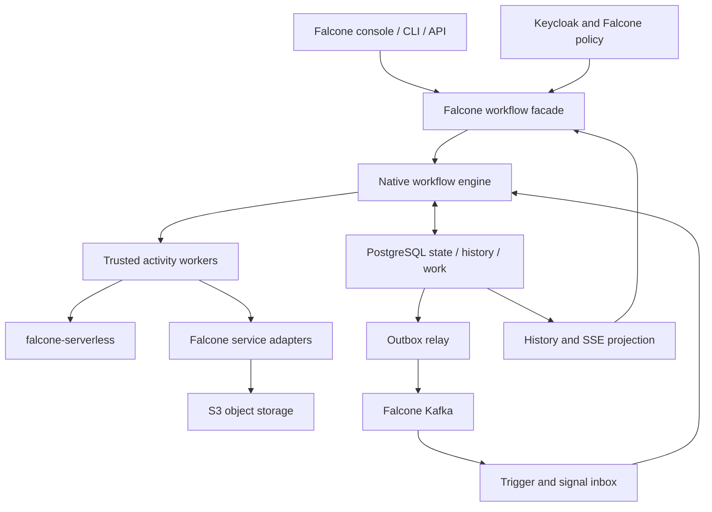

# 3. Baseline architecture

## Component topology

Timer scanning and lease recovery are engine roles. The evaluator does not call external services during a database transaction. Native engine pods do not run arbitrary tenant code. Legacy Temporal remains a separate backend behind the facade only during migration.

## Recommended stack and rationale

| Component | Initial choice | Why |
|---|---|---|
| Public facade | Existing Falcone Node.js service and existing authentication boundary | Preserve route, role, error and console contracts |
| Engine | TypeScript/Node.js with explicit persisted DSL state machine (D2) | Reuse schema/CEL/task semantics and contributor skills; one language with the facade and adapters |
| Persistence | Separate database on the shared PostgreSQL cluster (D5), application RLS role, separate migration role and a connection budget | Transactions can atomically commit state and work; operationally familiar to Falcone; workflow load is isolated from Falcone's own database |
| Scheduler | Durable SQL timers and ready queues, bounded row claims using SKIP LOCKED, leases and fencing from the shared Falcone lease/fencing module (D4) | No leader required for correctness; DB locks alone do not establish fairness |
| Worker transport | Versioned internal HTTP/JSON initially; optional gRPC after profiling | Keep worker integration debuggable and accessible to existing adapters |
| Event transport | Existing Falcone Kafka plus the shared Falcone outbox/inbox module (D4) | Reuse infrastructure; broker is not the state authority |
| User computation | Qualified falcone-serverless profiles through `ctr-worker-execution-api` and `ctr-job-checkpoint` (D4) | Centralize untrusted-code isolation; engine interprets data only |
| Large payloads | Falcone S3 adapter, configured provider | Preserve tenant/object policy and avoid hard-wiring provider-specific semantics |
| Secrets | Existing Falcone credential/secret services; Keycloak for user identity | No additional user directory or long-lived tokens in workflow history |
| Observability | OpenTelemetry, Prometheus-compatible metrics, structured logs, existing SSE facade | One Falcone user experience and operator tooling |
| Packaging | OCI images; Helm chart in falcone-charts (D1) with standard namespaced resources | Fits restricted Kubernetes/OpenShift without mandatory operator/CRDs |

TypeScript on Node.js is decided (D2), but it is not a performance guarantee. Isolate bounded CEL evaluation in worker processes and persist outcomes; pin the CEL library version per interpreter version.

The engine's database shares the PostgreSQL cluster with Falcone (D5), so it needs explicit CPU/IO/connection budgets and tested failure isolation. Move to a dedicated instance before workflow traffic harms product transactions. PostgreSQL HA, backup and encryption must already be provided or provisioned through the platform team; namespaced installation does not grant those capabilities automatically.

## Repository placement and shared contracts

The engine, evaluator, scheduler, timer and lease services and the trusted task workers are built in falcone-workflow. The facade, backend routing, console, CLI, quotas, admission and service adapters are built in falcone, and the Helm chart in falcone-charts (D1). A story that spans these repositories is decomposed into one issue per repository. Stories and epics are product-level and may span repositories; the backlog decomposition turns each story into technical issues, one per repository, each with a single owner and explicit cross-repository dependencies.

falcone-workflow does not define its own serverless invocation, checkpoint, outbox/inbox or lease protocols (D4). Function and large-task execution use falcone-serverless's `ctr-worker-execution-api` and `ctr-job-checkpoint`; outbox/inbox delivery and lease fencing use the shared Falcone module that falcone-serverless story STO-03 builds. The serverless Temporal-activity tasks remain while Temporal serves existing runs. Gaps in a shared contract are raised as issues in the owning repository.

Additive DSL features from the functional gap analysis (error boundaries, map, callback and event waits, human-task forms, concurrency keys and priorities) are interpreter features in falcone-workflow; their search, bulk-operation and approval surfaces in the console and CLI are falcone work. apiVersion v1.0 definitions keep their inventoried semantics.

## Data model and invariants

All logical keys include tenant and workspace, including definition versions, run locators, events, schedules, jobs and deduplication records. Opaque public IDs do not replace authorization.

- **definitions / versions / compiled_plans:** immutable version/hash and schema/interpreter/connector compatibility metadata.
- **runs:** backend, run revision, root/parent identity, current state, pinned plan, creation/deadline and policy snapshot references.
- **node_occurrences:** stable execution occurrence path, canvas node ID, state and result reference. Node ID alone is insufficient when graph structure revisits a node.
- **tasks / attempts:** stable operation ID across retries, changing attempt ID and lease generation, due time, deadlines and heartbeat.
- **run_events:** append-only sequence per run; payloads are bounded/redacted and may refer to object storage.
- **timers / schedules / occurrences:** database timestamps, calendar policy and unique occurrence IDs.
- **inbox / outbox:** event IDs, tenant scope, delivery state, expiration and backoff.
- **approvals / compensations:** authenticated actor, target occurrence, decision revision, group-membership snapshot and cleanup progress.
- **incidents:** typed needs-attention records on node occurrences, opened by retries exhausted, ambiguous outcomes, expression errors, missing payloads, credential expiry, policy blocks or undeliverable signals, and closed only by audited resolution.
- **credential_references / quota_reservations:** opaque handles and authoritative lineage/accounting; never raw tokens in event history.

A transaction checks the run revision, writes one or more ordered events, updates the explicit continuation state, inserts next tasks/timers and outbox/audit records, then commits. Unique constraints guard admission and completion. Snapshot reconstruction uses a pure versioned reducer and never re-executes side effects. This is explicit DSL state persistence, not replay of arbitrary JavaScript stacks.

Use separate `run_id`, `root_run_id`, `node_occurrence_id`, `operation_id`, `attempt_id` and `lease_generation`. Externally retryable operation keys remain stable across attempts; transport request IDs and fencing tokens have different jobs.

## Task and failure semantics

Claim a bounded ready set under short database locks, increase lease generation and commit before I/O. Workers renew leases and report completion with their generation and expected status. A stale or expired attempt is rejected even if its HTTP request arrives late. Per-run revision checks serialize competing evaluators; unique work identities stop duplicated successors. Partition large queues by tenant/run hash only after profiling, retaining one ordered writer per run.

Execution is **at least once** for external tasks. A fenced completion prevents duplicate state commits, but cannot undo an external HTTP request from an expired worker. Connectors must use downstream idempotency keys, read-after-timeout reconciliation or an explicit ambiguous-outcome/manual-repair state. Unknown outcome for a non-idempotent action must not trigger blind retries.

Cancellation requests are durable and stop scheduling new normal work. In-flight effects may already have happened. Record cancellation requested, worker acknowledgement, external cleanup pending and terminal outcome separately. Termination is an administrative operation with explicit consequences, not proof that all remote effects stopped. Compensation is a business operation with its own failures; it is not ACID rollback.

Document default retry/timeouts explicitly by definition/interpreter version. A missing legacy retry policy inherits Temporal defaults today; migration must capture those effective defaults rather than silently substitute new ones. Timeouts have distinct queue, attempt, heartbeat and total-operation meanings.

The existing DSL is acyclic but can reference children and repeated graph occurrences. Bound sub-flow recursion, fan-out, expression cost, expanded plan size and stored output growth. Parallel results are stored per occurrence and merged by a deterministic rule; ambiguous legacy state collisions are migration blockers.

## Typical invocation

1. Falcone verifies identity, workspace membership and operation permissions; validates the published version and idempotency key. Admission atomically reserves applicable quota and persists start state.
2. An evaluator loads the immutable plan and committed continuation. It computes a bounded transition and commits ready tasks/timers/events with the next revision.
3. A worker claims a task, resolves a short-lived credential through authoritative native run lineage and calls the appropriate Falcone adapter. A function task invokes falcone-serverless with the stable operation ID.
4. Completion is authenticated and fenced. The transaction records result/reference, releases relevant reservations, advances the graph and enqueues telemetry/events through the outbox.
5. Kafka publication is retried independently. A consumer commits an inbox record and workflow transition before acknowledging a triggering event.
6. The console reads current state and resumes SSE using a durable per-run cursor. Logs expose correlation and sanitized errors; sensitive payloads remain behind scoped retrieval.
7. Waits, approvals and asynchronous jobs park in PostgreSQL. Restart scans recover timers and leases without relying on in-memory notifications.

## Long-lived credentials and payloads

User login expiration is not a reason to persist an unlimited user token. Store an execution authority reference; renew task-scoped capabilities only under Falcone's current policy and run lineage. Decide whether user revocation cancels, pauses or prevents new effects; default fail closed for newly unauthorized effects and expose a recoverable policy-blocked status.

Upload large objects under immutable scoped keys, verify completion/hash, then commit the database reference. A sweeper removes unreferenced uploads after a grace period. Reference-count/retention rules prevent deleting live-run inputs. Restore must include required object versions and credential encryption material. A DB commit cannot make an external object write transactional; the protocol must tolerate orphans and missing objects explicitly.

## Capacity and service objectives — proposals, not promises

The capacity baseline is measured on the current Temporal staging deployment during M0 (MIG-01). The earlier serverless estimates were 20 tenants, 10,000 deployed functions, approximately 100k WebSocket/event messages per second and about 20 concurrent executions per tenant. These are not measured workflow workload figures. Workflow starts, step transitions, open waits, concurrent activities and retained history each need independent estimates.

For sizing, transitions/s is approximately starts/s × mean committed transitions/run, plus signals, timer resumptions and retry transitions. Retained bytes depend on event count, metadata size and retention, not only active execution count. Waiting for months consumes storage and timer/index overhead, not an active execution slot unless Falcone policy explicitly chooses that billing rule.

| Proposed initial objective | Measurement and conditions |
|---|---|
| 99.9% monthly API availability | Valid admitted/read requests; define exclusions and monitoring point with product/SRE |
| p95 start acknowledgement ≤250 ms | Same region, warm facade/engine, bounded payload, agreed admitted load; includes durable commit |
| p95 ready-task dispatch ≤1 s | Eligible work with available worker capacity; separate queueing from execution duration |
| p95 timer lateness ≤2 s | Healthy system under agreed benchmark; not hard real-time |
| Pod-loss progress recovery ≤60 s | Example 30 s task lease plus bounded scan/dispatch; verify long-task heartbeat policy |
| RPO 0 for acknowledged commits under tested synchronous DB failover | Conditional on actual HA setup; not a blanket regional disaster guarantee |
| Disaster restore RPO ≤5 min, RTO ≤60 min | Provisional targets requiring WAL/object-version backup and an actual restore rehearsal |

Benchmark tiers should cover 10/100/1,000 starts per second as exploration points, with 10–30 transitions/run, waiting-heavy mixes, skewed tenants, bursty signals and bounded external adapters. These are test loads, not supported capacity claims. Record DB hardware, replication, event/payload sizes, latency percentiles, error rate and saturation. Do not let exploratory throughput targets override durability.

## Dependencies retained and replaced

Retain Falcone API/gateway, Keycloak, PostgreSQL, Kafka, S3 interface, secret management, console and observability. Replace Temporal server coordination, SDK client calls, interpreter primitives, activities' Temporal Context, schedules, history projection and ancestry checks. Rewrite metadata bindings while preserving public contracts. Keep legacy workers and Temporal during drainage.

Do not require a new Redis, Elasticsearch, Dapr or Conductor deployment for the baseline. Native execution does not require Kubernetes API access; only optional trusted existing large-task adapters may need tightly scoped namespaced job access. Their compatibility with the restrictive untrusted-code policy must be qualified separately.
