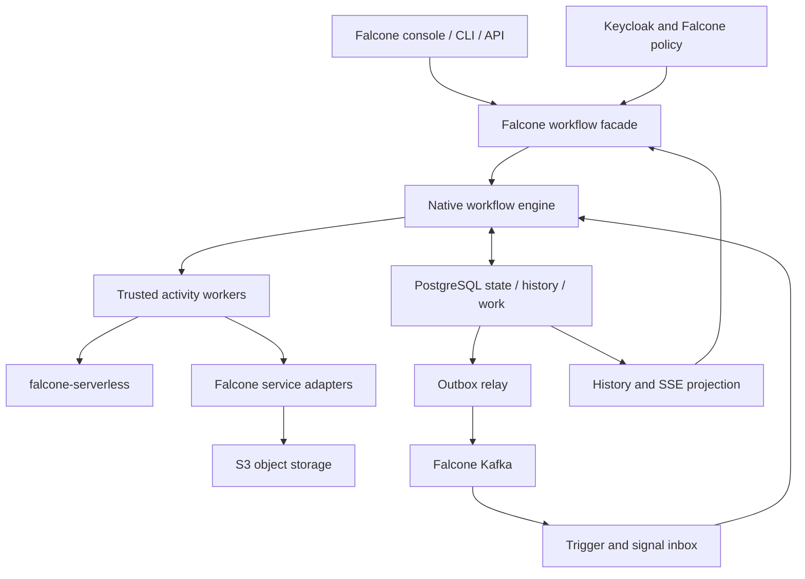

# falcone-workflow: native durable workflow engine design

<!-- Generated by tools/build_docs.py from design.md, survey.md, planning-source.json, architecture.md, open-questions.md, tradeoffs.md, migration.md and sources.md. Do not edit by hand. -->

Planning status (2026-10-22): proposed; unresolved user scope recorded in open-questions.md. 72 requirements, 12 epics and 36 stories.

## Accepted direction and scope

Date: 22 October 2026. Source baseline inspected: Falcone commit `47674add95223e6ccd7f6f0dcd11106469a0a30e`. This is a repository snapshot, not a verified deployed version.

### Purpose and scope

Build a first-party Falcone service that replaces the Temporal engine behind Falcone workflows while retaining Falcone's APIs, DSL, console, identity, tenancy and service integrations. This is not a proposal to install a different generic workflow platform.

The user confirmed the project and repository. The three scope questions about raw Temporal compatibility, authoring modes and long-lived workflows were not explicitly answered. The plan therefore uses provisional defaults and marks them in [open questions](open-questions.md). Existing code already establishes visual-DSL, external-call and human-approval requirements. Optional compensation and repair extensions must remain versioned.

### Six-part specification

1. [Survey and comparative analysis](survey.md): Temporal, Cadence, Conductor OSS, Apache Airflow, Dapr Workflow, DBOS and an explicitly source-available Restate reference.
2. [Functional requirements](requirements.md): 72 testable statements in 12 categories.
3. [Baseline architecture](architecture.md): component diagram, stack, transaction semantics, data flow, capacity targets and responsibilities.
4. [Detailed backlog](backlog.md): 12 epics, 36 stories, acceptance criteria, dependencies and rough effort; [JSON import payloads](backlog.json).
5. [Open questions](open-questions.md): decisions required before implementation/cutover.
6. [Trade-offs](tradeoffs.md): implementation alternatives and phased delivery.

### Recommended boundary

Retain the current Falcone DSL and develop an explicit durable state machine for its nodes. Run only trusted interpreter and connector code in engine processes. Tenant expressions receive strict limits; arbitrary tenant code belongs in qualified falcone-serverless execution profiles. Waiting workflows occupy persisted records, not dedicated pods or permanently blocked worker threads.

Use Falcone PostgreSQL as the initial authoritative store with a dedicated schema and operational resource budget. Use existing Kafka for event transport, not as a second authoritative workflow log. Large payloads remain behind Falcone's S3 abstraction. Keep identity through Keycloak/Falcone and credential references through the existing secret-management boundary.

### Evidence-driven scope

The inspected interpreter supports sequence, parallel, task, branch, wait, approval and sub-flow. It pins definitions and uses Temporal activities, timers, signals and child workflows. The facade owns definition versions, execution lifecycle and role checks. Flow cron scheduling is separate from Falcone's standalone scheduling-engine. Monitoring translates Temporal history to SSE.

The task catalog includes database, storage, functions, events, HTTP, email, LLM completion/batch and large-task execution. Those are replacement requirements, not greenfield feature suggestions. Source comments and historical READMEs sometimes describe early stubs; the implementation and contract fixtures must take precedence. In particular the dispatch catalog retains an echo fallback for harness/legacy paths; the new production worker must reject unknown task types.

### Delivery gates

- **M0 — scope and feasibility:** inventory actual deployments, preserve DSL fixtures, settle engine language and shared serverless protocol, validate restricted deployment constraints.
- **M1 — durable core:** transactional state, leases/fencing, timers, bounded evaluator, authentication and native worker context. Crash/concurrency tests are mandatory.
- **M2 — Falcone completeness:** port task catalog, triggers, schedules, approvals, quotas, SSE and optional compensation.
- **M3 — qualification and migration:** restore/load/soak tests, differential semantics, canary cohorts, schedule transfer, long-lived run drainage, then retirement.

Do not remove Temporal merely because M1 demonstrations succeed. Some deployed workflows may remain on the old engine for their full lifetime.

## 1. Survey and comparative analysis

Reviewed 22 October 2026. Platform behavior is grounded in [primary sources](sources.md); suitability ratings are architectural judgments for Falcone. No benchmark below claims measured superiority.

### Temporal baseline

Temporal separates Frontend RPC admission, History state/timers, Matching task queues and an internal Worker service. Application workers run workflow and activity code outside the server. Durable history supports replay; activities provide side effects, retries and heartbeats; timers, signals, child workflows and schedules support extended business processes. Persistent storage is required; visibility and operational tooling add deployment concerns. [T1–T3]

Its strongest reference for Falcone is explicit failure semantics. The replacement must preserve accepted work, cancellation behavior, version pinning and recovery, not merely a graph traversal API.

#### Observed Falcone coupling and pain points

- Workflow orchestration imports Temporal SDK primitives throughout the DSL interpreter; task adapters rely on Activity Context and Temporal error classes.
- Credential reference resolution queries Temporal run ancestry. Removing the SDK without replacing this authorization proof would break isolation.
- Schedule management and triggers use a Temporal client; an existing reconnect fix documents how a rejected connection promise could poison later requests.
- Monitoring maps Temporal event types and activity IDs into Falcone SSE frames.
- The worker package documents a TypeScript/CommonJS bundling deviation from sibling ESM services. This is a repository-specific integration constraint, not a claim that all Temporal installations require Falcone's exact build layout.
- Falcone supplies business schemas, catalog, identity and quotas around the engine. A custom engine can integrate these directly, but Falcone then owns distributed-system correctness and on-call operations.

Temporal does not intrinsically require privileged tenant pods or an operator. Restricted OpenShift deployment alone does not prove replacement is necessary; first-party control and a smaller Falcone-specific scope are the additional rationale.

### Comparison

| Reference | Functional model | Scale model and extensibility | Strength versus Temporal for this design | Weakness / Falcone mapping |
|---|---|---|---|---|
| **Temporal** | Durable code workflows, activity retries, signals, timers, children and schedules | Independently scaled server services and application workers; SDKs and activities | Existing implementation and strong recovery semantics | Multiple operational components; SDK/replay and history coupling; Falcone IAM/S3/task policy still supplied by adapters |
| **Cadence** | Durable code workflows, activities, signals and long-lived state | Distributed service with partitioned history and worker task lists; SDK activity implementations | Valuable independent reference for timeout and task lifecycle contracts | Similar distributed-service and replay burden; not a simplification by itself; domain isolation does not replace Falcone workspace authorization [C1–C2] |
| **Conductor OSS** | Declarative workflows and task workers across languages | Scale servers and poll-based workers; task domains, custom workers and persistence/queue integrations | Closest conceptual reference to Falcone's existing DSL and task catalog | Adoption would still require DSL/contract translation and policy adapters; persistence/queue combinations add operations choices [N1] |
| **Apache Airflow** | Scheduled DAG/task execution, dependencies and operational run management | Scheduler/executor/worker architecture; pluggable executors and providers | Strong reference for schedules, backfills, task history and operational UX | Primarily batch/data orchestration; a less natural base for Falcone's interactive signal/approval flows; DAG Python is trusted code, not tenant sandboxing [A1–A2] |
| **Dapr Workflow** | Code-defined durable workflows integrated with invocation, pub/sub and state | Durable Task engine and distributed runtime; SDK activities and Dapr components | Useful activity/lifecycle abstraction and failure-recovery patterns | Full Dapr adoption adds another runtime and configuration surface; Kubernetes installation details require qualification under corporate restrictions [D1–D2] |
| **DBOS TypeScript** | Application-embedded durable steps/workflows backed by PostgreSQL | Application workers and database coordination; library calls and queues | Closest lower-operations alternative and reference for leveraging Falcone PostgreSQL | Still a library dependency and programming-model migration; tenant isolation, DSL execution and API compatibility remain Falcone work [B1–B2] |
| **Restate — source-available reference** | Journaled durable services, workflow primitives and keyed state | Partitioned runtime with external SDK service endpoints | Useful design reference for durable calls, operation identity and suspension | Current server license is BSL 1.1, explicitly not open source; do not count it among OSS alternatives or copy server code into Falcone without a separately approved licensing path [R1–R2] |

Cadence, Conductor, Airflow, Dapr and DBOS provide five open-source references beyond Temporal. Maturity is not identical: Temporal/Cadence and Airflow have longer operating histories; evaluate DBOS and individual Dapr workflow SDKs against the actual Falcone workload rather than assuming feature parity.

### Falcone integration implications

For every alternative, Keycloak authentication, Falcone workspace roles and quota policy need an application-specific authorization layer. S3 is suitable for large payload references, not an automatic replacement for the engine's transactional state. A function invocation adapter is required for falcone-serverless. Multi-tenancy must cover database predicates, events, histories, callbacks and credentials; an engine namespace or task queue alone is not an untrusted-code isolation boundary.

Adopt patterns rather than cloning engines: durable transitions from Temporal/Cadence; explicit task graphs from Conductor; schedule operations from Airflow; narrow activity protocols from Dapr; transactional persistence from DBOS. Restate is an additional conceptual reference only.

### Licensing and reuse

Inspected repository pages identify Cadence and Conductor as Apache-2.0 and DBOS TypeScript as MIT. Pin exact upstream revisions and inspect component licenses before reusing code. Current Restate license specifies BSL 1.1 and a future change license; “public repository” must not be equated with open-source reuse permission. No upstream code is included in this proposal. [C1, N1, B2, R2]

## 2. Functional requirements checklist

72 testable statements in 12 areas. Every requirement maps to one story in section 4. Requirements added by the 30 October 2026 functional gap analysis continue each area's numbering; additive DSL features leave apiVersion v1.0 behavior unchanged.

### CON. Falcone contracts and developer experience

- [ ] **FR-CON-01:** The system must preserve inventoried Falcone workflow API routes, response schemas, status codes and tenant-scoped identifiers through a compatibility facade.
- [ ] **FR-CON-02:** The project must publish a compatibility matrix marking each observed behavior as preserved, intentionally versioned, or a migration blocker.
- [ ] **FR-CON-03:** The system must expose authenticated start, get, list, cancel, retry and signal operations with tenant-scoped idempotency keys.
- [ ] **FR-CON-04:** The system must route every existing run to its recorded backend and return a retryable service-unavailable response when that backend is unavailable.
- [ ] **FR-CON-05:** The system must support CLI validate, publish, start, inspect, cancel and retry operations using Falcone authentication.
- [ ] **FR-CON-06:** The system must provide versioned task schemas and validation errors usable by Falcone's existing visual editor.

### DSL. DSL interpretation and versioning

- [ ] **FR-DSL-01:** The system must validate sequence, parallel, task, branch, wait, approval and sub-flow nodes using the inventoried Falcone DSL rules.
- [ ] **FR-DSL-02:** The system must reject invalid cycles, duplicate IDs, unknown tasks, dangling references and invalid cron/duration expressions before publishing.
- [ ] **FR-DSL-03:** The system must evaluate expressions with bounded input size, runtime and memory without network, filesystem or arbitrary-code access.
- [ ] **FR-DSL-04:** The system must persist branch decisions, parallel completion sets and deterministic output-merge behavior before advancing successors.
- [ ] **FR-DSL-05:** The system must pin each run to immutable definition and interpreter versions and each child to an authorized explicit definition version.
- [ ] **FR-DSL-06:** The system must reject unsupported historical versions and require an explicit audited migration plan before changing active-run semantics.

### DUR. Durable state and recovery

- [ ] **FR-DUR-01:** The system must acknowledge a start only after committing the run, pinned plan, first ready work, audit event and idempotency record.
- [ ] **FR-DUR-02:** The system must commit each state transition, ordered per-run event and generated work atomically under a checked revision.
- [ ] **FR-DUR-03:** The system must reject task completions and heartbeats with expired or superseded lease generations.
- [ ] **FR-DUR-04:** The system must recover abandoned tasks through durable scans even when all optional notifications are lost.
- [ ] **FR-DUR-05:** The system must bound event history and payload growth using configured limits and resumable continuation or archival policies.
- [ ] **FR-DUR-06:** The system must restore database and referenced object payloads to a consistent recovery point and reconcile external effects before resuming dispatch.

### ACT. Task execution and long-running work

- [ ] **FR-ACT-01:** The system must dispatch tasks through a versioned protocol carrying tenant, workspace, run, node occurrence, attempt, lease generation and pinned adapter version.
- [ ] **FR-ACT-02:** The system must execute side effects only in authorized workers and must reject unknown task types in production.
- [ ] **FR-ACT-03:** The system must apply configured maximum attempts, backoff, retryable error classes, start-to-close, schedule-to-close and heartbeat timeouts.
- [ ] **FR-ACT-04:** The system must classify connectors by idempotency support and surface ambiguous external outcomes instead of promising universal exactly-once effects.
- [ ] **FR-ACT-05:** The system must persist external job IDs and checkpoint references and resume observation after worker loss without blindly resubmitting the job.
- [ ] **FR-ACT-06:** The system must support configurable multi-day waits with bounded heartbeat, cancellation and credential-renewal policies.

### TIM. Timers and schedules

- [ ] **FR-TIM-01:** The system must persist wait and retry timers and fire each logical timer at most once into workflow state.
- [ ] **FR-TIM-02:** The system must resolve simultaneous signal, timeout and cancellation transitions with one documented transactional ordering rule.
- [ ] **FR-TIM-03:** The system must preserve Falcone schedule identities, published cron text, next-action times, recent actions and idempotent pause/resume behavior.
- [ ] **FR-TIM-04:** The system must implement explicit overlap, catch-up window, timezone and daylight-saving policies and atomically deduplicate each scheduled occurrence.
- [ ] **FR-TIM-05:** The system must fence schedule ownership during backend handover so only one engine may admit an occurrence.
- [ ] **FR-TIM-06:** The system must support audited bounded backfill with a preview of candidate occurrences and quota impact.

### EVT. Events and trigger delivery

- [ ] **FR-EVT-01:** The system must persist incoming trigger/event deduplication records and resulting workflow transitions before acknowledging delivery.
- [ ] **FR-EVT-02:** The system must publish committed outgoing events through a retryable transactional outbox with stable event IDs.
- [ ] **FR-EVT-03:** The system must authenticate webhook triggers with rotation-aware signatures, replay protection and size limits.
- [ ] **FR-EVT-04:** The system must derive tenant and workspace from verified trigger registration rather than caller-supplied payload fields.
- [ ] **FR-EVT-05:** The system must persist authorized signals using deduplication IDs and explicit run/node-occurrence correlation.
- [ ] **FR-EVT-06:** The system must define TTL, capacity and terminal-run behavior for unmatched or early-arriving signals.

### HUM. Human approvals and compensation

- [ ] **FR-HUM-01:** The system must derive approval actor identity from verified authentication and enforce configured reviewer permissions.
- [ ] **FR-HUM-02:** The system must preserve approval outcome fields and distinguish rejection, timeout and cancellation.
- [ ] **FR-HUM-03:** The system must record completed compensatable operations and schedule configured compensations in dependency-safe reverse order.
- [ ] **FR-HUM-04:** The system must track compensation retries, failures and manual intervention separately from the original task outcome.
- [ ] **FR-HUM-05:** The system must require authorization, reason and expected run revision for manual repair or retry actions.
- [ ] **FR-HUM-06:** The system must preserve original history and create explicit linked attempts or continuation records for repair.

### TEN. Security, tenancy and Falcone quotas

- [ ] **FR-TEN-01:** The system must enforce tenant/workspace ownership for definitions, runs, events, schedules, payloads and monitoring streams using verified identity.
- [ ] **FR-TEN-02:** The system must preserve Falcone definition-write role restrictions and test authorization on every execution lifecycle operation.
- [ ] **FR-TEN-03:** The system must bind execution credential references to authoritative tenant, workspace, root run and allowed child lineage before connector use.
- [ ] **FR-TEN-04:** The system must renew or reauthorize long-lived runs under Falcone policy without storing bearer tokens or secret values in history.
- [ ] **FR-TEN-05:** The system must consume versioned Falcone quota policy for starts, active tasks, waiting runs, retries, fan-out, payload bytes and retention.
- [ ] **FR-TEN-06:** The system must enforce fair tenant/workspace admission with idempotent reservations, releases and usage events across crashes.

### INT. Falcone services and serverless integration

- [ ] **FR-INT-01:** The system must preserve qualified contracts for db.query, storage.get/put, functions.invoke, events.publish, http.request, email.send, llm.complete, llm.batch and largeTask.run.
- [ ] **FR-INT-02:** The system must enforce per-connector timeout, payload, credential, egress and workspace policies before performing external calls.
- [ ] **FR-INT-03:** The system must define versioned start/status/cancel/result callbacks with stable operation keys, authenticated correlation and explicit cancellation outcomes.
- [ ] **FR-INT-04:** The system must avoid a runtime dependency cycle: falcone-serverless execution primitives must run without calling Temporal or requiring falcone-workflow to execute themselves.
- [ ] **FR-INT-05:** The system must store large payloads through tenant-scoped Falcone object references with content hashes, retention metadata and authorization checks.
- [ ] **FR-INT-06:** The system must persist provider job IDs and bounded poll schedules for batch tasks, including cancellation cleanup and credential expiry.

### OBS. Monitoring, audit and performance

- [ ] **FR-OBS-01:** The system must expose ordered tenant-scoped history and compatible SSE frames with stable resumable event cursors.
- [ ] **FR-OBS-02:** The system must emit audit events for lifecycle, authorization-sensitive changes, approvals, repair and backend handover.
- [ ] **FR-OBS-03:** The system must measure admission latency, transition throughput, queue age, timer lag, lease expiry, retry rate, outbox lag and database contention.
- [ ] **FR-OBS-04:** The system must propagate trace correlation across Falcone services while redacting secrets and controlling metric cardinality.
- [ ] **FR-OBS-05:** The project must benchmark workflow starts, step transitions, durable waits and activity concurrency independently from Falcone's WebSocket message rate.
- [ ] **FR-OBS-06:** The project must publish achieved availability, latency and recovery results against an agreed workload and resource budget before production cutover.

### OPS. Deployment, CI/CD and operations

- [ ] **FR-OPS-01:** The system must deploy using existing PostgreSQL and standard namespaced resources without mandatory CRDs, operators, cluster roles or privileged containers.
- [ ] **FR-OPS-02:** The system must run as non-root with arbitrary allowed UID, read-only root filesystem, dropped capabilities and no host access.
- [ ] **FR-OPS-03:** The system must support rolling compatible upgrades, bounded graceful drain and documented rollback limits for schema and interpreter changes.
- [ ] **FR-OPS-04:** The project must provide tested runbooks for database failover, backup restore, stuck runs, queue overload and key rotation.
- [ ] **FR-OPS-05:** The project must gate releases on contract, isolation, state-machine fault, schema-migration and dependency-security checks.
- [ ] **FR-OPS-06:** The project must assign accountable runtime maintenance, SRE on-call, security review and Falcone product ownership before production release.

### MIG. Temporal migration and retirement

- [ ] **FR-MIG-01:** The project must inventory Temporal-dependent code, active workflow versions, open executions, schedule ownership and task adapters before selecting migration cohorts.
- [ ] **FR-MIG-02:** The project must compare native and Temporal outcomes using deterministic fixtures or isolated effect simulators without doubling production effects.
- [ ] **FR-MIG-03:** The system must route new starts by approved cohort and persist backend ownership for all later run operations.
- [ ] **FR-MIG-04:** The system must keep in-flight Temporal runs on Temporal unless an explicit application-level checkpoint transfer is validated.
- [ ] **FR-MIG-05:** The project must verify no remaining required Temporal runs, schedules, credentials or callers before removing the Temporal deployment and SDK dependencies.
- [ ] **FR-MIG-06:** The project must update Falcone integration documentation and falcone-serverless workflow references to the native contract with a rollback and retention plan.

## 3. Baseline architecture

### Component topology

Timer scanning and lease recovery are engine roles. The evaluator does not call external services during a database transaction. Native engine pods do not run arbitrary tenant code. Legacy Temporal remains a separate backend behind the facade only during migration.

### Recommended stack and rationale

| Component | Initial choice | Why |
|---|---|---|
| Public facade | Existing Falcone Node.js service and existing authentication boundary | Preserve route, role, error and console contracts |
| Engine | TypeScript/Node.js with explicit persisted DSL state machine; Go is an M0 benchmark alternative | Reuse schema/CEL/task semantics and contributor skills; avoid a second language before measurement justifies it |
| Persistence | PostgreSQL, dedicated workflow schema, application RLS role and separate migration role | Transactions can atomically commit state and work; operationally familiar to Falcone |
| Scheduler | Durable SQL timers and ready queues, bounded row claims using SKIP LOCKED, leases and fencing | No leader required for correctness; DB locks alone do not establish fairness |
| Worker transport | Versioned internal HTTP/JSON initially; optional gRPC after profiling | Keep worker integration debuggable and accessible to existing adapters |
| Event transport | Existing Falcone Kafka plus SQL inbox/outbox | Reuse infrastructure; broker is not the state authority |
| User computation | Qualified falcone-serverless profiles | Centralize untrusted-code isolation; engine interprets data only |
| Large payloads | Falcone S3 adapter, configured provider | Preserve tenant/object policy and avoid hard-wiring provider-specific semantics |
| Secrets | Existing Falcone credential/secret services; Keycloak for user identity | No additional user directory or long-lived tokens in workflow history |
| Observability | OpenTelemetry, Prometheus-compatible metrics, structured logs, existing SSE facade | One Falcone user experience and operator tooling |
| Packaging | OCI images and Helm with standard namespaced resources | Fits restricted Kubernetes/OpenShift without mandatory operator/CRDs |

Node is a starting recommendation, not a performance guarantee. Isolate bounded CEL evaluation in worker processes and persist outcomes. If a Go core is selected, use differential CEL/JSON fixtures to prove numeric/null/error and output equivalence; “same expression language” is not sufficient evidence.

Use a shared PostgreSQL cluster only with explicit CPU/IO/connection budgets and tested failure isolation. Move to a dedicated instance before workflow traffic harms product transactions. PostgreSQL HA, backup and encryption must already be provided or provisioned through the platform team; namespaced installation does not grant those capabilities automatically.

### Data model and invariants

All logical keys include tenant and workspace, including definition versions, run locators, events, schedules, jobs and deduplication records. Opaque public IDs do not replace authorization.

- **definitions / versions / compiled_plans:** immutable version/hash and schema/interpreter/connector compatibility metadata.
- **runs:** backend, run revision, root/parent identity, current state, pinned plan, creation/deadline and policy snapshot references.
- **node_occurrences:** stable execution occurrence path, canvas node ID, state and result reference. Node ID alone is insufficient when graph structure revisits a node.
- **tasks / attempts:** stable operation ID across retries, changing attempt ID and lease generation, due time, deadlines and heartbeat.
- **run_events:** append-only sequence per run; payloads are bounded/redacted and may refer to object storage.
- **timers / schedules / occurrences:** database timestamps, calendar policy and unique occurrence IDs.
- **inbox / outbox:** event IDs, tenant scope, delivery state, expiration and backoff.
- **approvals / compensations:** authenticated actor, target occurrence, decision revision and cleanup progress.
- **credential_references / quota_reservations:** opaque handles and authoritative lineage/accounting; never raw tokens in event history.

A transaction checks the run revision, writes one or more ordered events, updates the explicit continuation state, inserts next tasks/timers and outbox/audit records, then commits. Unique constraints guard admission and completion. Snapshot reconstruction uses a pure versioned reducer and never re-executes side effects. This is explicit DSL state persistence, not replay of arbitrary JavaScript stacks.

Use separate `run_id`, `root_run_id`, `node_occurrence_id`, `operation_id`, `attempt_id` and `lease_generation`. Externally retryable operation keys remain stable across attempts; transport request IDs and fencing tokens have different jobs.

### Task and failure semantics

Claim a bounded ready set under short database locks, increase lease generation and commit before I/O. Workers renew leases and report completion with their generation and expected status. A stale or expired attempt is rejected even if its HTTP request arrives late. Per-run revision checks serialize competing evaluators; unique work identities stop duplicated successors. Partition large queues by tenant/run hash only after profiling, retaining one ordered writer per run.

Execution is **at least once** for external tasks. A fenced completion prevents duplicate state commits, but cannot undo an external HTTP request from an expired worker. Connectors must use downstream idempotency keys, read-after-timeout reconciliation or an explicit ambiguous-outcome/manual-repair state. Unknown outcome for a non-idempotent action must not trigger blind retries.

Cancellation requests are durable and stop scheduling new normal work. In-flight effects may already have happened. Record cancellation requested, worker acknowledgement, external cleanup pending and terminal outcome separately. Termination is an administrative operation with explicit consequences, not proof that all remote effects stopped. Compensation is a business operation with its own failures; it is not ACID rollback.

Document default retry/timeouts explicitly by definition/interpreter version. A missing legacy retry policy inherits Temporal defaults today; migration must capture those effective defaults rather than silently substitute new ones. Timeouts have distinct queue, attempt, heartbeat and total-operation meanings.

The existing DSL is acyclic but can reference children and repeated graph occurrences. Bound sub-flow recursion, fan-out, expression cost, expanded plan size and stored output growth. Parallel results are stored per occurrence and merged by a deterministic rule; ambiguous legacy state collisions are migration blockers.

### Typical invocation

1. Falcone verifies identity, workspace membership and operation permissions; validates the published version and idempotency key. Admission atomically reserves applicable quota and persists start state.
2. An evaluator loads the immutable plan and committed continuation. It computes a bounded transition and commits ready tasks/timers/events with the next revision.
3. A worker claims a task, resolves a short-lived credential through authoritative native run lineage and calls the appropriate Falcone adapter. A function task invokes falcone-serverless with the stable operation ID.
4. Completion is authenticated and fenced. The transaction records result/reference, releases relevant reservations, advances the graph and enqueues telemetry/events through the outbox.
5. Kafka publication is retried independently. A consumer commits an inbox record and workflow transition before acknowledging a triggering event.
6. The console reads current state and resumes SSE using a durable per-run cursor. Logs expose correlation and sanitized errors; sensitive payloads remain behind scoped retrieval.
7. Waits, approvals and asynchronous jobs park in PostgreSQL. Restart scans recover timers and leases without relying on in-memory notifications.

### Long-lived credentials and payloads

User login expiration is not a reason to persist an unlimited user token. Store an execution authority reference; renew task-scoped capabilities only under Falcone's current policy and run lineage. Decide whether user revocation cancels, pauses or prevents new effects; default fail closed for newly unauthorized effects and expose a recoverable policy-blocked status.

Upload large objects under immutable scoped keys, verify completion/hash, then commit the database reference. A sweeper removes unreferenced uploads after a grace period. Reference-count/retention rules prevent deleting live-run inputs. Restore must include required object versions and credential encryption material. A DB commit cannot make an external object write transactional; the protocol must tolerate orphans and missing objects explicitly.

### Capacity and service objectives — proposals, not promises

The earlier serverless estimates were 20 tenants, 10,000 deployed functions, approximately 100k WebSocket/event messages per second and about 20 concurrent executions per tenant. These are not measured workflow workload figures. Workflow starts, step transitions, open waits, concurrent activities and retained history each need independent estimates.

For sizing, transitions/s is approximately starts/s × mean committed transitions/run, plus signals, timer resumptions and retry transitions. Retained bytes depend on event count, metadata size and retention, not only active execution count. Waiting for months consumes storage and timer/index overhead, not an active execution slot unless Falcone policy explicitly chooses that billing rule.

| Proposed initial objective | Measurement and conditions |
|---|---|
| 99.9% monthly API availability | Valid admitted/read requests; define exclusions and monitoring point with product/SRE |
| p95 start acknowledgement ≤250 ms | Same region, warm facade/engine, bounded payload, agreed admitted load; includes durable commit |
| p95 ready-task dispatch ≤1 s | Eligible work with available worker capacity; separate queueing from execution duration |
| p95 timer lateness ≤2 s | Healthy system under agreed benchmark; not hard real-time |
| Pod-loss progress recovery ≤60 s | Example 30 s task lease plus bounded scan/dispatch; verify long-task heartbeat policy |
| RPO 0 for acknowledged commits under tested synchronous DB failover | Conditional on actual HA setup; not a blanket regional disaster guarantee |
| Disaster restore RPO ≤5 min, RTO ≤60 min | Provisional targets requiring WAL/object-version backup and an actual restore rehearsal |

Benchmark tiers should cover 10/100/1,000 starts per second as exploration points, with 10–30 transitions/run, waiting-heavy mixes, skewed tenants, bursty signals and bounded external adapters. These are test loads, not supported capacity claims. Record DB hardware, replication, event/payload sizes, latency percentiles, error rate and saturation. Do not let exploratory throughput targets override durability.

### Dependencies retained and replaced

Retain Falcone API/gateway, Keycloak, PostgreSQL, Kafka, S3 interface, secret management, console and observability. Replace Temporal server coordination, SDK client calls, interpreter primitives, activities' Temporal Context, schedules, history projection and ancestry checks. Rewrite metadata bindings while preserving public contracts. Keep legacy workers and Temporal during drainage.

Do not require a new Redis, Elasticsearch, Dapr or Conductor deployment for the baseline. Native execution does not require Kubernetes API access; only optional trusted existing large-task adapters may need tightly scoped namespaced job access. Their compatibility with the restrictive untrusted-code policy must be qualified separately.

### Ownership

- **Falcone product owner:** supported semantics, DSL evolution, quotas, compatibility and rollout acceptance.
- **Workflow/runtime maintainers:** state machine, persistence migrations, interpreter versions, connector protocol and correctness tests.
- **Falcone integration team:** facade, console, identity, billing and task adapters.
- **SRE/platform team:** database HA, deployment, dashboards, backups, capacity, on-call incidents and recovery exercises.
- **Security engineers:** threat model, expression isolation, credential lineage, tenant boundary tests, dependency review and security release qualification.
- **Release/QA maintainers:** contract fixtures, crash matrices, compatibility gates and evidence retention.

A small team may combine roles, but accountable owners and an escalation rota must exist before production.

## 4. Detailed backlog

12 epics and 36 stories. Every story has a user story, description, acceptance criteria, requirement links, dependencies, phase and effort. Effort S/M/L is relative, not a delivery estimate. Phases: M0 discovery; M1 durable core; M2 Falcone completeness; M3 qualification and migration. Issue numbers come from github-issues.md; stories marked unpublished have no GitHub issue yet. A story that spans repositories is decomposed into one issue per repository (falcone-workflow, falcone, falcone-charts).

### CON. Falcone contracts and developer experience

- **Epic EP-CON (#1): Preserve Falcone-facing behavior and establish the exact replacement boundary.**

- **CON-01 — Inventory and freeze the Falcone workflow contracts** · M · M0 · #13
  - **Story:** As a Falcone maintainer, I want a versioned contract inventory so that replacement cannot silently change existing behavior.
  - **Description:** Inventory routes, DSL, errors, roles, schedules, monitoring and task envelopes against pinned source and deployed fixtures.
  - **Acceptance:** (1) Capture fixtures for definition CRUD, publish, validate, executions, cancel, retry, signal, catalog and schedules. (2) Include existing SSE node-status/log-line/stream-end frames and Last-Event-ID behavior. (3) Record whether arbitrary Temporal SDK workflows exist; do not claim raw SDK compatibility without evidence.
  - **Requirements:** FR-CON-01, FR-CON-02. **Dependencies:** None.

- **CON-02 — Implement the Falcone facade and backend routing** · L · M1 · #14
  - **Story:** As an application developer, I want stable Falcone APIs so that clients survive the engine migration.
  - **Description:** Introduce a narrow WorkflowBackend interface inside Falcone; separate public compatibility from internal engine routes.
  - **Acceptance:** (1) Concurrent identical starts yield one run; reuse of the key with different input returns a conflict. (2) Historic Temporal runs remain queryable and cancellable during mixed operation. (3) Connection failure followed by recovery succeeds without process restart; legacy error mappings are fixture-tested.
  - **Requirements:** FR-CON-03, FR-CON-04. **Dependencies:** CON-01, DUR-01.

- **CON-03 — Provide CLI and console integration contracts** · M · M2 · #15
  - **Story:** As a Falcone user, I want familiar authoring and monitoring tools so that I do not need another workflow portal.
  - **Description:** Use the current console DSL and task catalog; add CLI operations through the same facade.
  - **Acceptance:** (1) CLI and console send equivalent requests and display stable error codes. (2) A round-trip through the editor preserves all supported DSL fields. (3) Read-only users can inspect authorized flows but cannot publish definitions.
  - **Requirements:** FR-CON-05, FR-CON-06. **Dependencies:** CON-02, DSL-01, OBS-01.

### DSL. DSL interpretation and versioning

- **Epic EP-DSL (#2): Build a native interpreter for Falcone definitions without executing arbitrary tenant orchestration code.**

- **DSL-01 — Qualify and compile the existing Falcone DSL** · L · M0 · #16
  - **Story:** As a flow author, I want my current definitions to work so that migration does not require rewriting every flow.
  - **Description:** Compile v1.0 graph structure to an immutable execution plan; preserve schema and validator diagnostics.
  - **Acceptance:** (1) All existing valid and invalid DSL fixtures produce equivalent results or documented blockers. (2) Compilation stores schema version, plan hash and interpreter version. (3) Repeated node references receive unique execution occurrence IDs while retaining canvas node IDs.
  - **Requirements:** FR-DSL-01, FR-DSL-02. **Dependencies:** CON-01.

- **DSL-02 — Implement bounded expressions and graph semantics** · L · M1 · #17
  - **Story:** As a flow author, I want predictable branches and parallel joins so that failures do not change business outcomes.
  - **Description:** Keep CEL semantics compatible with existing fixtures; isolate evaluation and persist selected branches and outputs.
  - **Acceptance:** (1) CEL compatibility fixtures cover nulls, numbers, errors and time-sensitive inputs; incompatible expressions block migration. (2) Crash/restart at a branch or join neither duplicates successors nor loses completed branches. (3) Conflicting parallel writes are rejected or resolved by a versioned documented rule; elapsed time is not an implicit merge order.
  - **Requirements:** FR-DSL-03, FR-DSL-04. **Dependencies:** DSL-01, DUR-01.

- **DSL-03 — Pin definitions, children and interpreter semantics** · L · M1 · #18
  - **Story:** As an operator, I want safe upgrades so that long-running flows retain their intended behavior.
  - **Description:** Version definitions, connector contracts and interpreter semantics independently; retain old interpreters while runs drain.
  - **Acceptance:** (1) Publishing a new definition leaves active parent and child runs unchanged. (2) A rolling upgrade with old/new evaluators completes compatible runs and leaves unsupported runs safely parked. (3) Bounded sub-flow depth and expanded graph size prevent recursive resource exhaustion.
  - **Requirements:** FR-DSL-05, FR-DSL-06. **Dependencies:** DSL-02.

### DUR. Durable state and recovery

- **Epic EP-DUR (#3): Make PostgreSQL transactions the authoritative boundary for workflow progress.**

- **DUR-01 — Implement the transactional run state machine** · L · M1 · #19
  - **Story:** As a platform engineer, I want atomic state transitions so that crashes cannot lose accepted work.
  - **Description:** Persist run state, history, ready work and outbox records in one transaction with optimistic revisions.
  - **Acceptance:** (1) Fault injection before/after commit proves that acknowledged starts remain discoverable. (2) Two evaluators racing one revision produce exactly one committed transition. (3) No production in-memory fallback exists when PostgreSQL is unavailable.
  - **Requirements:** FR-DUR-01, FR-DUR-02. **Dependencies:** DSL-01.

- **DUR-02 — Add task leases, fencing and recovery scans** · L · M1 · #20
  - **Story:** As an SRE, I want workers to recover abandoned tasks so that node failure does not strand runs.
  - **Description:** Claim ready tasks with bounded leases, database time, monotonic attempt fencing and periodic reconciliation.
  - **Acceptance:** (1) Kill a worker after claim and verify another claims after expiry. (2) An old worker completion cannot change a newer attempt or terminal run. (3) DB disconnection stops new dispatch; bounded reconnection resumes scanning without manual repair.
  - **Requirements:** FR-DUR-03, FR-DUR-04. **Dependencies:** DUR-01.

- **DUR-03 — Bound history and verify disaster recovery** · L · M3 · #21
  - **Story:** As an operator, I want recoverable compact state so that months-long runs do not create unbounded replay costs.
  - **Description:** Use explicit continuations and snapshots; preserve audit order and payload references through archival.
  - **Acceptance:** (1) Restore an encrypted backup into an isolated environment and complete waiting and running fixtures. (2) Compacted runs retain a contiguous inspectable event lineage or an explicit archive cursor. (3) Recovery reports possible post-backup external effects and prevents automatic duplicate dispatch until reconciled.
  - **Requirements:** FR-DUR-05, FR-DUR-06. **Dependencies:** DUR-02, OPS-02.

### ACT. Task execution and long-running work

- **Epic EP-ACT (#4): Separate orchestration from side effects and enforce honest delivery semantics.**

- **ACT-01 — Define the native activity worker protocol** · L · M1 · #22
  - **Story:** As a connector maintainer, I want an engine-neutral task context so that Falcone adapters no longer import Temporal.
  - **Description:** Specify claim, heartbeat, complete and fail messages with run/occurrence/attempt identity and credentials.
  - **Acceptance:** (1) A native worker executes a test connector without any Temporal SDK import. (2) Invalid tenant, adapter version or lease metadata is rejected before connector I/O. (3) Production dispatch cannot reach the legacy echo/mock fallback.
  - **Requirements:** FR-ACT-01, FR-ACT-02. **Dependencies:** DUR-02.

- **ACT-02 — Implement retries, deadlines and side-effect safety** · L · M1 · #23
  - **Story:** As a workflow author, I want controlled retries so that transient failures recover without uncontrolled duplicate effects.
  - **Description:** Use stable business-operation idempotency keys across attempts, typed errors and durable retry timers.
  - **Acceptance:** (1) Inject a crash after external success but before completion commit; idempotent connector deduplicates the retry. (2) Non-idempotent connector enters reconciliation-required when success is ambiguous. (3) Run cancellation and retry budgets terminate new attempts without erasing prior outcomes.
  - **Requirements:** FR-ACT-03, FR-ACT-04. **Dependencies:** ACT-01, TIM-01.

- **ACT-03 — Support asynchronous jobs and checkpoints** · L · M2 · #24
  - **Story:** As a data analyst, I want long-running tasks to survive worker restarts so that analysis is resumable.
  - **Description:** Separate job submission, observation, checkpoint and result retrieval; avoid holding orchestration processes during waits.
  - **Acceptance:** (1) A worker dies after job submission; reconciliation finds the same external job. (2) A cancelled job cannot report the workflow completed; delayed cleanup is visible and retried under policy. (3) A capability-qualified checkpoint resumes correctly; unsupported native workloads remain migration blockers.
  - **Requirements:** FR-ACT-05, FR-ACT-06. **Dependencies:** ACT-02, INT-02.

### TIM. Timers and schedules

- **Epic EP-TIM (#5): Replace Temporal timers and schedules with durable Falcone-owned scheduling.**

- **TIM-01 — Implement durable timers and race resolution** · M · M1 · #25
  - **Story:** As a workflow author, I want durable delays so that waits survive outages.
  - **Description:** Store due timestamps in PostgreSQL, use database time and serialize timer firing with signals/cancellation.
  - **Acceptance:** (1) Restart all engine pods while a timer is pending; it fires after recovery. (2) Race an approval, timeout and cancellation and verify one accepted outcome and audited losers. (3) Clock skew between workers does not move a database-timed deadline earlier.
  - **Requirements:** FR-TIM-01, FR-TIM-02. **Dependencies:** DUR-01.

- **TIM-02 — Replace flow schedules with compatible controls** · L · M2 · #26
  - **Story:** As a workspace owner, I want existing cron controls so that scheduled automation remains operable.
  - **Description:** Preserve one schedule per flow and public list/get/pause/resume/trigger responses; persist occurrence identity.
  - **Acceptance:** (1) Fixtures match the current schedule API, including absent and foreign schedules. (2) Concurrent schedulers create one run per occurrence and enforce overlap policy. (3) DST transitions and outage catch-up produce documented bounded outcomes.
  - **Requirements:** FR-TIM-03, FR-TIM-04. **Dependencies:** TIM-01, CON-02.

- **TIM-03 — Coordinate schedule cutover and backfill** · L · M3 · #27
  - **Story:** As an operator, I want one active schedule owner so that migration cannot double-fire workflows.
  - **Description:** Add backend ownership epochs, bounded backfill and reconciliation against legacy schedule state.
  - **Acceptance:** (1) Pause legacy admission, reconcile accepted occurrences, transfer the ownership epoch and resume the new scheduler. (2) A stale schedule owner cannot admit runs after handover. (3) Backfill cancellation stops future admissions without deleting already accepted runs.
  - **Requirements:** FR-TIM-05, FR-TIM-06. **Dependencies:** TIM-02, MIG-02.

### EVT. Events and trigger delivery

- **Epic EP-EVT (#6): Use Falcone's existing event infrastructure with durable inbox/outbox semantics.**

- **EVT-01 — Add inbox and outbox integration** · L · M1 · #28
  - **Story:** As a platform engineer, I want durable event delivery so that broker outages cannot lose workflow transitions.
  - **Description:** Use Kafka as transport, PostgreSQL as state authority; enforce tenant-bound event identities.
  - **Acceptance:** (1) Crash between DB commit and broker acknowledgement; redelivery causes no second logical admission. (2) Crash after publish but before outbox acknowledgement; consumer deduplication handles repeat delivery. (3) Broker unavailability accumulates bounded backlog and exposes age/size metrics.
  - **Requirements:** FR-EVT-01, FR-EVT-02. **Dependencies:** DUR-01.

- **EVT-02 — Preserve webhook and platform-event triggers** · L · M2 · #29
  - **Story:** As a Falcone user, I want existing event triggers so that my automations continue to start securely.
  - **Description:** Reuse Falcone HMAC webhook validation and structural tenant/workspace event routing.
  - **Acceptance:** (1) Invalid signature, expired replay window and oversized request are rejected before admission. (2) Foreign workspace identifiers cannot reroute an event. (3) Publish/update/delete registration reconciliation has no unbounded stale listeners.
  - **Requirements:** FR-EVT-03, FR-EVT-04. **Dependencies:** EVT-01, TEN-01.

- **EVT-03 — Implement correlated signals and event waits** · L · M2 · #30
  - **Story:** As a workflow author, I want durable external signals so that workflows can wait without active threads.
  - **Description:** Persist ordered signal inboxes, bounded early-arrival buffers and explicit correlation policies.
  - **Acceptance:** (1) Signal-before-wait survives restart and is consumed by its intended occurrence. (2) Duplicate and unauthorized signals do not unblock additional nodes. (3) Overflow and stale signals produce documented errors/dead-letter records without tenant data leakage.
  - **Requirements:** FR-EVT-05, FR-EVT-06. **Dependencies:** EVT-01, TIM-01.

### HUM. Human approvals and compensation

- **Epic EP-HUM (#7): Extend Falcone business workflows with auditable decisions and recoverable cleanup.**

- **HUM-01 — Preserve human approval behavior** · M · M2 · #31
  - **Story:** As a reviewer, I want authorized approval decisions so that sensitive steps need accountable consent.
  - **Description:** Preserve existing flowApproval/human-approval semantics at the facade while binding decisions to authenticated actors.
  - **Acceptance:** (1) Forged actor fields are ignored or rejected; an unauthorized reviewer cannot decide. (2) Concurrent approval submissions produce one accepted decision and auditable conflicts. (3) Legacy untargeted approval behavior is explicitly fixture-tested; stricter occurrence targeting uses a versioned change.
  - **Requirements:** FR-HUM-01, FR-HUM-02. **Dependencies:** EVT-03, TEN-01.

- **HUM-02 — Add versioned saga compensation** · L · M2 · #32
  - **Story:** As a business process owner, I want compensating actions so that partial success can be repaired.
  - **Description:** Add an opt-in DSL extension for compensation, leaving v1.0 behavior intact.
  - **Acceptance:** (1) A failed later task compensates only committed successful predecessors. (2) A crash during compensation resumes without skipping or blindly duplicating completed cleanup. (3) UI/API distinguish failed, compensating, compensated and compensation-failed without rewriting history.
  - **Requirements:** FR-HUM-03, FR-HUM-04. **Dependencies:** ACT-02, DSL-03.

- **HUM-03 — Provide audited operator repair actions** · L · M3 · #33
  - **Story:** As an authorized operator, I want controlled repair tools so that ambiguous outcomes can be resolved safely.
  - **Description:** Support retry-from-known-boundary and reconciliation acknowledgements; disallow arbitrary history edits.
  - **Acceptance:** (1) Stale revision or cross-tenant repair requests fail before mutation. (2) Preview identifies side effects that may repeat and requires a documented resolution for ambiguous tasks. (3) Every accepted repair records actor, reason, prior revision and resulting attempt lineage.
  - **Requirements:** FR-HUM-05, FR-HUM-06. **Dependencies:** HUM-02, OBS-01.

### TEN. Security, tenancy and Falcone quotas

- **Epic EP-TEN (#8): Keep identity, policy and resource accounting under Falcone ownership.**

- **TEN-01 — Preserve tenant and workspace authorization** · L · M1 · #34
  - **Story:** As a tenant administrator, I want strict isolation so that no other tenant can observe or operate my workflows.
  - **Description:** Use verified Keycloak/Falcone identity, deny-by-default engine authorization, PostgreSQL RLS and explicit workspace binding.
  - **Acceptance:** (1) Cross-tenant and cross-workspace negative tests cover API, worker completion, SSE and object references. (2) RLS is enforced for application-role queries and pooled connections cannot retain prior tenant context. (3) Production trusts only authenticated gateway/service identities; injected headers or body tenant IDs cannot elevate access.
  - **Requirements:** FR-TEN-01, FR-TEN-02. **Dependencies:** CON-01, DUR-01.

- **TEN-02 — Replace Temporal-bound credentials safely** · L · M1 · #35
  - **Story:** As a security engineer, I want native execution credentials so that activities retain least privilege after migration.
  - **Description:** Replace Temporal ancestry lookup with authoritative native run lineage; use short-lived capabilities and secret references.
  - **Acceptance:** (1) Foreign, expired, revoked and sibling-run references fail closed. (2) Children and retries inherit only declared scope using recorded lineage, never caller-provided ancestry. (3) History/log scans contain no raw execution tokens; credential-store outage produces a bounded retryable failure.
  - **Requirements:** FR-TEN-03, FR-TEN-04. **Dependencies:** TEN-01, ACT-01.

- **TEN-03 — Implement fair admission and quota accounting** · L · M2 · #36
  - **Story:** As a Falcone operator, I want centrally managed limits so that retries and noisy tenants cannot exhaust capacity.
  - **Description:** Separate stored definitions, waiting runs, runnable steps, external activities and message rate; integrate Falcone policy and billing ledgers.
  - **Acceptance:** (1) Concurrent admissions cannot exceed a configured hard limit; expired reservations are reconciled. (2) A saturated tenant does not starve eligible work from other tenants in the benchmark. (3) Billing fixtures classify retries, failures, waits and cancellations explicitly; workflow does not invent independent tariff rules.
  - **Requirements:** FR-TEN-05, FR-TEN-06. **Dependencies:** DUR-02, TEN-02.

### INT. Falcone services and serverless integration

- **Epic EP-INT (#9): Port first-party adapters and define the boundary with falcone-serverless.**

- **INT-01 — Port the existing first-party task catalog** · L · M2 · #37
  - **Story:** As a Falcone developer, I want current task types to work so that workflows remain useful on day one.
  - **Description:** Extract engine-neutral activity context for DB, storage, functions, events, HTTP, email and LLM tasks.
  - **Acceptance:** (1) Each task type has success/error/cancellation/duplicate-attempt fixtures and an explicit migration status. (2) HTTP SSRF tests cover redirects, DNS resolution, private/metadata targets and credential forwarding. (3) External effects run against controlled test services; existing mocks are never reported as live qualification.
  - **Requirements:** FR-INT-01, FR-INT-02. **Dependencies:** ACT-02, TEN-02.

- **INT-02 — Define the serverless invocation and checkpoint contract** · L · M0 · #38
  - **Story:** As a platform developer, I want one shared invocation contract so that workflow and serverless can evolve independently.
  - **Description:** Keep workflow state in falcone-workflow and untrusted computation in falcone-serverless; separate legacy largeTask support.
  - **Acceptance:** (1) A contract simulator tests submit acknowledgement loss, duplicate completion, stale cancellation and checkpoint references. (2) An ADR records ownership of execution leases, logical retries, metering and checkpoint retention. (3) Legacy largeTask profiles incompatible with restricted Wasm execution are flagged; no silent native-container fallback is permitted.
  - **Requirements:** FR-INT-03, FR-INT-04. **Dependencies:** CON-01.

- **INT-03 — Preserve asynchronous batch and object-storage behavior** · L · M2 · #39
  - **Story:** As a workflow user, I want large inputs and provider jobs to remain durable so that orchestration is not tied to one process.
  - **Description:** Use a provider-neutral Falcone S3 interface and submit/status/collect/cancel phases for asynchronous integrations.
  - **Acceptance:** (1) An interrupted LLM batch resumes polling the same provider job; ambiguous submit is reconciled. (2) Missing or hash-mismatched objects fail explicitly; no cross-tenant object can be dereferenced. (3) SeaweedFS or another configured S3 provider passes the adapter contract before deployment; backend identity is recorded.
  - **Requirements:** FR-INT-05, FR-INT-06. **Dependencies:** INT-01, INT-02, EVT-03.

### OBS. Monitoring, audit and performance

- **Epic EP-OBS (#10): Preserve the Falcone run view and make recovery measurable.**

- **OBS-01 — Implement run history and resumable SSE** · L · M2 · #40
  - **Story:** As a Falcone user, I want the existing run timeline so that I can inspect progress after migration.
  - **Description:** Project durable native events to existing node-status/log-line/stream-end frames; retain run/node mapping.
  - **Acceptance:** (1) Disconnect/reconnect with Last-Event-ID produces no missing persisted events within retention. (2) Terminal streams replay retained history and end; expired cursors receive an explicit resynchronization response. (3) Slow consumers are bounded and cannot block workflow commits or leak foreign run data.
  - **Requirements:** FR-OBS-01, FR-OBS-02. **Dependencies:** DUR-01, CON-01.

- **OBS-02 — Add operational metrics and tracing** · M · M2 · #41
  - **Story:** As an SRE, I want queue and recovery visibility so that failures are detected before workflows stall.
  - **Description:** Instrument engine transactions, timers, outbox, adapters and leases with OpenTelemetry and Prometheus-compatible metrics.
  - **Acceptance:** (1) Dashboards separate starts, transitions, messages, running activities and waiting runs. (2) An injected database outage, broker outage and stalled adapter trigger distinct actionable alerts. (3) Per-run IDs appear in traces/logs rather than unbounded metric labels; payload logging is redacted.
  - **Requirements:** FR-OBS-03, FR-OBS-04. **Dependencies:** OBS-01, DUR-02.

- **OBS-03 — Qualify performance and reliability targets** · L · M3 · #42
  - **Story:** As a product owner, I want measured capacity so that commitments match infrastructure.
  - **Description:** Publish reproducible load, soak and fault-injection profiles; treat numerical targets as provisional until tested.
  - **Acceptance:** (1) Run small/medium/load profiles with 20 tenants, mixed waits and fan-out; publish hardware, DB configuration and percentiles. (2) Measure p95 start acknowledgement, ready-task dispatch and due-timer lag under load and failure recovery. (3) Document saturation, fairness and storage growth; do not interpret 100k messages/s as 100k workflow starts/s.
  - **Requirements:** FR-OBS-05, FR-OBS-06. **Dependencies:** OBS-02, TEN-03, OPS-02.

### OPS. Deployment, CI/CD and operations

- **Epic EP-OPS (#11): Operate as a restricted Falcone service without administrator-installed runtimes.**

- **OPS-01 — Package restricted Kubernetes and OpenShift deployment** · L · M1 · #43
  - **Story:** As a platform operator, I want ordinary namespaced deployment so that restricted clusters can host the engine.
  - **Description:** Provide containers, Helm manifests, migrations, health probes and documented external service requirements.
  - **Acceptance:** (1) Install in a restricted namespace with no permission to create cluster-scoped resources. (2) Document pre-provisioned namespace, RBAC, DB, gateway and network prerequisites and pass readiness checks. (3) Test the agreed Kubernetes minors and actual corporate OpenShift version; unsupported versions fail qualification rather than being assumed.
  - **Requirements:** FR-OPS-01, FR-OPS-02. **Dependencies:** DUR-01.

- **OPS-02 — Implement upgrade, backup and recovery runbooks** · L · M3 · #44
  - **Story:** As an on-call engineer, I want tested operating procedures so that releases and incidents are recoverable.
  - **Description:** Use expand/contract schema migrations, drain behavior, PostgreSQL HA and coordinated payload backup policies.
  - **Acceptance:** (1) Old/new binaries coexist through a schema expansion and drain test. (2) A DB failover test fences old owners before new dispatch resumes. (3) A restore rehearsal reports measured RPO/RTO, required object versions and credential recovery dependencies.
  - **Requirements:** FR-OPS-03, FR-OPS-04. **Dependencies:** OPS-01, DSL-03.

- **OPS-03 — Establish CI, security qualification and ownership** · L · M1 · #45
  - **Story:** As a maintainer, I want enforceable release gates so that durability regressions cannot ship unnoticed.
  - **Description:** Add contract suites, concurrency/fault tests, supply-chain checks and named ownership responsibilities.
  - **Acceptance:** (1) CI checks generated backlog integrity and runs a real PostgreSQL integration suite once implementation exists. (2) Images have pinned dependencies, SBOMs and signed release artifacts; copied upstream code has documented provenance. (3) An ownership/runbook review names escalation and patch responsibilities; documentation alone cannot mark runtime qualified.
  - **Requirements:** FR-OPS-05, FR-OPS-06. **Dependencies:** CON-01, OPS-01.

### MIG. Temporal migration and retirement

- **Epic EP-MIG (#12): Retire Temporal only when Falcone contract and recovery evidence support it.**

- **MIG-01 — Build a migration inventory and differential harness** · L · M0 · #46
  - **Story:** As a release engineer, I want evidence of semantic parity so that unsupported flows are not cut over.
  - **Description:** Inventory deployed DSLs, open runs, schedules, Temporal patches and SDK usage; use isolated effects for comparisons.
  - **Acceptance:** (1) Cover sequence, parallel, branches, approval/cancel races, children, batch polling, retries and schedule errors. (2) Track each incompatible semantic with owner and resolution; do not copy Temporal history into native tables. (3) Record the actual deployed image/source baseline separately from repository inspection.
  - **Requirements:** FR-MIG-01, FR-MIG-02. **Dependencies:** CON-01.

- **MIG-02 — Implement staged routing and in-flight drainage** · L · M3 · #47
  - **Story:** As an operator, I want controlled rollout so that existing workflows finish safely.
  - **Description:** Route new runs by cohort; keep a durable backend locator; drain old runs and retain old worker versions.
  - **Acceptance:** (1) Rollback routes future starts back while native runs retain native ownership. (2) Schedule/webhook/event ownership is coordinated to avoid duplicate admission during rollout. (3) A long-lived Temporal run remains operable until completion or an approved explicit intervention; no automatic restart repeats effects.
  - **Requirements:** FR-MIG-03, FR-MIG-04. **Dependencies:** MIG-01, CON-02, INT-01, HUM-01.

- **MIG-03 — Qualify retirement and synchronize Falcone documentation** · L · M3 · #48
  - **Story:** As the Falcone owner, I want a verifiable retirement gate so that Temporal can be removed safely.
  - **Description:** Update Falcone code/charts and the serverless design only after contract readiness; preserve audit/retention obligations.
  - **Acceptance:** (1) Scan code, manifests and runtime telemetry for remaining callers and record authorized exceptions. (2) Complete a no-Temporal end-to-end workflow run covering function invocation, storage, approval and recovery. (3) Retain required old histories and recovery material, then remove resources only through a separately authorized rollout.
  - **Requirements:** FR-MIG-05, FR-MIG-06. **Dependencies:** MIG-02, TIM-03, OBS-03, DUR-03.

## 5. Open questions and ownership

Repository creation was confirmed. The following choices were not explicitly answered and remain proposed. Publishing this backlog does not silently resolve them.

| Question | Provisional direction | Gate |
|---|---|---|
| Must direct Temporal SDK workflows or raw APIs remain compatible? | Preserve Falcone interfaces and DSL; permit internal migration. Inventory actual direct callers first. | M0 / CON-01 |
| What authoring experience is required? | Keep existing visual DSL/editor and JSON/YAML contracts; developer CLI uses the same DSL. Arbitrary code-authored orchestration is deferred. | M0 |
| Are multi-month waits and new compensation semantics required? | Preserve current waits/approvals; design for long duration. Compensation is opt-in versioned scope. | M0 product review |
| Which engine language does the team want to maintain? | TypeScript for current ecosystem alignment; Go only if qualification or team preference justifies migration cost. | M0 |
| Which deployed Falcone version and contracts are authoritative? | Inspected source is a pinned repository snapshot, not a deployed inventory. | M0 / MIG-01 |
| What are starts/s, transitions/run, waiting-run count, schedule count and retention? | Do not reuse serverless message throughput as workflow throughput. Measure independently. | Capacity gate |
| Is S3 currently SeaweedFS, RustFS or another deployment? | Provider-neutral Falcone adapter. Prior serverless context named SeaweedFS; actual provider must be confirmed. | INT-03 |
| What corporate OpenShift release and PostgreSQL HA service are available? | Standard restricted namespaced resources; record actual version and privileges before qualification. | OPS-01 |
| Which largeTask.run profiles and native Python/data libraries must survive? | Do not silently run arbitrary tenant native code because no sandbox RuntimeClass is available. Preserve only qualified paths or block migration. | INT-02 |
| How does user/role revocation affect long-lived runs? | Fail closed for new unauthorized effects; record policy-blocked state and allow controlled reauthorization. | TEN-02 |
| Which approval actors, segregation-of-duty rules and deadlines apply? | Preserve current verified identity and explicitly define reviewers per product policy. | HUM-01 |
| How are retries, failed starts, waits, idle capacity and history billed? | Falcone owns policy; engine emits idempotent usage facts and enforces supplied limits. | TEN-03 |
| What are accepted availability, recovery and latency targets? | Proposed targets in architecture.md; no contractual SLA before measurement. | OBS-03 |
| Who owns on-call, database recovery, security qualification and runtime upgrades? | Named Falcone maintainers, SRE, security and product owners required. | OPS-03 |
| Which license should the new service use? | No upstream code copied; choose before implementation and review any reuse. | M0 |
| Is native GitHub Project/sub-issue setup required? | Issues use labels and Markdown hierarchy; connector does not expose native parent mutation. | Project administration |

### Questions that block implementation choices

Confirm raw Temporal compatibility, engine language and required native task profiles before building the core. Deployed-contract inventory, capacity and operational ownership block production commitments. The current documentation and backlog remain useful while those decisions are pending.

## 6. Trade-offs and sequence

| Path | Scalability | Developer experience | Operational cost | Falcone compatibility |
|---|---|---|---|---|
| **Recommended: native persisted DSL state machine** | SQL contention and history volume set initial ceiling; partition after measured need | Reuses current visual graph and task catalog | Few new services, but Falcone owns durability and incident response | Direct control of existing contracts; internal migration required |
| **Embed DBOS beneath a Falcone-owned facade/interpreter** | Application workers plus PostgreSQL; qualify actual DSL and concurrency load | Faster access to durable primitives, ongoing library semantics to learn | Lower implementation burden; retain a third-party library dependency | Can still be a custom Falcone service if product contracts remain first-party; requires deliberate approval of reuse |
| **Go engine plus Node adapters** | Potentially efficient concurrency and smaller runtime footprint; benchmark rather than assume | Two language/tooling stacks and CEL equivalence work | Additional build/release/debug surface | Narrow protocol helps, but cross-language numeric/error semantics need fixtures |
| **Temporary Temporal/native dual backend** | Independent backends during migration; more total resource consumption | Stable client facade and gradual adoption | Highest temporary operating cost | Safest way to preserve in-flight runs; never execute the same real side effect twice |
| **Adopt Conductor or Dapr as the engine** | Mature distributed primitives and worker ecosystems | Another model/configuration surface | Replaces one external runtime with another | Useful contingency/reference, but diverges from a fully custom engine goal |
| **Full arbitrary-code replay runtime** | Potentially broad durable-programming capability | Flexible SDK authoring but determinism/versioning constraints | Very high implementation and security burden | Unnecessary unless inventory shows real code-authored workflow demand |
| **Active-active multi-region initially** | Regional resilience but complex ordering and conflict coordination | More failure modes for authors | Consensus, replicated state and stronger on-call requirements | Defer; prefer tested single-region HA and disaster recovery first |

### Optional enhancements after parity

- **Versioned connector registry:** trusted platform adapters with input/output schema, idempotency and cancellation declarations. Third-party tenant plug-ins execute in falcone-serverless rather than engine processes.
- **Policy hooks:** Falcone may choose pluggable decision models for admission or branching. Pin policy version and persist decisions; policy calls cannot become nondeterministic replay inputs.
- **Reusable sub-flows:** immutable library versions scoped to workspace, with explicit cross-workspace sharing permissions rather than arbitrary ID references.
- **Dry-run planner:** validate paths, quotas and connector permissions without executing effects. It predicts feasibility, not actual external outcomes.
- **Event compaction and query projections:** optimize monitoring separately from authoritative state, preserving cursor semantics and retention boundaries.
- **Per-tenant dedicated queues/databases:** offer isolation for heavy tenants only after shared scheduling limits are measured; more operational overhead and migration machinery.

### Accepted technical costs of the recommendation

The custom engine gives Falcone control over product behavior but transfers correctness responsibility to its maintainers. Durable task semantics, schedule races, retries, credentials and recovery are substantial engineering work. A graph executor with a retry loop is insufficient.

Prioritize migration of existing behavior before new orchestration languages, broad plug-in marketplaces or generic multi-region infrastructure. PostgreSQL reduces component count but can become a shared bottleneck; measurements decide when to isolate or partition it.

### Migration and qualification sequence

### Replace behavior, not just imports

The native service is not a drop-in Temporal server. Preserve Falcone's inventoried product interfaces; rewrite the internal Temporal client, workflow and activity integration. Raw Temporal APIs, SDK workflows, encoded histories and Temporal Web compatibility are provisionally outside scope until CON-01 confirms actual callers.

#### Boundary mapping

| Current boundary | Native replacement | Evidence required |
|---|---|---|
| DslInterpreterWorkflow + SDK timers/signals/children | Persisted graph continuation and transition evaluator | DSL and race fixtures, version-pinning proof |
| flow-executor Temporal gateway | WorkflowBackend facade and backend locator | Routes, error envelopes, IDs, tenancy and idempotency fixtures |
| flow-trigger-registry schedules | Native schedules with ownership epochs | Pause/resume/trigger, overlap/catch-up and cutover tests |
| Temporal Activity Context/errors | Engine-neutral ActivityContext | Retry, heartbeat, cancellation and ancestry tests |
| execution-token-ref ancestry queries | Native root/parent/attempt lineage | Forged lineage, foreign workspace and revocation tests |
| History-to-SSE mapping | Native durable event projection | Frame shape/order, node occurrence mapping, cursor resume |
| llm.batch staged execution | Persisted job and phase state | Submit ambiguity, polling, cancellation and credential expiry |
| largeTask.run Temporal heartbeats | Authorized job adapter / qualified serverless protocol | Legacy profile support and checkpoint/cleanup behavior |

### Rollout

1. Inventory deployed definitions, open runs, cron schedules, patches, task versions, credentials, quotas and all direct Temporal callers. Record source/image versions separately from inspected repository source.
2. Introduce the backend interface and persist backend ownership for runs and trigger registrations. Preserve old IDs and routing; do not infer backend from an untrusted ID format.
3. Run isolated differential fixtures. Compare meaningful business state and errors, allowing only declared timing/order differences. Never shadow-execute real email, billing, database writes or provider submissions.
4. Canary new runs for a selected tenant/flow cohort. Existing Temporal runs and their pinned workers remain on Temporal. Rollback affects future starts, not ownership of existing native runs.
5. Transfer schedules and event/webhook admission with a durable ownership epoch. Pause old admission, reconcile already admitted events/occurrences and enable the new owner. Outages during the gap use explicit bounded catch-up.
6. Drain or explicitly resolve long-lived legacy runs. Transfer only application-level checkpoints supported by both engines, with deduplicated effects and a recorded cutover boundary. Do not attempt generic Temporal-history conversion.
7. Complete capacity, isolation, backup and failover qualification. Remove the old dependency only when remaining caller/run/schedule inventories are empty or have approved retention exceptions.

No change in this repository authorizes deleting an existing Temporal deployment. Runtime cutover is a later release action with environment-specific evidence.

### Required failure matrix

| Injection point | Expected result |
|---|---|
| Before start commit | No accepted run; safe client retry |
| After start commit, before reply | Same idempotency key returns the same run |
| After task lease, before work | Lease expiry permits recovery |
| After external effect, before completion | Downstream deduplication or explicit reconciliation |
| Late completion after lease reassignment | Old generation rejected |
| Transition commit before outbox publish | Relay eventually publishes |
| Publish before outbox acknowledgement | Duplicate event tolerated by inbox |
| Approval and timeout and cancellation race | One recorded winner; no fabricated timeout on cancellation |
| DB partition/failover | No uncommitted dispatch; fenced ownership on recovery |
| Object upload before DB reference | Orphan sweep; no false referenced payload |
| Mixed engine versions | Pinned interpreter honored or run safely parked |
| Backup restored after outside effects occurred | Reconciliation before resuming ambiguous actions |

Tests must exercise real PostgreSQL transactions and concurrent processes. Mock-only tests are insufficient for durability claims. No such runtime tests were performed for this planning-only publication.

### Cross-repository work

The existing falcone-serverless proposal names Temporal as workflow owner. INT-02 defines the replacement handshake; MIG-03 tracks updates to Falcone core, charts and serverless docs. Do not introduce a circular design in which workflow needs serverless to advance state while serverless needs workflow just to start an execution. A local/mock adapter is acceptable for development but not evidence of production integration.

## Sources and evidence

Reviewed 22 October 2026. External documentation is mutable; pin upstream code/version and license before implementation. This report provides a focused code inspection, not a complete production audit or executed benchmark.

### Falcone repository evidence

Pinned inspected commit: [47674add95223e6ccd7f6f0dcd11106469a0a30e](https://github.com/gntik-ai/falcone/tree/47674add95223e6ccd7f6f0dcd11106469a0a30e).

| Inspected path | What it establishes |
|---|---|
| [DslInterpreterWorkflow.ts](https://github.com/gntik-ai/falcone/blob/47674add95223e6ccd7f6f0dcd11106469a0a30e/apps/workflow-worker/src/workflows/DslInterpreterWorkflow.ts) | Generic DSL interpreter, Temporal primitives, approvals, children, version pinning and LLM batch phases |
| [flow-executor.mjs](https://github.com/gntik-ai/falcone/blob/47674add95223e6ccd7f6f0dcd11106469a0a30e/apps/control-plane-executor/src/runtime/flow-executor.mjs) | API boundary, identifiers, definition store, credential creation and role authorization |
| [flow-trigger-registry.mjs](https://github.com/gntik-ai/falcone/blob/47674add95223e6ccd7f6f0dcd11106469a0a30e/apps/control-plane-executor/src/runtime/flow-trigger-registry.mjs) | Cron/webhook/platform-event integration and separate schedule subsystem |
| [flow-monitoring-executor.mjs](https://github.com/gntik-ai/falcone/blob/47674add95223e6ccd7f6f0dcd11106469a0a30e/apps/control-plane-executor/src/runtime/flow-monitoring-executor.mjs) | Temporal history-to-SSE mapping, node IDs and cursor semantics |
| [catalog.mjs](https://github.com/gntik-ai/falcone/blob/47674add95223e6ccd7f6f0dcd11106469a0a30e/apps/workflow-worker/src/activities/catalog.mjs) | Current first-party task registry and legacy/harness echo behavior |
| [execution-token-ref.mjs](https://github.com/gntik-ai/falcone/blob/47674add95223e6ccd7f6f0dcd11106469a0a30e/apps/workflow-worker/src/activities/execution-token-ref.mjs) | Credential binding depends on authoritative run ancestry |
| [large-task-run.mjs](https://github.com/gntik-ai/falcone/blob/47674add95223e6ccd7f6f0dcd11106469a0a30e/apps/workflow-worker/src/activities/large-task-run.mjs) | Heartbeats, job identity, timeouts and cancellation cleanup |
| [flow-definition.json](https://github.com/gntik-ai/falcone/blob/47674add95223e6ccd7f6f0dcd11106469a0a30e/packages/internal-contracts/src/flow-definition.json) | Versioned public DSL schema |
| [flow-definition-mapping.json](https://github.com/gntik-ai/falcone/blob/47674add95223e6ccd7f6f0dcd11106469a0a30e/packages/internal-contracts/src/flow-definition-mapping.json) | FLW validation errors, CEL, retry mapping and schema evolution |
| [workflow-worker/package.json](https://github.com/gntik-ai/falcone/blob/47674add95223e6ccd7f6f0dcd11106469a0a30e/apps/workflow-worker/package.json) | Node/TypeScript worker and Temporal SDK dependencies |
| [workflow-worker/README.md](https://github.com/gntik-ai/falcone/blob/47674add95223e6ccd7f6f0dcd11106469a0a30e/apps/workflow-worker/README.md) | Repository build rationale; early harness descriptions require comparison with current implementation |
| [Schedule-management documentation](https://github.com/gntik-ai/falcone/blob/47674add95223e6ccd7f6f0dcd11106469a0a30e/docs/reference/architecture/flow-schedule-management.md) | Published routes, identity, roles, responses and status/error behavior |
| [Reconnect fix proposal](https://github.com/gntik-ai/falcone/blob/47674add95223e6ccd7f6f0dcd11106469a0a30e/openspec/changes/fix-989-schedule-temporal-reconnect/proposal.md) | Recorded rejected-connection recovery issue and intended behavior |

The workflow-worker contains production-style adapter code as well as legacy harness paths. Reading these files does not establish that a particular cluster deployed or qualified every feature.

### External primary references

- **T1:** [Temporal Server components](https://docs.temporal.io/temporal-service/temporal-server)
- **T2:** [How Temporal works](https://docs.temporal.io/encyclopedia/architecture/how-temporal-works)
- **T3:** [Temporal application workers](https://docs.temporal.io/workers)
- **C1:** [Cadence source and license](https://github.com/cadence-workflow/cadence)
- **C2:** [Cadence activities and timeout concepts](https://cadenceworkflow.io/docs/concepts/activities)
- **N1:** [Conductor OSS source, worker model and license](https://github.com/conductor-oss/conductor). This is the maintained Conductor OSS reference, rather than treating the historical Netflix repository as the current implementation.
- **A1:** [Airflow architecture](https://airflow.apache.org/docs/apache-airflow/stable/core-concepts/overview.html)
- **A2:** [Airflow executors](https://airflow.apache.org/docs/apache-airflow/stable/core-concepts/executor/index.html)
- **D1:** [Dapr Workflow overview](https://docs.dapr.io/developing-applications/building-blocks/workflow/workflow-overview/)
- **D2:** [Dapr workflow backend concepts, versioned v1.15 reference](https://v1-15.docs.dapr.io/developing-applications/building-blocks/workflow/workflow-features-concepts/). Used for the Durable Task relationship, not a claim that v1.15 is the current release.
- **B1:** [DBOS architecture](https://docs.dbos.dev/architecture)
- **B2:** [DBOS TypeScript source and MIT license](https://github.com/dbos-inc/dbos-transact-ts)
- **R1:** [Restate key concepts](https://docs.restate.dev/foundations/key-concepts)
- **R2:** [Restate server license](https://github.com/restatedev/restate/blob/main/LICENSE). The reviewed text identifies BSL 1.1, a restricted additional use grant and a future Apache-2.0 change license. It explicitly distinguishes BSL from an open-source license.

### Provenance and confidence

- **Observed:** code/schema behavior and published primary-source descriptions above.
- **Proposed:** engine implementation, PostgreSQL schema, scheduling/fairness choices, reliability targets, extensions and milestone sequencing.
- **Unverified:** production topology, achieved throughput, restore capability, actual OpenShift version, complete inventory of direct Temporal clients, and object-storage provider currently in use.
- **Not performed:** live cluster access, runtime implementation, failure/load/security tests, Temporal removal or changes to Falcone core/serverless repositories.

Before reusing upstream implementation code, record exact commit, component license and notices. The design and backlog here are original planning material; no upstream engine code is vendored.
