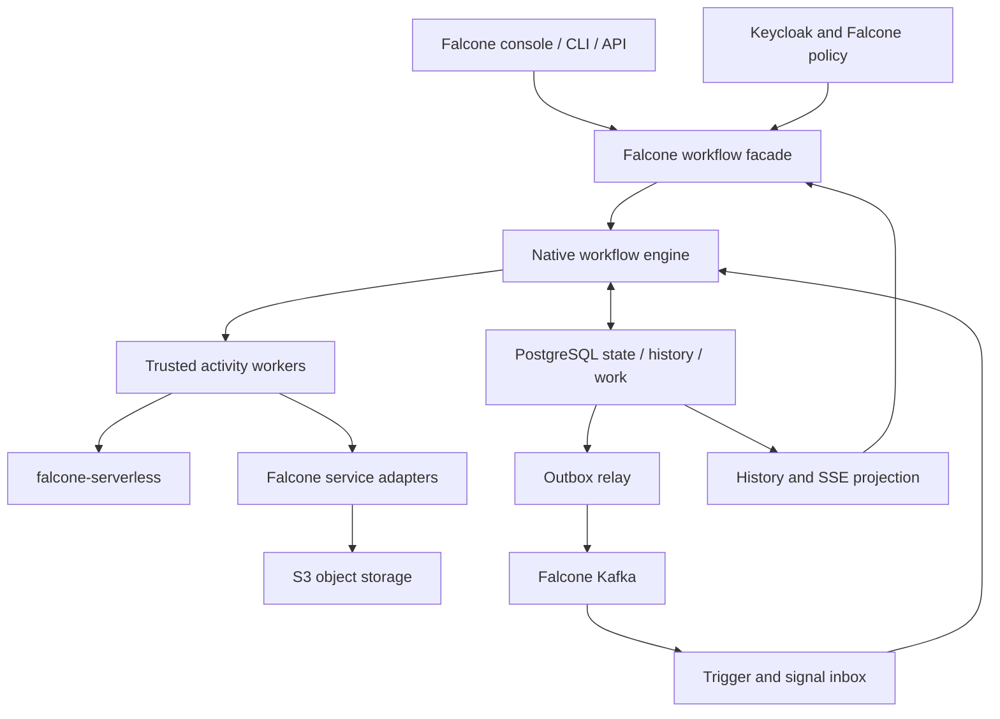

# falcone-workflow: native durable workflow engine design

<!-- Generated by tools/build_docs.py from design.md, survey.md, planning-source.json, architecture.md, open-questions.md, tradeoffs.md, migration.md and sources.md. Do not edit by hand. -->

Planning status (2026-10-30): architecture direction and ADRs 0001-0013 accepted 2026-10-30; remaining scope in open-questions.md. 98 requirements, 12 epics and 47 stories.

## Accepted direction and scope

Updated 30 October 2026. Source baseline inspected: Falcone commit `47674add95223e6ccd7f6f0dcd11106469a0a30e`. This is a repository snapshot, not a verified deployed version. **The operator accepted the architecture direction on 30 October 2026 ([ADR 0001](adr/0001-native-falcone-workflow.md)). No runtime is implemented, and corporate-cluster feasibility, capacity and security qualification remain unverified.**

### Purpose and scope

Build a first-party Falcone service that replaces the Temporal engine behind Falcone workflows while retaining Falcone's APIs, DSL, console, identity, tenancy and service integrations. This is not a proposal to install a different generic workflow platform.

Falcone's workflow API and DSL are the public contract. Raw Temporal SDK and server compatibility is out of scope. During migration both engines run behind the Falcone facade, and existing Temporal runs finish on Temporal. Existing code already establishes visual-DSL, external-call and human-approval requirements. Compensation and the flow-control, human-task and operator extensions from the functional gap analysis are opt-in and versioned; apiVersion v1.0 behavior is unchanged.

### Operator decisions (2026-10-30)

| # | Topic | Decision |
|---|---|---|
| D1 | Repository split | The engine, evaluator, scheduler/timer/lease services and trusted task workers live in `gntik-ai/falcone-workflow`. The workflow facade, backend routing, console, CLI, quotas, admission and service adapters live in `gntik-ai/falcone`. The Helm chart lives in `gntik-ai/falcone-charts`. A story that spans repositories is split into one issue per repository. Stories and epics are product-level and may span repositories; the backlog decomposition turns each story into technical issues, one per repository, each with a single owner and explicit cross-repository dependencies. |
| D2 | Engine language | TypeScript on Node.js. Go is no longer an M0 alternative. |
| D3 | Temporal compatibility | No raw Temporal SDK or server compatibility. Falcone's workflow API and DSL stay the public contract; both engines run behind the Falcone facade during migration; existing Temporal runs finish on Temporal. |
| D4 | Shared contracts with falcone-serverless | falcone-workflow consumes falcone-serverless's worker execution API (`ctr-worker-execution-api`) and job checkpoint contract (`ctr-job-checkpoint`), and the shared Falcone outbox/inbox and lease/fencing module that falcone-serverless story STO-03 builds in Falcone, instead of defining its own. INT-02 is rescoped to consuming those contracts. The serverless Temporal-activity tasks stay while Temporal serves existing runs. |
| D5 | Database | A separate database on the shared PostgreSQL cluster, not a schema in Falcone's database, with a connection budget. |
| D6 | License | MIT, the same as Falcone. |
| D7 | Cluster testing | Cluster tests run in dedicated `fw-test-*` namespaces and may read `in-falcone-staging`; `family-rentals-prod`, `musematic*` and `llmwiki*` are off limits. k3s with Pod Security "restricted" stands in for OpenShift. |
| D8 | Waits and compensation | Keep current waits and approvals, support multi-month waits, and make compensation opt-in and versioned. The maximum permitted wait W_max is 12 months (ADR-0009). |

The repository seed (license, contributor guide, CI and the TypeScript skeleton) already provides the CI bootstrap, so OPS-03 no longer blocks M0 for CI. Capacity must be measured on the current Temporal staging deployment during M0 (MIG-01).

### Repository ownership

| Repository | Owns |
|---|---|
| `gntik-ai/falcone-workflow` | Engine, bounded evaluator, scheduler, timer and lease services, trusted task workers |
| `gntik-ai/falcone` | Workflow facade and backend routing, console, CLI, quotas, admission and service adapters; the shared outbox/inbox and lease/fencing module |
| `gntik-ai/falcone-charts` | Helm chart deploying the engine and its workers |
| `gntik-ai/falcone-serverless` | Qualified untrusted computation and the worker execution and job checkpoint contracts |

### Recommended boundary

Retain the current Falcone DSL and develop an explicit durable state machine for its nodes. Run only trusted interpreter and connector code in engine processes. Tenant expressions receive strict limits; arbitrary tenant code belongs in qualified falcone-serverless execution profiles. Waiting workflows occupy persisted records, not dedicated pods or permanently blocked worker threads.

Use a dedicated database on the shared PostgreSQL cluster as the authoritative store, with its own roles and a connection budget. Use existing Kafka for event transport through the shared outbox/inbox module, not as a second authoritative workflow log. Large payloads remain behind Falcone's S3 abstraction. Keep identity through Keycloak/Falcone and credential references through the existing secret-management boundary.

### Evidence-driven scope

The inspected interpreter supports sequence, parallel, task, branch, wait, approval and sub-flow. It pins definitions and uses Temporal activities, timers, signals and child workflows. The facade owns definition versions, execution lifecycle and role checks. Flow cron scheduling is separate from Falcone's standalone scheduling-engine. Monitoring translates Temporal history to SSE.

The task catalog includes database, storage, functions, events, HTTP, email, LLM completion/batch and large-task execution. Those are replacement requirements, not greenfield feature suggestions. Source comments and historical READMEs sometimes describe early stubs; the implementation and contract fixtures must take precedence. In particular the dispatch catalog retains an echo fallback for harness/legacy paths; the new production worker must reject unknown task types.

### Functional gap analysis (2026-10-30)

A review against 16 workflow engines and specifications found the baseline strong on durability and weaker on flow-control primitives, run-level operator controls, admission control and visibility. Its findings are folded into this revision:

- **Must-have for migration or parity:** error-type taxonomy and `nonRetryableErrors` matching, trigger start-or-signal by business key, parallel failure and child propagation semantics, data-passing and flow-input rules, distinct cancel/terminate/retry operations, schedule policy fidelity, effective retry/timeout defaults and multi-month waits. These are requirements on existing stories.
- **Should-have:** error boundaries and finalizers (DSL-04), dynamic fan-out (DSL-05), in-flight version migration (DSL-06), callback-token and event-or-timeout waits (EVT-04), lifecycle events and trigger filters (EVT-05), flow concurrency, rate limits and priority (TEN-04), human-task forms, quorum and escalation (HUM-04), bulk operations (OPS-04), SLA alerts (OBS-04), run search (OBS-05), test mode (CON-04), and typed incidents, retention and erasure, output schemas and synchronous acknowledgements on existing stories.
- **Later** items are listed as optional enhancements after parity, and explicitly rejected patterns as rejected paths, in [trade-offs](tradeoffs.md).

Eighteen under-specified requirements were completed in place, including FR-ACT-06, which now requires multi-month waits and retention of interpreter and definition versions for at least the longest permitted wait. The operator later set that maximum wait, W_max, to 12 months (ADR-0009).

### Delivery gates

- **M0 — scope and feasibility:** inventory actual deployments and legacy semantics, preserve DSL fixtures, consume the falcone-serverless contracts, measure capacity on the current Temporal staging deployment and validate restricted deployment constraints on the k3s stand-in.
- **M1 — durable core:** transactional state, leases/fencing, timers, bounded evaluator, authentication and native worker context. Crash/concurrency tests are mandatory.
- **M2 — Falcone completeness:** port task catalog, triggers, schedules, approvals, quotas, SSE and optional compensation, plus the should-have flow-control, human-task and visibility features.
- **M3 — qualification and migration:** restore/load/soak tests, differential semantics, canary cohorts, schedule transfer, long-lived run drainage, operator bulk tooling, then retirement.

Do not remove Temporal merely because M1 demonstrations succeed. Some deployed workflows may remain on the old engine for their full lifetime.

### Accepted architecture decisions (ADRs 0002–0013)

The [architecture review](architecture-review.md) proposed ADRs 0002–0013 covering ownership, persistence, shared primitives, dispatch, serverless tasks, expressions, calendars, versions, migration, credentials, history and capacity. The operator accepted all twelve as written on 30 October 2026, including the explicit R3 approval for RLS (ADR-0003), expression isolation (ADR-0007), dual-engine and live-run migration (ADR-0010) and long-lived credentials (ADR-0011). D1–D8 remain authoritative.

The operator also resolved three review blockers: W_max is 12 months (F08, ADR-0009); the STO-03 shared module is falcone issues #1331, #1343, #1356, #1361 and #1381 (F03, ADR-0004); and `ctr-worker-execution-api` v1 is falcone-serverless #124 and #130, with `ctr-job-checkpoint` v1 planned as falcone-serverless task JOB-01.t1 (F05, ADR-0006). Exact contract paths and versions are confirmed from the delivered code as an integration gate. Per-repository technical issues come from the backlog decomposition (F01), and the M0 capacity baseline is a gate before numeric commitments (F12). The remaining findings stay open with their owner roles in the review.

### Document map

The combined design document, [falcone-workflow-design.md](falcone-workflow-design.md), is generated from these chapters and is what Hermes's backlog decomposition reads.

1. [Survey and comparative analysis](survey.md)
2. [Functional requirements](requirements.md)
3. [Baseline architecture](architecture.md)
4. [Detailed backlog](backlog.md) and [JSON import payloads](backlog.json)
5. [Open questions and ownership](open-questions.md)
6. [Trade-offs](tradeoffs.md) and [migration sequence](migration.md)

## 1. Survey and comparative analysis

Reviewed 22 October 2026. Platform behavior is grounded in [primary sources](sources.md); suitability ratings are architectural judgments for Falcone. No benchmark below claims measured superiority.

### Temporal baseline

Temporal separates Frontend RPC admission, History state/timers, Matching task queues and an internal Worker service. Application workers run workflow and activity code outside the server. Durable history supports replay; activities provide side effects, retries and heartbeats; timers, signals, child workflows and schedules support extended business processes. Persistent storage is required; visibility and operational tooling add deployment concerns. [T1–T3]

Its strongest reference for Falcone is explicit failure semantics. The replacement must preserve accepted work, cancellation behavior, version pinning and recovery, not merely a graph traversal API.

#### Observed Falcone coupling and pain points

- Workflow orchestration imports Temporal SDK primitives throughout the DSL interpreter; task adapters rely on Activity Context and Temporal error classes.
- Credential reference resolution queries Temporal run ancestry. Removing the SDK without replacing this authorization proof would break isolation.
- Schedule management and triggers use a Temporal client; an existing reconnect fix documents how a rejected connection promise could poison later requests.
- Monitoring maps Temporal event types and activity IDs into Falcone SSE frames.
- The worker package documents a TypeScript/CommonJS bundling deviation from sibling ESM services. This is a repository-specific integration constraint, not a claim that all Temporal installations require Falcone's exact build layout.
- Falcone supplies business schemas, catalog, identity and quotas around the engine. A custom engine can integrate these directly, but Falcone then owns distributed-system correctness and on-call operations.

Temporal does not intrinsically require privileged tenant pods or an operator. Restricted OpenShift deployment alone does not prove replacement is necessary; first-party control and a smaller Falcone-specific scope are the additional rationale.

### Comparison

| Reference | Functional model | Scale model and extensibility | Strength versus Temporal for this design | Weakness / Falcone mapping |
|---|---|---|---|---|
| **Temporal** | Durable code workflows, activity retries, signals, timers, children and schedules | Independently scaled server services and application workers; SDKs and activities | Existing implementation and strong recovery semantics | Multiple operational components; SDK/replay and history coupling; Falcone IAM/S3/task policy still supplied by adapters |
| **Cadence** | Durable code workflows, activities, signals and long-lived state | Distributed service with partitioned history and worker task lists; SDK activity implementations | Valuable independent reference for timeout and task lifecycle contracts | Similar distributed-service and replay burden; not a simplification by itself; domain isolation does not replace Falcone workspace authorization [C1–C2] |
| **Conductor OSS** | Declarative workflows and task workers across languages | Scale servers and poll-based workers; task domains, custom workers and persistence/queue integrations | Closest conceptual reference to Falcone's existing DSL and task catalog | Adoption would still require DSL/contract translation and policy adapters; persistence/queue combinations add operations choices [N1] |
| **Apache Airflow** | Scheduled DAG/task execution, dependencies and operational run management | Scheduler/executor/worker architecture; pluggable executors and providers | Strong reference for schedules, backfills, task history and operational UX | Primarily batch/data orchestration; a less natural base for Falcone's interactive signal/approval flows; DAG Python is trusted code, not tenant sandboxing [A1–A2] |
| **Dapr Workflow** | Code-defined durable workflows integrated with invocation, pub/sub and state | Durable Task engine and distributed runtime; SDK activities and Dapr components | Useful activity/lifecycle abstraction and failure-recovery patterns | Full Dapr adoption adds another runtime and configuration surface; Kubernetes installation details require qualification under corporate restrictions [D1–D2] |
| **DBOS TypeScript** | Application-embedded durable steps/workflows backed by PostgreSQL | Application workers and database coordination; library calls and queues | Closest lower-operations alternative and reference for leveraging Falcone PostgreSQL | Still a library dependency and programming-model migration; tenant isolation, DSL execution and API compatibility remain Falcone work [B1–B2] |
| **Restate — source-available reference** | Journaled durable services, workflow primitives and keyed state | Partitioned runtime with external SDK service endpoints | Useful design reference for durable calls, operation identity and suspension | Current server license is BSL 1.1, explicitly not open source; do not count it among OSS alternatives or copy server code into Falcone without a separately approved licensing path [R1–R2] |

Cadence, Conductor, Airflow, Dapr and DBOS provide five open-source references beyond Temporal. Maturity is not identical: Temporal/Cadence and Airflow have longer operating histories; evaluate DBOS and individual Dapr workflow SDKs against the actual Falcone workload rather than assuming feature parity.

### Functional references from the gap analysis (30 October 2026)

A functional gap analysis compared capabilities across 16 products. It added the 11 below and re-checked Temporal, Conductor OSS, Airflow 3.x, Restate and DBOS for capabilities this survey had not compared: Temporal updates, priority/fairness, the schedule policy set, reset/batch operations and parent-close policy; Conductor timeout policies, rate limits, rerun/skip and its test API; Airflow 3 human-in-the-loop operators, deadline alerts and backfill reprocess modes; DBOS queue flow control (the closest PostgreSQL-native reference for TEN-03 and TEN-04); Restate awakeables. Products are pattern references; none is adopted. Source-available products are **design references only**: no code is copied from them.

| Product | License class | What Falcone borrows |
|---|---|---|
| Argo Workflows | Apache-2.0 | Retry strategy with expressions; mutex/semaphore synchronization; cron concurrency policy, time zone and documented DST behavior; parameter fan-out; archive TTL |
| Camunda 8 / Zeebe | Camunda License 1.0, source-available; production licence required for self-managed since 8.6. **Design reference only** | Typed incidents; instance migration with mapping instructions; instance modification; multi-instance with completion condition; message correlation with TTL buffering; error boundary events; user-task assignment, due dates and escalation |
| Kestra | Apache-2.0; enterprise features proprietary | Concurrency overflow (queue, cancel, fail); missed-schedule recovery and pausable backfill; SLA actions; replay from a task; error branches, allow-failure and after-execution handlers |
| Prefect 3 | Apache-2.0 | Concurrency slots with leases and rate limits; typed wait-for-input; automations including absence-of-event triggers |
| n8n | Sustainable Use License (fair-code, not OSI open source). **Design reference only** | Error workflows; Wait node resumed by an authenticated URL or form with a wait limit |
| Windmill | Apache-2.0 / AGPLv3 plus a proprietary enterprise edition. **Design reference only** | Approval count, self-approval prohibition, group restriction, form schema and continue-on-timeout; concurrency limits with custom keys |
| Hatchet | MIT | CEL concurrency keys with round-robin and cancel strategies; static and dynamic rate limits; priority tiers; durable sleep/event or-groups |
| Inngest | SSPL-1.0 with a future Apache-2.0 licence. **Design reference only** | Flow control (concurrency, throttling, debounce, priority, batching); cancel-on-event; wait-for-event with match and timeout; idempotency window |
| Serverless Workflow / Open Workflow DSL | CNCF specification; license not reviewed | Task vocabulary (try/catch/raise, competing fork, listen-until, for); retry when/except-when/jitter; RFC 7807 error types; workflow and task lifecycle CloudEvents |
| Dagster | Apache-2.0 | Sensor `run_key` deduplication as a precedent for start-or-signal; partitions and backfills |
| Flyte | Apache-2.0 | Typed task interfaces; map tasks with partial-failure tolerance; gate nodes |

Restate (BSL 1.1, above) is also a design reference only. The patterns adopted from these products are the gap-analysis requirements in section 2 and stories CON-04, DSL-04 to DSL-06, EVT-04, EVT-05, HUM-04, TEN-04, OBS-04, OBS-05 and OPS-04; deferred and rejected patterns are in section 6. Sources are listed under "Functional gap analysis references".

### Falcone integration implications

For every alternative, Keycloak authentication, Falcone workspace roles and quota policy need an application-specific authorization layer. S3 is suitable for large payload references, not an automatic replacement for the engine's transactional state. A function invocation adapter is required for falcone-serverless. Multi-tenancy must cover database predicates, events, histories, callbacks and credentials; an engine namespace or task queue alone is not an untrusted-code isolation boundary.

Adopt patterns rather than cloning engines: durable transitions from Temporal/Cadence; explicit task graphs from Conductor; schedule operations from Airflow; narrow activity protocols from Dapr; transactional persistence from DBOS. Restate is an additional conceptual reference only.

### Licensing and reuse

Inspected repository pages identify Cadence and Conductor as Apache-2.0 and DBOS TypeScript as MIT. Pin exact upstream revisions and inspect component licenses before reusing code. Current Restate license specifies BSL 1.1 and a future change license; “public repository” must not be equated with open-source reuse permission. Camunda 8, Inngest, n8n, Windmill and Restate are source-available or not OSI open source and are design references only. Falcone itself, and this service, are MIT-licensed (D6). No upstream code is included in this proposal. [C1, N1, B2, R2]

## 2. Functional requirements checklist

98 testable statements in 12 areas. Every requirement maps to one story in section 4. Requirements added by the 30 October 2026 functional gap analysis continue each area's numbering; additive DSL features leave apiVersion v1.0 behavior unchanged.

### CON. Falcone contracts and developer experience

- [ ] **FR-CON-01:** The system must preserve inventoried Falcone workflow API routes, response schemas, status codes and tenant-scoped identifiers through a compatibility facade.
- [ ] **FR-CON-02:** The project must publish a compatibility matrix marking each observed behavior as preserved, intentionally versioned, or a migration blocker.
- [ ] **FR-CON-03:** The system must expose authenticated start, get, list, cancel, retry and signal operations with idempotency keys scoped to (tenant, workspace, flow): the same key with the same input returns the same run for at least max(24 h, the run's retention) and a different input returns a conflict; an optional business ID has a conflict policy (fail or use-existing; terminate-existing is administrator-only) and a reuse-after-close policy (allow, allow-if-failed or reject).
- [ ] **FR-CON-04:** The system must route every existing run to its recorded backend and return a retryable service-unavailable response when that backend is unavailable.
- [ ] **FR-CON-05:** The system must support CLI validate, publish, start, inspect, cancel and retry operations using Falcone authentication.
- [ ] **FR-CON-06:** The system must provide versioned task schemas and validation errors usable by Falcone's existing visual editor, preserving the FLW-E001 to FLW-E009 codes, rules and kinds verbatim; new validation rules receive new codes and never reuse existing ones.
- [ ] **FR-CON-07:** The system must provide cancel (cooperative: stops new normal work, runs configured cleanup or compensation), terminate (administrative: no further workflow logic, reason required, audited) and retry (the inventoried legacy meaning, recorded either as a linked new run or as a new attempt lineage of the failed node occurrence) as distinct operations with explicit parent/child propagation, each reporting request acceptance separately from the eventual terminal outcome.
- [ ] **FR-CON-08:** The system must run a flow version in test mode with mocked task outputs or errors, simulated time and injected signals, events and approval decisions, producing the same history, error codes and SSE frames as live execution without resolving credentials or dispatching to any connector, through both the API and the CLI.
- [ ] **FR-CON-09:** The system must validate connector outputs against the pinned task output schema before committing a completion, treating a violation as a typed non-retryable error, and must expose input and output schemas to the visual editor for reference completion.

### DSL. DSL interpretation and versioning

- [ ] **FR-DSL-01:** The system must validate sequence, parallel, task, branch, wait, approval and sub-flow nodes using the inventoried Falcone DSL rules.
- [ ] **FR-DSL-02:** The system must reject invalid cycles, duplicate IDs, unknown tasks, dangling references and invalid cron/duration expressions before publishing, reporting the inventoried FLW-E001 to FLW-E009 codes, rules and kinds verbatim.
- [ ] **FR-DSL-03:** The system must evaluate expressions with bounded input size, runtime and memory without network, filesystem or arbitrary-code access; maximum expression length, evaluation cost and steps, result size and input bytes are configured per interpreter version, the CEL library version is pinned per interpreter version, and clock functions use the persisted evaluation time, never the wall clock at replay.
- [ ] **FR-DSL-04:** The system must persist branch decisions, parallel completion sets and deterministic output-merge behavior before advancing successors; parallel failure and cancellation semantics follow FR-DSL-07.
- [ ] **FR-DSL-05:** The system must pin each run to immutable definition and interpreter versions and each child to an authorized explicit definition version; child behavior on parent cancellation, termination, failure or timeout follows FR-DSL-07.
- [ ] **FR-DSL-06:** The system must reject unsupported historical versions, require an explicit audited migration plan before changing active-run semantics, and retain every interpreter and definition version, and every other artifact a run pins, for at least 12 months (W_max) after the last run that pins it closes; migrating a run through FR-DSL-11 moves that run's pins to the target version but never shortens the retention of the versions it pinned before.
- [ ] **FR-DSL-07:** The system must define per interpreter version, and preserve for apiVersion v1.0, (a) parallel-node failure semantics: fail-fast or wait-all, whether in-flight sibling tasks are cancelled, left running or abandoned, and which sibling results are retained; and (b) child-run behaviour when the parent is cancelled, terminated, fails or times out: terminate, request-cancel or abandon. Both must be fixture-tested against Temporal outcomes.
- [ ] **FR-DSL-08:** The system must preserve the inventoried rules by which task and sub-flow inputs reference flow inputs, run variables and prior node-occurrence outputs (reference syntax, evaluation time, missing-reference, null and type-coercion behaviour), and must apply declared flow-input type, required and default rules at admission, rejecting violations with stable error codes before a run is created.
- [ ] **FR-DSL-09:** In an additive DSL version, the system must support error boundaries on task, sub-flow, sequence and parallel nodes that route errors matching declared error types (after retries are exhausted) to a declared handler node, optional finalizer nodes that run on success, failure or cancellation of their scope, and a flow-level on-failure handler; caught errors must be recorded in history, and uncaught errors must fail the run exactly as in v1.0.
- [ ] **FR-DSL-10:** The system must support a map node that runs a task or sub-flow for each element of a runtime collection with a declared maximum item count, maximum concurrency, failure policy (fail-fast, continue, or minimum success count or ratio) and index-ordered output collection, reserving fan-out quota at expansion time and persisting per-item occurrence state so that a crash neither duplicates nor drops items.
- [ ] **FR-DSL-11:** The system must migrate selected waiting or running native runs to another published version of the same flow using an explicit node-occurrence mapping that is validated in a dry run, applied atomically per run under the expected revision and recorded in audit, and must reject migration when an active task, timer or approval lacks a mapping or the mapping changes node type or scope.

### DUR. Durable state and recovery

- [ ] **FR-DUR-01:** The system must acknowledge a start only after committing the run, pinned plan, first ready work, audit event and idempotency record.
- [ ] **FR-DUR-02:** The system must commit each state transition, ordered per-run event and generated work atomically under a checked revision.
- [ ] **FR-DUR-03:** The system must reject task completions and heartbeats with expired or superseded lease generations.
- [ ] **FR-DUR-04:** The system must recover abandoned tasks through durable scans even when all optional notifications are lost.
- [ ] **FR-DUR-05:** The system must bound event history and payload growth using configured limits and resumable continuation or archival policies: a run segment has a configured maximum event count and byte size, and continuation keeps the public run ID, links segments and keeps SSE cursors (FR-OBS-01) monotonic across segments.
- [ ] **FR-DUR-06:** The system must restore database and referenced object payloads to a consistent recovery point and reconcile external effects before resuming dispatch.
- [ ] **FR-DUR-07:** The system must apply a per-workspace retention period to closed runs within quota limits, support authorized deletion of individual closed runs and their payload objects with audit, and support erasure of payload objects linked to a data subject while preserving redacted structural history, honoring legal-hold flags that suspend deletion.

### ACT. Task execution and long-running work

- [ ] **FR-ACT-01:** The system must dispatch tasks through a versioned protocol carrying tenant, workspace, run, node occurrence, attempt, lease generation and pinned adapter version.
- [ ] **FR-ACT-02:** The system must execute side effects only in authorized workers and must reject unknown task types in production.
- [ ] **FR-ACT-03:** The system must apply the retry fields maxAttempts (at least 1), initialInterval, backoffCoefficient (at least 1), maximumInterval and nonRetryableErrors (FR-ACT-07 types) with delay(n) = min(initialInterval × backoffCoefficient^(n−1), maximumInterval), and the timeouts scheduleToStart (queue wait), startToClose (per attempt), scheduleToClose (all attempts), heartbeat (at most startToClose) and a run-level executionTimeout (none for apiVersion v1.0); the compiled plan of a v1.0 definition must store the effective legacy defaults explicitly, including those injected for absent policies or timeouts; optional jitter and a connector-supplied next-delay override belong to a new apiVersion and never extend maxAttempts or scheduleToClose.
- [ ] **FR-ACT-04:** The system must classify each catalog connector as idempotent-by-key, reconcilable (read-after-timeout) or non-idempotent, use that class for retry eligibility, the repair preview (FR-HUM-08) and ambiguous-outcome incidents (FR-HUM-09), block blind retries of non-idempotent connectors regardless of maxAttempts, and surface ambiguous external outcomes instead of promising universal exactly-once effects.
- [ ] **FR-ACT-05:** The system must persist external job IDs and checkpoint references and resume observation after worker loss without blindly resubmitting the job.
- [ ] **FR-ACT-06:** The system must support waits, approvals and timers up to the maximum permitted wait W_max of 12 months, with bounded heartbeat, cancellation and credential-renewal policies, and must exercise credential renewal (FR-TEN-04) in a test that crosses a Keycloak session or offline-token expiry.
- [ ] **FR-ACT-07:** The system must classify every task, expression and connector failure with a stable error type from a versioned taxonomy (at least validation, authorization, timeout, communication, rate-limited, ambiguous-outcome, cancelled and connector-specific types), and must evaluate nonRetryableErrors for apiVersion v1.0 definitions against the inventoried legacy Temporal error-type names emitted by each catalog task.

### TIM. Timers and schedules

- [ ] **FR-TIM-01:** The system must persist wait and retry timers and fire each logical timer at most once into workflow state.
- [ ] **FR-TIM-02:** The system must resolve simultaneous signal, timeout and cancellation transitions with one documented transactional ordering rule.
- [ ] **FR-TIM-03:** The system must preserve Falcone schedule identities, published cron text, next-action times, the inventoried number of retained recent actions and idempotent pause/resume behavior; trigger-now and pause/resume notes follow FR-TIM-08.
- [ ] **FR-TIM-04:** The system must preserve the eight DSL overlap names (skip, allow, allow_all, buffer, buffer_one, buffer_all, cancel_other, terminate_other) with their inventoried normalisation and skip as the default, use the inventoried effective catch-up window when catchupWindow is absent, evaluate apiVersion v1.0 schedules in UTC, run a nonexistent local time once at the next valid instant and an ambiguous local time once at its first occurrence for time-zone-aware schedules (a new field), and atomically deduplicate each occurrence by (schedule ID, nominal UTC instant); pausing does not affect admitted runs and manual triggers are not bound by the catch-up window.
- [ ] **FR-TIM-05:** The system must fence schedule ownership during backend handover so only one engine may admit an occurrence.
- [ ] **FR-TIM-06:** The system must support audited bounded backfill over [start, end) with a reprocess mode (missing only, missing and failed, or all), an order (oldest first by default, newest first optional), a concurrency cap independent of live scheduling and the schedule's overlap policy; backfill is exempt from the catch-up window, limited to one active backfill per schedule with a maximum occurrence count, can be paused and cancelled, and offers a dry run listing candidate occurrences and quota impact.
- [ ] **FR-TIM-07:** The system must support waiting until an absolute instant or a CEL-computed instant with an explicit IANA time zone, evaluated once and persisted before the timer is armed.
- [ ] **FR-TIM-08:** The system must support optional schedule start and end bounds, bounded jitter, a maximum action count, pause-on-failure, an operator note on pause and resume, and an audited trigger-now action that applies the schedule's overlap policy unless overridden.

### EVT. Events and trigger delivery

- [ ] **FR-EVT-01:** The system must persist incoming trigger/event deduplication records and resulting workflow transitions before acknowledging delivery.
- [ ] **FR-EVT-02:** The system must publish committed outgoing events, including the FR-EVT-09 lifecycle event catalogue, through a retryable transactional outbox with stable event IDs.
- [ ] **FR-EVT-03:** The system must authenticate webhook triggers with rotation-aware signatures, replay protection and size limits.
- [ ] **FR-EVT-04:** The system must derive tenant and workspace from verified trigger registration rather than caller-supplied payload fields.
- [ ] **FR-EVT-05:** The system must persist authorized signals using deduplication IDs and explicit run/node-occurrence correlation.
- [ ] **FR-EVT-06:** The system must take the TTL and per-run capacity for unmatched or early-arriving signals from quota policy, consume buffered signals FIFO per signal name, deduplicate them by signal ID while buffered and for the run's retention after consumption, reject a signal to a terminal run with an explicit error code and record it, and deliver a signal matching several waits to the earliest-armed node occurrence.
- [ ] **FR-EVT-07:** For each inventoried trigger that uses start-or-signal semantics, the system must derive a tenant- and workspace-scoped business key from the verified trigger registration and event, and in one transaction either deliver the signal to the open run holding that key or start a new run and deliver the signal to it, so that concurrent deliveries for one key yield at most one open run and no lost signal.
- [ ] **FR-EVT-08:** The system must provide a callback wait node that issues a single-use, signed, tenant- and node-occurrence-bound completion token or URL with an expiry, accepts exactly one authenticated terminal completion (success or failure) validated against a declared payload schema and size limit, accepts authenticated non-terminal progress heartbeats with the same token until that completion (each heartbeat is idempotent by sequence number, only refreshes progress and the optional heartbeat timeout, and never consumes the token or resolves the wait), and resolves completion, timeout and cancellation races with the FR-TIM-02 ordering rule.
- [ ] **FR-EVT-09:** The system must publish versioned CloudEvents-formatted lifecycle events for run and node-occurrence transitions (started, completed, failed, cancelled, terminated, waiting for approval or callback, incident opened and resolved, SLA breached) through the outbox, carrying identifiers, versions and object references but no secrets or unredacted payload values.
- [ ] **FR-EVT-10:** The system must support a CEL filter over the verified event and an input mapping for each platform-event and webhook trigger, evaluated before admission and recorded in the trigger's delivery record.
- [ ] **FR-EVT-11:** The system must return, after commit, a synchronous result for signals and approval decisions (accepted, rejected by validation, target not waiting, duplicate, or run terminal), validating the payload before it is persisted.
- [ ] **FR-EVT-12:** The system must support an event-wait node that waits for a correlated platform event or signal matching a declared filter, with a timeout, and records which condition won together with the event reference.

### HUM. Human approvals and compensation

- [ ] **FR-HUM-01:** The system must derive approval actor identity from verified authentication and enforce configured reviewer permissions.
- [ ] **FR-HUM-02:** The system must preserve approval outcome fields as {decision, actor subject, actor display name, decided-at, comment, decision revision, source (UI or API)}, distinguish rejection, timeout and cancellation, produce the declared default outcome or the approval.timeout error type on timeout, and raise the approval.rejected error type on rejection so that error boundaries (FR-DSL-09) can route it in a new DSL version.
- [ ] **FR-HUM-03:** The system must record completed compensatable operations and schedule configured compensations in dependency-safe reverse order.
- [ ] **FR-HUM-04:** The system must track compensation retries, failures and manual intervention separately from the original task outcome.
- [ ] **FR-HUM-05:** The system must require authorization, reason and expected run revision for manual repair or retry actions, including the FR-HUM-08 run operations.
- [ ] **FR-HUM-06:** The system must preserve original history and create explicit linked attempts or continuation records for repair.
- [ ] **FR-HUM-07:** The system must support approval nodes with a versioned response schema (choices and typed fields), assignment by user, Keycloak group or role expression, quorum rules (any, all, or N of M), optional prohibition of approval by the run initiator, reminder and escalation timers that do not interrupt the approval, and a declared default outcome on timeout. Every response, reassignment and escalation must be recorded in audit history.
- [ ] **FR-HUM-08:** The system must provide authorized, audited run operations (pause and resume dispatch; retry a failed node occurrence in place; skip a node with an operator-supplied, schema-valid output; set run variables; and rerun from a selected node as a new linked run pinned to the original or an explicitly selected compatible version), each requiring the expected run revision and showing a preview of side effects that may repeat according to connector idempotency class.
- [ ] **FR-HUM-09:** The system must represent each condition that requires human resolution (retries exhausted under an alert-only timeout policy, ambiguous external outcome, expression evaluation error, missing or hash-mismatched payload, expired or revoked credential, policy-blocked effect, undeliverable signal) as a typed incident on the affected node occurrence that stops dispatch on that path, emits a lifecycle event, and closes only through an audited resolution action.

### TEN. Security, tenancy and Falcone quotas

- [ ] **FR-TEN-01:** The system must enforce tenant/workspace ownership for definitions, runs, events, schedules, payloads and monitoring streams using verified identity.
- [ ] **FR-TEN-02:** The system must preserve Falcone definition-write role restrictions and test authorization on every execution lifecycle operation.
- [ ] **FR-TEN-03:** The system must bind execution credential references to authoritative tenant, workspace, root run and allowed child lineage before connector use.
- [ ] **FR-TEN-04:** The system must renew or reauthorize long-lived runs under Falcone policy without storing bearer tokens or secret values in history.
- [ ] **FR-TEN-05:** The system must consume versioned Falcone quota policy for starts, active tasks, waiting runs, retries, fan-out, payload bytes and retention.
- [ ] **FR-TEN-06:** The system must enforce fair tenant/workspace admission with idempotent reservations, releases and usage events across crashes, using weighted round-robin across tenants and then across workspaces within a tenant, with weights from quota policy.
- [ ] **FR-TEN-07:** The system must enforce optional per-flow and per-key concurrency limits, where the key is a bounded CEL expression over verified run input, with a declared overflow strategy (queue with maximum wait, reject, cancel newest, or cancel oldest running), and per-workspace named rate limits (units per window) that task nodes reference, without letting any tenant-defined key cross tenant or workspace scope.
- [ ] **FR-TEN-08:** The system must support bounded run priority tiers inherited by tasks and children, and weighted fairness keys, such that priority orders work only within a tenant's fair share and no workspace exceeds its configured share under contention.

### INT. Falcone services and serverless integration

- [ ] **FR-INT-01:** The system must preserve qualified contracts for db.query, storage.get/put, functions.invoke, events.publish, http.request, email.send, llm.complete, llm.batch and largeTask.run.
- [ ] **FR-INT-02:** The system must enforce per-connector timeout, payload, credential, egress and workspace policies before performing external calls.
- [ ] **FR-INT-03:** The system must invoke falcone-serverless through pinned versions of ctr-worker-execution-api and ctr-job-checkpoint with stable operation keys, authenticated correlation and explicit cancellation outcomes, and must not define a parallel workflow-specific execution or checkpoint protocol.
- [ ] **FR-INT-04:** The system must avoid a runtime dependency cycle: falcone-serverless execution primitives must run without calling Temporal or requiring falcone-workflow to execute themselves.
- [ ] **FR-INT-05:** The system must store large payloads through tenant-scoped Falcone object references with content hashes, retention metadata and authorization checks, using a configured inline threshold and per-run and per-node maximum referenced bytes that are part of quota policy and recorded in the policy snapshot, and failing explicitly when a limit is exceeded.
- [ ] **FR-INT-06:** The system must persist provider job IDs and bounded poll schedules for batch tasks, including cancellation cleanup and credential expiry.

### OBS. Monitoring, audit and performance

- [ ] **FR-OBS-01:** The system must expose ordered tenant-scoped history and compatible SSE frames with stable resumable event cursors.
- [ ] **FR-OBS-02:** The system must emit audit events for lifecycle, authorization-sensitive changes, approvals, repair and backend handover.
- [ ] **FR-OBS-03:** The system must measure admission latency, transition throughput, queue age, timer lag, lease expiry, retry rate, outbox lag and database contention.
- [ ] **FR-OBS-04:** The system must propagate trace correlation across Falcone services while redacting secrets and controlling metric cardinality.
- [ ] **FR-OBS-05:** The project must benchmark workflow starts, step transitions, durable waits and activity concurrency independently from Falcone's WebSocket message rate.
- [ ] **FR-OBS-06:** The project must publish achieved availability, latency and recovery results against an agreed workload and resource budget before production cutover.
- [ ] **FR-OBS-07:** The system must evaluate declared per-flow and per-node deadlines (maximum duration from run start, from a schedule's nominal time, or from approval assignment) and on breach must record an SLA event and apply the configured action: notify only, fail, or cancel.
- [ ] **FR-OBS-08:** The system must let authorized users list and count runs within a workspace by status, flow, version, time range, trigger, initiator, and bounded user-defined labels or typed search attributes set at start or by nodes, with indexed filters, stable pagination and per-workspace limits on attribute count, key length and value size.

### OPS. Deployment, CI/CD and operations

- [ ] **FR-OPS-01:** The system must deploy using its own database on the shared PostgreSQL cluster within a declared connection budget, and standard namespaced resources without mandatory CRDs, operators, cluster roles or privileged containers.
- [ ] **FR-OPS-02:** The system must run as non-root with arbitrary allowed UID, read-only root filesystem, dropped capabilities and no host access.
- [ ] **FR-OPS-03:** The system must support rolling compatible upgrades, bounded graceful drain and documented rollback limits for schema and interpreter changes, retaining every interpreter and definition version a run pins for at least 12 months (W_max) after the last run that pins it closes.
- [ ] **FR-OPS-04:** The project must provide tested runbooks for database failover, backup restore, stuck runs, queue overload and key rotation.
- [ ] **FR-OPS-05:** The project must gate releases on contract, isolation, state-machine fault, schema-migration and dependency-security checks.
- [ ] **FR-OPS-06:** The project must assign accountable runtime maintenance, SRE on-call, security review and Falcone product ownership before production release.
- [ ] **FR-OPS-07:** The system must apply cancel, terminate, pause, resume and retry to a filtered set of runs within one workspace as a resumable, rate-limited batch with a dry-run count, per-run outcome and a single audit record referencing all affected runs.

### MIG. Temporal migration and retirement

- [ ] **FR-MIG-01:** The project must inventory Temporal-dependent code, active workflow versions, open executions, schedule ownership and task adapters before selecting migration cohorts.
- [ ] **FR-MIG-02:** The project must compare native and Temporal outcomes using deterministic fixtures or isolated effect simulators without doubling production effects.
- [ ] **FR-MIG-03:** The system must route new starts by approved cohort and persist backend ownership for all later run operations.
- [ ] **FR-MIG-04:** The system must keep in-flight Temporal runs on Temporal unless an explicit application-level checkpoint transfer is validated.
- [ ] **FR-MIG-05:** The project must verify no remaining required Temporal runs, schedules, credentials or callers before removing the Temporal deployment and SDK dependencies.
- [ ] **FR-MIG-06:** The project must update Falcone integration documentation and falcone-serverless workflow references to the native contract with a rollback and retention plan.

## 3. Baseline architecture

### Component topology

Timer scanning and lease recovery are engine roles. The evaluator does not call external services during a database transaction. Native engine pods do not run arbitrary tenant code. Legacy Temporal remains a separate backend behind the facade only during migration.

### Recommended stack and rationale

| Component | Initial choice | Why |
|---|---|---|
| Public facade | Existing Falcone Node.js service and existing authentication boundary | Preserve route, role, error and console contracts |
| Engine | TypeScript/Node.js with explicit persisted DSL state machine (D2) | Reuse schema/CEL/task semantics and contributor skills; one language with the facade and adapters |
| Persistence | Separate database on the shared PostgreSQL cluster (D5), application RLS role, separate migration role and a connection budget | Transactions can atomically commit state and work; operationally familiar to Falcone; workflow load is isolated from Falcone's own database |
| Scheduler | Durable SQL timers and ready queues, bounded row claims using SKIP LOCKED, leases and fencing from the shared Falcone lease/fencing module (D4) | No leader required for correctness; DB locks alone do not establish fairness |
| Worker transport | Versioned internal HTTP/JSON initially; optional gRPC after profiling | Keep worker integration debuggable and accessible to existing adapters |
| Event transport | Existing Falcone Kafka plus the shared Falcone outbox/inbox module (D4) | Reuse infrastructure; broker is not the state authority |
| User computation | Qualified falcone-serverless profiles through `ctr-worker-execution-api` and `ctr-job-checkpoint` (D4) | Centralize untrusted-code isolation; engine interprets data only |
| Large payloads | Falcone S3 adapter, configured provider | Preserve tenant/object policy and avoid hard-wiring provider-specific semantics |
| Secrets | Existing Falcone credential/secret services; Keycloak for user identity | No additional user directory or long-lived tokens in workflow history |
| Observability | OpenTelemetry, Prometheus-compatible metrics, structured logs, existing SSE facade | One Falcone user experience and operator tooling |
| Packaging | OCI images; Helm chart in falcone-charts (D1) with standard namespaced resources | Fits restricted Kubernetes/OpenShift without mandatory operator/CRDs |

TypeScript on Node.js is decided (D2), but it is not a performance guarantee. Isolate bounded CEL evaluation in worker processes and persist outcomes; pin the CEL library version per interpreter version.

The engine's database shares the PostgreSQL cluster with Falcone (D5), so it needs explicit CPU/IO/connection budgets and tested failure isolation. Move to a dedicated instance before workflow traffic harms product transactions. PostgreSQL HA, backup and encryption must already be provided or provisioned through the platform team; namespaced installation does not grant those capabilities automatically.

### Repository placement and shared contracts

The engine, evaluator, scheduler, timer and lease services and the trusted task workers are built in falcone-workflow. The facade, backend routing, console, CLI, quotas, admission and service adapters are built in falcone, and the Helm chart in falcone-charts (D1). A story that spans these repositories is decomposed into one issue per repository. Stories and epics are product-level and may span repositories; the backlog decomposition turns each story into technical issues, one per repository, each with a single owner and explicit cross-repository dependencies.

falcone-workflow does not define its own serverless invocation, checkpoint, outbox/inbox or lease protocols (D4). Function and large-task execution use falcone-serverless's `ctr-worker-execution-api` and `ctr-job-checkpoint`; outbox/inbox delivery and lease fencing use the shared Falcone module that falcone-serverless story STO-03 builds.

The owners and references are confirmed (ADR-0004, ADR-0006): the STO-03 module is built in gntik-ai/falcone as issues #1331 (activation, deduplication and outbox written atomically), #1343 (attempt fencing against stale writes), #1356 (outbox recovery and inbox deduplication), #1361 (crash-recovery tests) and #1381 (commit-gated asynchronous acceptance on the STO-03 transaction and relay), with #1349 (fenced delivery attempts and deduplication window) related. `ctr-worker-execution-api` v1 is defined by falcone-serverless #124 and served by falcone-serverless #130. `ctr-job-checkpoint` v1 is falcone-serverless plan task JOB-01.t1 (gntik-ai/falcone, functions-api), a dependency to link once published. Exact API paths and versions are confirmed from the delivered code as an integration gate, not a blocker for decomposition. The serverless Temporal-activity tasks remain while Temporal serves existing runs. Gaps in a shared contract are raised as issues in the owning repository.

Additive DSL features from the functional gap analysis (error boundaries, map, callback and event waits, human-task forms, concurrency keys and priorities) are interpreter features in falcone-workflow; their search, bulk-operation and approval surfaces in the console and CLI are falcone work. apiVersion v1.0 definitions keep their inventoried semantics.

### Data model and invariants

All logical keys include tenant and workspace, including definition versions, run locators, events, schedules, jobs and deduplication records. Opaque public IDs do not replace authorization.

- **definitions / versions / compiled_plans:** immutable version/hash and schema/interpreter/connector compatibility metadata.
- **runs:** backend, run revision, root/parent identity, current state, pinned plan, creation/deadline and policy snapshot references.
- **node_occurrences:** stable execution occurrence path, canvas node ID, state and result reference. Node ID alone is insufficient when graph structure revisits a node.
- **tasks / attempts:** stable operation ID across retries, changing attempt ID and lease generation, due time, deadlines and heartbeat.
- **run_events:** append-only sequence per run; payloads are bounded/redacted and may refer to object storage.
- **timers / schedules / occurrences:** database timestamps, calendar policy and unique occurrence IDs.
- **inbox / outbox:** event IDs, tenant scope, delivery state, expiration and backoff.
- **approvals / compensations:** authenticated actor, target occurrence, decision revision, group-membership snapshot and cleanup progress.
- **incidents:** typed needs-attention records on node occurrences, opened by retries exhausted, ambiguous outcomes, expression errors, missing payloads, credential expiry, policy blocks or undeliverable signals, and closed only by audited resolution.
- **credential_references / quota_reservations:** opaque handles and authoritative lineage/accounting; never raw tokens in event history.

A transaction checks the run revision, writes one or more ordered events, updates the explicit continuation state, inserts next tasks/timers and outbox/audit records, then commits. Unique constraints guard admission and completion. Snapshot reconstruction uses a pure versioned reducer and never re-executes side effects. This is explicit DSL state persistence, not replay of arbitrary JavaScript stacks.

Use separate `run_id`, `root_run_id`, `node_occurrence_id`, `operation_id`, `attempt_id` and `lease_generation`. Externally retryable operation keys remain stable across attempts; transport request IDs and fencing tokens have different jobs.

### Task and failure semantics

Claim a bounded ready set under short database locks, increase lease generation and commit before I/O. Workers renew leases and report completion with their generation and expected status. A stale or expired attempt is rejected even if its HTTP request arrives late. Per-run revision checks serialize competing evaluators; unique work identities stop duplicated successors. Partition large queues by tenant/run hash only after profiling, retaining one ordered writer per run.

Execution is **at least once** for external tasks. A fenced completion prevents duplicate state commits, but cannot undo an external HTTP request from an expired worker. Connectors must use downstream idempotency keys, read-after-timeout reconciliation or an explicit ambiguous-outcome/manual-repair state. Unknown outcome for a non-idempotent action must not trigger blind retries.

Cancellation requests are durable and stop scheduling new normal work. In-flight effects may already have happened. Record cancellation requested, worker acknowledgement, external cleanup pending and terminal outcome separately. Termination is an administrative operation with explicit consequences, not proof that all remote effects stopped. Compensation is a business operation with its own failures; it is not ACID rollback.

Document default retry/timeouts explicitly by definition/interpreter version. A missing legacy retry policy inherits Temporal defaults today; migration must capture those effective defaults rather than silently substitute new ones. Timeouts have distinct queue, attempt, heartbeat and total-operation meanings.

The existing DSL is acyclic but can reference children and repeated graph occurrences. Bound sub-flow recursion, fan-out, expression cost, expanded plan size and stored output growth. Parallel results are stored per occurrence and merged by a deterministic rule; ambiguous legacy state collisions are migration blockers.

### Typical invocation

1. Falcone verifies identity, workspace membership and operation permissions; validates the published version and idempotency key. Admission atomically reserves applicable quota and persists start state.
2. An evaluator loads the immutable plan and committed continuation. It computes a bounded transition and commits ready tasks/timers/events with the next revision.
3. A worker claims a task, resolves a short-lived credential through authoritative native run lineage and calls the appropriate Falcone adapter. A function task invokes falcone-serverless with the stable operation ID.
4. Completion is authenticated and fenced. The transaction records result/reference, releases relevant reservations, advances the graph and enqueues telemetry/events through the outbox.
5. Kafka publication is retried independently. A consumer commits an inbox record and workflow transition before acknowledging a triggering event.
6. The console reads current state and resumes SSE using a durable per-run cursor. Logs expose correlation and sanitized errors; sensitive payloads remain behind scoped retrieval.
7. Waits, approvals and asynchronous jobs park in PostgreSQL. Restart scans recover timers and leases without relying on in-memory notifications.

### Long-lived credentials and payloads

User login expiration is not a reason to persist an unlimited user token. Store an execution authority reference; renew task-scoped capabilities only under Falcone's current policy and run lineage. Decide whether user revocation cancels, pauses or prevents new effects; default fail closed for newly unauthorized effects and expose a recoverable policy-blocked status.

Upload large objects under immutable scoped keys, verify completion/hash, then commit the database reference. A sweeper removes unreferenced uploads after a grace period. Reference-count/retention rules prevent deleting live-run inputs. Restore must include required object versions and credential encryption material. A DB commit cannot make an external object write transactional; the protocol must tolerate orphans and missing objects explicitly.

### Capacity and service objectives — proposals, not promises

The capacity baseline is measured on the current Temporal staging deployment during M0 (MIG-01). The earlier serverless estimates were 20 tenants, 10,000 deployed functions, approximately 100k WebSocket/event messages per second and about 20 concurrent executions per tenant. These are not measured workflow workload figures. Workflow starts, step transitions, open waits, concurrent activities and retained history each need independent estimates.

For sizing, transitions/s is approximately starts/s × mean committed transitions/run, plus signals, timer resumptions and retry transitions. Retained bytes depend on event count, metadata size and retention, not only active execution count. Waiting for months consumes storage and timer/index overhead, not an active execution slot unless Falcone policy explicitly chooses that billing rule.

| Proposed initial objective | Measurement and conditions |
|---|---|
| 99.9% monthly API availability | Valid admitted/read requests; define exclusions and monitoring point with product/SRE |
| p95 start acknowledgement ≤250 ms | Same region, warm facade/engine, bounded payload, agreed admitted load; includes durable commit |
| p95 ready-task dispatch ≤1 s | Eligible work with available worker capacity; separate queueing from execution duration |
| p95 timer lateness ≤2 s | Healthy system under agreed benchmark; not hard real-time |
| Pod-loss progress recovery ≤60 s | Example 30 s task lease plus bounded scan/dispatch; verify long-task heartbeat policy |
| RPO 0 for acknowledged commits under tested synchronous DB failover | Conditional on actual HA setup; not a blanket regional disaster guarantee |
| Disaster restore RPO ≤5 min, RTO ≤60 min | Provisional targets requiring WAL/object-version backup and an actual restore rehearsal |

Benchmark tiers should cover 10/100/1,000 starts per second as exploration points, with 10–30 transitions/run, waiting-heavy mixes, skewed tenants, bursty signals and bounded external adapters. These are test loads, not supported capacity claims. Record DB hardware, replication, event/payload sizes, latency percentiles, error rate and saturation. Do not let exploratory throughput targets override durability.

### Dependencies retained and replaced

Retain Falcone API/gateway, Keycloak, PostgreSQL, Kafka, S3 interface, secret management, console and observability. Replace Temporal server coordination, SDK client calls, interpreter primitives, activities' Temporal Context, schedules, history projection and ancestry checks. Rewrite metadata bindings while preserving public contracts. Keep legacy workers and Temporal during drainage.

Do not require a new Redis, Elasticsearch, Dapr or Conductor deployment for the baseline. Native execution does not require Kubernetes API access; only optional trusted existing large-task adapters may need tightly scoped namespaced job access. Their compatibility with the restrictive untrusted-code policy must be qualified separately.

### Accepted architecture decisions

ADRs 0002–0013 were accepted by the operator on 30 October 2026, following architecture-review.md; none supersedes D1–D8. The R3-sensitive decisions on RLS, expression isolation, dual-engine migration and credentials carry explicit operator approval.

- Ownership and persistence (ADR-0002/0003): split technical deliverables by repository; qualify non-bypass runtime RLS, transaction-local tenant scope, separate migration access and platform HA/PITR/IO terms. Connection budgets remain provisional pending M0 measurement.
- Shared primitives and dispatch (ADR-0004/0005): consume the STO-03 module (falcone #1331, #1343, #1356, #1361, #1381) inside the engine's transaction and confirm its exported API and version from delivered code. If delivery is late, gate production integration rather than build a parallel module. Lease, heartbeat and scan settings are provisional pending M0; fenced completion never guarantees exactly-once external effects.
- Serverless and expressions (ADR-0006/0007): `ctr-worker-execution-api` v1 (falcone-serverless #124, #130) and `ctr-job-checkpoint` v1 (JOB-01.t1, linked when published) are consumed at pinned versions confirmed from delivered code. Review ACT-01 envelope reuse without inventing another serverless protocol. Pin CEL limits and isolate evaluation outside engine processes and database transactions; arbitrary user code stays in falcone-serverless.
- Calendars and versions (ADR-0008/0009): fixture legacy schedule aliases/defaults and additive time-zone/DST behavior. W_max is 12 months; retain every version and artifact a run pins for at least 12 months after the last pinning run closes. DSL-06 is native-to-native only, with audited atomic mapping and no Temporal history conversion.
- Migration and authority (ADR-0010/0011): persist backend routing, fence schedule/trigger handover and retain existing native runs through rollback. Resolve short-lived task credentials from authoritative lineage under current policy; unauthorized new effects fail closed pending controlled reauthorization.
- History and capacity (ADR-0012/0013): keep SSE cursors monotonic across linked history segments, retain live object references and coordinate restore. Measure Temporal staging in M0 and independently qualify native load, fairness and recovery; all capacity and service objectives remain provisional until then.

## 4. Detailed backlog

12 epics and 47 stories. Every story has a user story, description, acceptance criteria, requirement links, dependencies, phase and effort. Effort S/M/L is relative, not a delivery estimate. Phases: M0 discovery; M1 durable core; M2 Falcone completeness; M3 qualification and migration. Issue numbers come from github-issues.md; stories marked unpublished have no GitHub issue yet. A story that spans repositories is decomposed into one issue per repository (falcone-workflow, falcone, falcone-charts).

### CON. Falcone contracts and developer experience

- **Epic EP-CON (#1): Preserve Falcone-facing behavior and establish the exact replacement boundary.**

- **CON-01 — Inventory and freeze the Falcone workflow contracts** · M · M0 · #13
  - **Story:** As a Falcone maintainer, I want a versioned contract inventory so that replacement cannot silently change existing behavior.
  - **Description:** Inventory routes, DSL, errors, roles, schedules, monitoring and task envelopes against pinned source and deployed fixtures.
  - **Acceptance:** (1) Capture fixtures for definition CRUD, publish, validate, executions, cancel, retry, signal, catalog and schedules. (2) Include existing SSE node-status/log-line/stream-end frames and Last-Event-ID behavior. (3) Record every direct Temporal SDK or API caller as a migration item; raw Temporal SDK and server compatibility is out of scope (ADR 0001). (4) Fixture the legacy behaviors the native engine must reproduce: which triggers use start-or-signal and how their key is derived, what retry means, flow-input required/default enforcement, task-input reference rules, schedule overlap-alias normalisation and the effective retry and timeout defaults injected for absent policies.
  - **Requirements:** FR-CON-01, FR-CON-02. **Dependencies:** None.

- **CON-02 — Implement the Falcone facade and backend routing** · L · M1 · #14
  - **Story:** As an application developer, I want stable Falcone APIs so that clients survive the engine migration.
  - **Description:** Introduce a narrow WorkflowBackend interface inside Falcone; separate public compatibility from internal engine routes.
  - **Acceptance:** (1) Concurrent identical starts yield one run; reuse of the key with different input returns a conflict. (2) Historic Temporal runs remain queryable and cancellable during mixed operation. (3) Connection failure followed by recovery succeeds without process restart; legacy error mappings are fixture-tested. (4) Business-ID conflict and reuse-after-close policies are fixture-tested, and a key reused after its retention window is documented. (5) Cancel, terminate and retry are fixture-tested as distinct operations: terminate requires a reason and is audited, retry follows the inventoried legacy meaning, children follow FR-DSL-07, and each response reports acceptance separately from the terminal outcome.
  - **Requirements:** FR-CON-03, FR-CON-04, FR-CON-07. **Dependencies:** CON-01, DUR-01.

- **CON-03 — Provide CLI and console integration contracts** · M · M2 · #15
  - **Story:** As a Falcone user, I want familiar authoring and monitoring tools so that I do not need another workflow portal.
  - **Description:** Use the current console DSL and task catalog; add CLI operations through the same facade.
  - **Acceptance:** (1) CLI and console send equivalent requests and display stable error codes. (2) A round-trip through the editor preserves all supported DSL fields. (3) Read-only users can inspect authorized flows but cannot publish definitions. (4) A connector output that violates its pinned output schema fails the node with a typed non-retryable error and no completion is committed.
  - **Requirements:** FR-CON-05, FR-CON-06, FR-CON-09. **Dependencies:** CON-02, DSL-01, OBS-01.

- **CON-04 — Add test mode with mocked outputs and simulated time** · M · M2 · #51
  - **Story:** As a flow author, I want to test branches, timeouts and approvals without live connectors so that I can verify a flow before publishing it.
  - **Description:** Run a flow version against a separate test dispatcher that returns mocked task outputs or errors, advances simulated time and injects signals, events and approval decisions. Share the effect simulator with the MIG-01 differential harness. Expose test mode through the facade API and the CLI.
  - **Acceptance:** (1) A test run with mocked outputs produces the same history, error codes and SSE frames as the equivalent live fixture run. (2) Test mode resolves no credentials and its dispatcher has no route to any connector; an attempt to reach one fails the test run. (3) Simulated time fires timers, approval timeouts and schedule occurrences deterministically without wall-clock waiting. (4) Test runs are marked as test runs, emit no production usage events, and their quota treatment is documented.
  - **Requirements:** FR-CON-08. **Dependencies:** CON-03, MIG-01.

### DSL. DSL interpretation and versioning

- **Epic EP-DSL (#2): Build a native interpreter for Falcone definitions without executing arbitrary tenant orchestration code.**

- **DSL-01 — Qualify and compile the existing Falcone DSL** · L · M0 · #16
  - **Story:** As a flow author, I want my current definitions to work so that migration does not require rewriting every flow.
  - **Description:** Compile v1.0 graph structure to an immutable execution plan; preserve schema and validator diagnostics.
  - **Acceptance:** (1) All existing valid and invalid DSL fixtures produce equivalent results or documented blockers. (2) Compilation stores schema version, plan hash and interpreter version. (3) Repeated node references receive unique execution occurrence IDs while retaining canvas node IDs. (4) Fixtures cover task-input references to flow inputs, run variables and prior node outputs, including missing, null and type-coercion cases; a start that violates a declared flow-input type, required or default rule is rejected with a stable error code and creates no run.
  - **Requirements:** FR-DSL-01, FR-DSL-02, FR-DSL-08. **Dependencies:** CON-01.

- **DSL-02 — Implement bounded expressions and graph semantics** · L · M1 · #17
  - **Story:** As a flow author, I want predictable branches and parallel joins so that failures do not change business outcomes.
  - **Description:** Keep CEL semantics compatible with existing fixtures; isolate evaluation and persist selected branches and outputs.
  - **Acceptance:** (1) CEL compatibility fixtures cover nulls, numbers, errors and time-sensitive inputs; incompatible expressions block migration. (2) Crash/restart at a branch or join neither duplicates successors nor loses completed branches. (3) Conflicting parallel writes are rejected or resolved by a versioned documented rule; elapsed time is not an implicit merge order. (4) Expressions exceeding a configured length, cost, result-size or input limit fail with a stable error code, and re-evaluating a persisted expression after restart uses the persisted evaluation time. (5) apiVersion v1.0 fixtures reproduce the Temporal outcome when one parallel branch fails while siblings run: fail-fast or wait-all, whether in-flight siblings are cancelled, left running or abandoned, and which sibling results are retained.
  - **Requirements:** FR-DSL-03, FR-DSL-04, FR-DSL-07. **Dependencies:** DSL-01, DUR-01.

- **DSL-03 — Pin definitions, children and interpreter semantics** · L · M1 · #18
  - **Story:** As an operator, I want safe upgrades so that long-running flows retain their intended behavior.
  - **Description:** Version definitions, connector contracts and interpreter semantics independently; retain old interpreters while runs drain.
  - **Acceptance:** (1) Publishing a new definition leaves active parent and child runs unchanged. (2) A rolling upgrade with old/new evaluators completes compatible runs and leaves unsupported runs safely parked. (3) Bounded sub-flow depth and expanded graph size prevent recursive resource exhaustion. (4) Cancelling, terminating, failing or timing out a parent applies the inventoried legacy child policy (Temporal's default is terminate) in fixtures; an abandoned child still counts against its tenant's quota. (5) An upgrade cannot remove an interpreter or definition version, or another pinned artifact, while an open run references it or within 12 months after the last run that pins it closes.
  - **Requirements:** FR-DSL-05, FR-DSL-06. **Dependencies:** DSL-02.

- **DSL-04 — Add error boundaries and failure handlers** · L · M2 · #52
  - **Story:** As a flow author, I want to catch specific errors, always run cleanup and handle flow failure so that business flows can end gracefully instead of only retrying or failing.
  - **Description:** In an additive DSL version, add error boundaries on task, sub-flow, sequence and parallel nodes that route matching FR-ACT-07 error types to a handler node after retries are exhausted, finalizer nodes for a scope and a flow-level on-failure handler. A boundary handler runs before compensation; compensation runs only when the error escapes the scope. Extend validation so scoped handler edges keep the graph acyclic. apiVersion v1.0 behavior is unchanged.
  - **Acceptance:** (1) An error matching a boundary's declared type runs its handler after retries are exhausted and is recorded in history; a non-matching error fails the run exactly as in apiVersion v1.0. (2) Finalizers run once on success, failure and cancellation of their scope, each with its own timeout so cancellation stays bounded; a crash during a finalizer resumes without running it twice. (3) With compensation (HUM-02) enabled, the boundary handler runs first and compensation runs only when the error escapes the scope. (4) Validation rejects handler edges that form a cycle with a new FLW error code; apiVersion v1.0 validation fixtures are unchanged.
  - **Requirements:** FR-DSL-09. **Dependencies:** DSL-03, ACT-02, HUM-02.

- **DSL-05 — Add dynamic fan-out over runtime collections** · L · M2 · #53
  - **Story:** As a flow author, I want to run a task or sub-flow for each item of a runtime list so that per-file, per-record and per-prompt processing needs no fixed number of branches.
  - **Description:** Add a map node in an additive DSL version with a declared maximum item count, maximum concurrency, failure policy and index-ordered output. Reserve fan-out quota at expansion time, persist per-item occurrence state, store item results as object references and chunk large collections into child runs.
  - **Acceptance:** (1) A collection over the declared maximum item count is rejected before expansion is committed; expansion reserves fan-out quota (FR-TEN-05) and fails explicitly when the quota is exceeded. (2) A crash during expansion or item execution neither duplicates nor drops items; per-item occurrence IDs are stable across recovery. (3) Fail-fast, continue and minimum success count or ratio policies produce the documented run outcome, and the output collection is ordered by item index regardless of completion order. (4) Running items never exceed the declared concurrency, and one tenant's large map does not starve other tenants in the TEN-03 fairness benchmark.
  - **Requirements:** FR-DSL-10. **Dependencies:** DSL-03, TEN-03.

- **DSL-06 — Migrate in-flight runs between flow versions** · L · M3 · #54
  - **Story:** As a workspace operator, I want to move waiting runs to a corrected version of the same flow so that a definition fix can reach runs that wait for months.
  - **Description:** Native-to-native only: dry-run validate explicit node-occurrence mappings and apply atomically per run, preserving credential lineage, quota reservations and absolute timer due times. Accepted ADR-0009 applies: W_max is 12 months, and live version references prevent artifact deletion. No Temporal-history converter is authorized.
  - **Acceptance:** (1) A dry run lists, per selected run, the mapped node occurrences and every reason a run cannot be migrated, without changing any run. (2) Migration is rejected when an active task, timer or approval lacks a mapping or a mapping changes node type or scope. (3) An applied migration commits atomically per run under the expected revision, keeps absolute timer due times, credential lineage and quota reservations, and records actor, reason and both versions in audit. (4) A stale run revision fails that run's migration without partial changes.
  - **Requirements:** FR-DSL-11. **Dependencies:** DSL-03, OBS-01.

### DUR. Durable state and recovery

- **Epic EP-DUR (#3): Make PostgreSQL transactions the authoritative boundary for workflow progress.**

- **DUR-01 — Implement the transactional run state machine** · L · M1 · #19
  - **Story:** As a platform engineer, I want atomic state transitions so that crashes cannot lose accepted work.
  - **Description:** Persist run state, history, ready work and outbox records in one transaction with optimistic revisions. Accepted ADR-0003 and ADR-0004 apply: non-bypass runtime RLS within platform budgets, and the STO-03 shared outbox/inbox and fencing module (falcone #1331, #1343, #1356, #1361, #1381) participating in the engine's transaction; no parallel shared module is built.
  - **Acceptance:** (1) Fault injection before/after commit proves that acknowledged starts remain discoverable. (2) Two evaluators racing one revision produce exactly one committed transition. (3) No production in-memory fallback exists when PostgreSQL is unavailable.
  - **Requirements:** FR-DUR-01, FR-DUR-02. **Dependencies:** DSL-01.

- **DUR-02 — Add task leases, fencing and recovery scans** · L · M1 · #20
  - **Story:** As an SRE, I want workers to recover abandoned tasks so that node failure does not strand runs.
  - **Description:** Claim ready tasks with bounded leases, database time, monotonic attempt fencing and periodic reconciliation, using the shared Falcone lease/fencing module that falcone-serverless story STO-03 builds in Falcone instead of an engine-specific implementation.
  - **Acceptance:** (1) Kill a worker after claim and verify another claims after expiry. (2) An old worker completion cannot change a newer attempt or terminal run. (3) DB disconnection stops new dispatch; bounded reconnection resumes scanning without manual repair.
  - **Requirements:** FR-DUR-03, FR-DUR-04. **Dependencies:** DUR-01.

- **DUR-03 — Bound history and verify disaster recovery** · L · M3 · #21
  - **Story:** As an operator, I want recoverable compact state so that months-long runs do not create unbounded replay costs.
  - **Description:** Use explicit continuations and snapshots; preserve audit order and payload references through archival.
  - **Acceptance:** (1) Restore an encrypted backup into an isolated environment and complete waiting and running fixtures. (2) Compacted runs retain a contiguous inspectable event lineage or an explicit archive cursor. (3) Recovery reports possible post-backup external effects and prevents automatic duplicate dispatch until reconciled. (4) A run that exceeds a segment limit continues under the same public run ID, and an SSE client resumes across the segment boundary without gaps. (5) Closed runs past the workspace retention period are deleted with their payload objects unless a legal hold applies; erasure for a data subject removes linked payload objects while keeping redacted structural history; every deletion is audited.
  - **Requirements:** FR-DUR-05, FR-DUR-06, FR-DUR-07. **Dependencies:** DUR-02, OPS-02.

### ACT. Task execution and long-running work

- **Epic EP-ACT (#4): Separate orchestration from side effects and enforce honest delivery semantics.**

- **ACT-01 — Define the native activity worker protocol** · L · M1 · #22
  - **Story:** As a connector maintainer, I want an engine-neutral task context so that Falcone adapters no longer import Temporal.
  - **Description:** Specify the internal trusted-worker context with run/occurrence/attempt identity and opaque credential references. Under accepted ADR-0006, reuse the ctr-worker-execution-api envelope (falcone-serverless #124) only if its owners confirm it carries the required metadata, and record that review before implementation; serverless invocation and checkpoints use the upstream contracts and the shared fencing module.
  - **Acceptance:** (1) A native worker executes a test connector without any Temporal SDK import. (2) Invalid tenant, adapter version or lease metadata is rejected before connector I/O. (3) Production dispatch cannot reach the legacy echo/mock fallback.
  - **Requirements:** FR-ACT-01, FR-ACT-02. **Dependencies:** DUR-02.

- **ACT-02 — Implement retries, deadlines and side-effect safety** · L · M1 · #23
  - **Story:** As a workflow author, I want controlled retries so that transient failures recover without uncontrolled duplicate effects.
  - **Description:** Use stable business-operation idempotency keys across attempts, typed errors and durable retry timers.
  - **Acceptance:** (1) Inject a crash after external success but before completion commit; idempotent connector deduplicates the retry. (2) Non-idempotent connector enters reconciliation-required when success is ambiguous. (3) Run cancellation and retry budgets terminate new attempts without erasing prior outcomes. (4) A v1.0 task without a retry policy compiles to a plan recording the effective legacy defaults (Temporal: unlimited attempts, 1 s initial interval, coefficient 2.0, maximum 100 × initial); fixtures verify the backoff formula and each timeout kind. (5) An error whose type is listed in nonRetryableErrors fails without retry; an unknown legacy error-type name in a definition is reported as a migration blocker, not ignored.
  - **Requirements:** FR-ACT-03, FR-ACT-04, FR-ACT-07. **Dependencies:** ACT-01, TIM-01.

- **ACT-03 — Support asynchronous jobs and checkpoints** · L · M2 · #24
  - **Story:** As a data analyst, I want long-running tasks to survive worker restarts so that analysis is resumable.
  - **Description:** Separate job submission, observation, checkpoint and result retrieval; avoid holding orchestration processes during waits. Checkpoints use the falcone-serverless job checkpoint contract (ctr-job-checkpoint).
  - **Acceptance:** (1) A worker dies after job submission; reconciliation finds the same external job. (2) A cancelled job cannot report the workflow completed; delayed cleanup is visible and retried under policy. (3) A capability-qualified checkpoint resumes correctly; unsupported native workloads remain migration blockers. (4) A run waiting for W_max (12 months) in a simulated-time test resumes with renewed credentials after a Keycloak session or offline-token expiry, on its pinned interpreter version; a wait longer than W_max is rejected at validation or admission with a stable error code.
  - **Requirements:** FR-ACT-05, FR-ACT-06. **Dependencies:** ACT-02, INT-02.

### TIM. Timers and schedules

- **Epic EP-TIM (#5): Replace Temporal timers and schedules with durable Falcone-owned scheduling.**

- **TIM-01 — Implement durable timers and race resolution** · M · M1 · #25
  - **Story:** As a workflow author, I want durable delays so that waits survive outages.
  - **Description:** Store due timestamps in PostgreSQL, use database time and serialize timer firing with signals/cancellation.
  - **Acceptance:** (1) Restart all engine pods while a timer is pending; it fires after recovery. (2) Race an approval, timeout and cancellation and verify one accepted outcome and audited losers. (3) Clock skew between workers does not move a database-timed deadline earlier. (4) A computed wait-until instant is persisted when the timer is armed and is not re-evaluated after restart or upgrade; an instant given in a named time zone fires at the correct UTC instant across a DST change.
  - **Requirements:** FR-TIM-01, FR-TIM-02, FR-TIM-07. **Dependencies:** DUR-01.

- **TIM-02 — Replace flow schedules with compatible controls** · L · M2 · #26
  - **Story:** As a workspace owner, I want existing cron controls so that scheduled automation remains operable.
  - **Description:** Preserve one schedule per flow and public list/get/pause/resume/trigger responses; persist occurrence identity.
  - **Acceptance:** (1) Fixtures match the current schedule API, including absent and foreign schedules. (2) Concurrent schedulers create one run per occurrence and enforce overlap policy. (3) DST transitions and outage catch-up produce documented bounded outcomes. (4) Each of the eight overlap names and an absent catchupWindow have fixtures matching the inventoried legacy outcome. (5) Trigger-now is audited and applies the overlap policy unless overridden; a schedule past its end bound or maximum action count, or paused on failure, admits no further occurrences.
  - **Requirements:** FR-TIM-03, FR-TIM-04, FR-TIM-08. **Dependencies:** TIM-01, CON-02.

- **TIM-03 — Coordinate schedule cutover and backfill** · L · M3 · #27
  - **Story:** As an operator, I want one active schedule owner so that migration cannot double-fire workflows.
  - **Description:** Add backend ownership epochs, bounded backfill and reconciliation against legacy schedule state.
  - **Acceptance:** (1) Pause legacy admission, reconcile accepted occurrences, transfer the ownership epoch and resume the new scheduler. (2) A stale schedule owner cannot admit runs after handover. (3) Backfill cancellation stops future admissions without deleting already accepted runs. (4) A second backfill on a schedule with an active backfill is rejected, and each reprocess mode selects the documented occurrences in fixtures.
  - **Requirements:** FR-TIM-05, FR-TIM-06. **Dependencies:** TIM-02, MIG-02.

### EVT. Events and trigger delivery

- **Epic EP-EVT (#6): Use Falcone's existing event infrastructure with durable inbox/outbox semantics.**

- **EVT-01 — Add inbox and outbox integration** · L · M1 · #28
  - **Story:** As a platform engineer, I want durable event delivery so that broker outages cannot lose workflow transitions.
  - **Description:** Use Kafka as transport and PostgreSQL as state authority; enforce tenant-bound event identities. Use the shared Falcone outbox/inbox module that falcone-serverless story STO-03 builds in Falcone instead of an engine-specific implementation.
  - **Acceptance:** (1) Crash between DB commit and broker acknowledgement; redelivery causes no second logical admission. (2) Crash after publish but before outbox acknowledgement; consumer deduplication handles repeat delivery. (3) Broker unavailability accumulates bounded backlog and exposes age/size metrics.
  - **Requirements:** FR-EVT-01, FR-EVT-02. **Dependencies:** DUR-01.

- **EVT-02 — Preserve webhook and platform-event triggers** · L · M2 · #29
  - **Story:** As a Falcone user, I want existing event triggers so that my automations continue to start securely.
  - **Description:** Reuse Falcone HMAC webhook validation and structural tenant/workspace event routing.
  - **Acceptance:** (1) Invalid signature, expired replay window and oversized request are rejected before admission. (2) Foreign workspace identifiers cannot reroute an event. (3) Publish/update/delete registration reconciliation has no unbounded stale listeners. (4) Concurrent deliveries for one business key yield at most one open run and every signal is delivered; a caller-supplied tenant or workspace field cannot change the derived key.
  - **Requirements:** FR-EVT-03, FR-EVT-04, FR-EVT-07. **Dependencies:** EVT-01, TEN-01.

- **EVT-03 — Implement correlated signals and event waits** · L · M2 · #30
  - **Story:** As a workflow author, I want durable external signals so that workflows can wait without active threads.
  - **Description:** Persist ordered signal inboxes, bounded early-arrival buffers and explicit correlation policies.
  - **Acceptance:** (1) Signal-before-wait survives restart and is consumed by its intended occurrence. (2) Duplicate and unauthorized signals do not unblock additional nodes. (3) Overflow and stale signals produce documented errors/dead-letter records without tenant data leakage. (4) Signal and approval-decision requests return accepted, rejected by validation, target not waiting, duplicate or run terminal after commit, and an invalid payload is never persisted.
  - **Requirements:** FR-EVT-05, FR-EVT-06, FR-EVT-11. **Dependencies:** EVT-01, TIM-01.

- **EVT-04 — Add callback-token and event-or-timeout waits** · L · M2 · #55
  - **Story:** As a flow author, I want to wait for an external callback or a correlated event with a timeout so that flows can integrate with e-signature, payment and partner systems that answer later.
  - **Description:** In an additive DSL version, add a callback wait node that issues a single-use signed completion token or URL bound to tenant and node occurrence, and an event-wait node that races a correlated platform event or signal against a timeout. Tokens are bearer capabilities: keep them short-lived, never log them, revoke them on cancellation, keep tenant identifiers out of the URL path and rate-limit the endpoint per tenant.
  - **Acceptance:** (1) Progress heartbeats with a valid token are accepted repeatedly before the terminal completion, never resolve the wait and are rejected after it; a duplicate heartbeat sequence number is a no-op. (2) A callback token accepts exactly one authenticated terminal completion; a second terminal use, an expired or revoked token, a token for another tenant or node occurrence and an oversized or schema-invalid payload are rejected and recorded. (3) Completion, timeout and cancellation races resolve by the FR-TIM-02 ordering rule with one recorded winner. (4) Tokens never appear in logs, history or metrics, and cancelling the run revokes its outstanding tokens. (5) An event wait records whether the event or the timeout won, with the event reference; an early matching event is governed by FR-EVT-06, and matching uses the correlation-key index, never a payload scan.
  - **Requirements:** FR-EVT-08, FR-EVT-12. **Dependencies:** EVT-03, TIM-01, TEN-01.

- **EVT-05 — Publish lifecycle events and add trigger filters** · M · M2 · #56
  - **Story:** As a workspace administrator, I want lifecycle events and filtered triggers so that I can notify on failure, chain flows and start runs only for relevant events.
  - **Description:** Define a versioned CloudEvents lifecycle catalogue for run and node-occurrence transitions, published through the outbox; node-level events are opt-in per flow. Add a CEL filter and an input mapping to platform-event and webhook triggers. Bound flow-to-flow chains with a causation ID.
  - **Acceptance:** (1) Each catalogued transition emits one CloudEvent with a stable ID through the outbox; events carry identifiers, versions and object references, and scans find no secrets or unredacted payload values. (2) Node-level lifecycle events are emitted only for flows that opt in. (3) A run started by another flow's lifecycle event carries a causation ID, and a chain that exceeds the configured depth is rejected and recorded. (4) A trigger whose filter rejects an event admits no run and records the decision in the delivery record; filter and mapping errors produce stable error codes.
  - **Requirements:** FR-EVT-09, FR-EVT-10. **Dependencies:** EVT-01, EVT-02.

### HUM. Human approvals and compensation

- **Epic EP-HUM (#7): Extend Falcone business workflows with auditable decisions and recoverable cleanup.**

- **HUM-01 — Preserve human approval behavior** · M · M2 · #31
  - **Story:** As a reviewer, I want authorized approval decisions so that sensitive steps need accountable consent.
  - **Description:** Preserve existing flowApproval/human-approval semantics at the facade while binding decisions to authenticated actors.
  - **Acceptance:** (1) Forged actor fields are ignored or rejected; an unauthorized reviewer cannot decide. (2) Concurrent approval submissions produce one accepted decision and auditable conflicts. (3) Legacy untargeted approval behavior is explicitly fixture-tested; stricter occurrence targeting uses a versioned change. (4) Outcome fixtures contain every outcome field; rejection and timeout produce the approval.rejected and approval.timeout error types while apiVersion v1.0 run outcomes match the legacy fixtures.
  - **Requirements:** FR-HUM-01, FR-HUM-02. **Dependencies:** EVT-03, TEN-01.

- **HUM-02 — Add versioned saga compensation** · L · M2 · #32
  - **Story:** As a business process owner, I want compensating actions so that partial success can be repaired.
  - **Description:** Add an opt-in DSL extension for compensation, leaving v1.0 behavior intact.
  - **Acceptance:** (1) A failed later task compensates only committed successful predecessors. (2) A crash during compensation resumes without skipping or blindly duplicating completed cleanup. (3) UI/API distinguish failed, compensating, compensated and compensation-failed without rewriting history.
  - **Requirements:** FR-HUM-03, FR-HUM-04. **Dependencies:** ACT-02, DSL-03.

- **HUM-03 — Provide audited operator repair actions** · L · M3 · #33
  - **Story:** As an authorized operator, I want controlled repair tools so that ambiguous outcomes can be resolved safely.
  - **Description:** Support retry-from-known-boundary, run-level repair operations and reconciliation acknowledgements; disallow arbitrary history edits. Represent every condition that needs human resolution as a typed incident.
  - **Acceptance:** (1) Stale revision or cross-tenant repair requests fail before mutation. (2) Preview identifies side effects that may repeat and requires a documented resolution for ambiguous tasks. (3) Every accepted repair records actor, reason, prior revision and resulting attempt lineage. (4) Pause stops new dispatch for the run and resume restarts it; retry in place, skip with a schema-valid output, set variables and rerun from a node are each fixture-tested, and an output or variable that fails its schema is rejected. (5) Each listed incident condition opens a typed incident that stops dispatch on that path and emits a lifecycle event; the incident closes only through an audited resolution action.
  - **Requirements:** FR-HUM-05, FR-HUM-06, FR-HUM-08, FR-HUM-09. **Dependencies:** HUM-02, OBS-01, EVT-05.

- **HUM-04 — Add human-task forms, quorum and escalation** · L · M2 · #57
  - **Story:** As a business process owner, I want approvals with typed forms, quorum, separation of duties and escalation so that approval steps match our review policies.
  - **Description:** Extend approval nodes in an additive DSL version with a versioned response schema, assignment by user, Keycloak group or role expression, quorum rules, optional prohibition of approval by the run initiator, non-interrupting reminder and escalation timers and a declared default outcome on timeout. Resolve group membership at decision time and persist a snapshot. Notifications use lifecycle events. apiVersion v1.0 approvals are unchanged.
  - **Acceptance:** (1) A response that does not match the versioned response schema is rejected before it is persisted. (2) Any, all and N-of-M quorum rules complete only when satisfied, using HUM-01's single-winner transaction under concurrent responses; the run initiator cannot approve when that prohibition is configured. (3) Reminder and escalation timers fire without interrupting the approval, and a timeout applies the declared default outcome. (4) Every response, reassignment and escalation is audited with the group-membership snapshot used for the decision; apiVersion v1.0 approval fixtures are unchanged.
  - **Requirements:** FR-HUM-07. **Dependencies:** HUM-01, TIM-01, EVT-05.

### TEN. Security, tenancy and Falcone quotas

- **Epic EP-TEN (#8): Keep identity, policy and resource accounting under Falcone ownership.**

- **TEN-01 — Preserve tenant and workspace authorization** · L · M1 · #34
  - **Story:** As a tenant administrator, I want strict isolation so that no other tenant can observe or operate my workflows.
  - **Description:** Use verified Keycloak/Falcone identity, deny-by-default engine authorization, PostgreSQL RLS and explicit workspace binding.
  - **Acceptance:** (1) Cross-tenant and cross-workspace negative tests cover API, worker completion, SSE and object references. (2) RLS is enforced for application-role queries and pooled connections cannot retain prior tenant context. (3) Production trusts only authenticated gateway/service identities; injected headers or body tenant IDs cannot elevate access.
  - **Requirements:** FR-TEN-01, FR-TEN-02. **Dependencies:** CON-01, DUR-01.

- **TEN-02 — Replace Temporal-bound credentials safely** · L · M1 · #35
  - **Story:** As a security engineer, I want native execution credentials so that activities retain least privilege after migration.
  - **Description:** Replace Temporal ancestry lookup with authoritative native run lineage; use short-lived capabilities and secret references.
  - **Acceptance:** (1) Foreign, expired, revoked and sibling-run references fail closed. (2) Children and retries inherit only declared scope using recorded lineage, never caller-provided ancestry. (3) History/log scans contain no raw execution tokens; credential-store outage produces a bounded retryable failure.
  - **Requirements:** FR-TEN-03, FR-TEN-04. **Dependencies:** TEN-01, ACT-01.

- **TEN-03 — Implement fair admission and quota accounting** · L · M2 · #36
  - **Story:** As a Falcone operator, I want centrally managed limits so that retries and noisy tenants cannot exhaust capacity.
  - **Description:** Separate stored definitions, waiting runs, runnable steps, external activities and message rate; integrate Falcone policy and billing ledgers.
  - **Acceptance:** (1) Concurrent admissions cannot exceed a configured hard limit; expired reservations are reconciled. (2) With one tenant saturating its share, other tenants' p95 ready-task dispatch latency stays within the agreed factor of their unloaded baseline in the OBS-03 benchmark. (3) Billing fixtures classify retries, failures, waits and cancellations explicitly; workflow does not invent independent tariff rules.
  - **Requirements:** FR-TEN-05, FR-TEN-06. **Dependencies:** DUR-02, TEN-02.

- **TEN-04 — Add flow concurrency, rate limits and priority** · L · M2 · #58
  - **Story:** As a workspace administrator, I want per-flow and per-key concurrency limits, rate limits and priorities so that flows respect partner limits and urgent work runs first without hurting other tenants.
  - **Description:** Add optional concurrency limits per flow and per key (a bounded CEL expression over verified run input) with an overflow strategy, per-workspace named rate limits referenced by task nodes, bounded priority tiers and weighted fairness keys. Priority never overrides tenant fairness; distinct keys per workspace are capped; queued runs count as waiting runs for quota.
  - **Acceptance:** (1) A per-key limit of one admits one open run per key; queue with maximum wait, reject, cancel-newest and cancel-oldest overflow strategies produce the documented outcomes. (2) A key expression cannot reach another tenant's or workspace's scope, and the per-workspace distinct-key cap is enforced. (3) Task nodes that reference a named rate limit never exceed its units per window. (4) Higher-priority work is dispatched first only within the tenant's fair share; under contention no workspace exceeds its configured share in the benchmark.
  - **Requirements:** FR-TEN-07, FR-TEN-08. **Dependencies:** TEN-03, DSL-02.

### INT. Falcone services and serverless integration

- **Epic EP-INT (#9): Port first-party adapters and define the boundary with falcone-serverless.**

- **INT-01 — Port the existing first-party task catalog** · L · M2 · #37
  - **Story:** As a Falcone developer, I want current task types to work so that workflows remain useful on day one.
  - **Description:** Extract engine-neutral activity context for DB, storage, functions, events, HTTP, email and LLM tasks.
  - **Acceptance:** (1) Each task type has success/error/cancellation/duplicate-attempt fixtures, a mapping from every legacy Temporal error type it emits to its FR-ACT-07 type, and an explicit migration status. (2) HTTP SSRF tests cover redirects, DNS resolution, private/metadata targets and credential forwarding. (3) External effects run against controlled test services; existing mocks are never reported as live qualification.
  - **Requirements:** FR-INT-01, FR-INT-02. **Dependencies:** ACT-02, TEN-02.

- **INT-02 — Consume the falcone-serverless execution and checkpoint contracts** · L · M0 · #38
  - **Story:** As a platform developer, I want one shared invocation contract so that workflow and serverless can evolve independently.
  - **Description:** Consume falcone-serverless's worker execution API (ctr-worker-execution-api v1, defined by falcone-serverless #124 and served by #130) and job checkpoint contract (ctr-job-checkpoint v1, falcone-serverless plan task JOB-01.t1 in gntik-ai/falcone functions-api, to be linked when published), retaining Temporal activities during drainage. Under accepted ADR-0006, exact API paths and versions are confirmed from the delivered code as an integration gate, with owner fixtures and retry, lease, metering and checkpoint ownership; no workflow-specific serverless protocol or runtime cycle is permitted.
  - **Acceptance:** (1) A contract simulator built from the pinned serverless contract versions tests submit acknowledgement loss, duplicate completion, stale cancellation and checkpoint references. (2) An ADR records the consumed contract versions and the ownership of execution leases, logical retries, metering and checkpoint retention. (3) Legacy largeTask profiles incompatible with restricted Wasm execution are flagged; no silent native-container fallback is permitted. (4) A gap found in a serverless contract becomes a falcone-serverless issue; no local workaround protocol is added.
  - **Requirements:** FR-INT-03, FR-INT-04. **Dependencies:** CON-01.

- **INT-03 — Preserve asynchronous batch and object-storage behavior** · L · M2 · #39
  - **Story:** As a workflow user, I want large inputs and provider jobs to remain durable so that orchestration is not tied to one process.
  - **Description:** Use a provider-neutral Falcone S3 interface and submit/status/collect/cancel phases for asynchronous integrations.
  - **Acceptance:** (1) An interrupted LLM batch resumes polling the same provider job; ambiguous submit is reconciled. (2) Missing or hash-mismatched objects fail explicitly; no cross-tenant object can be dereferenced. (3) SeaweedFS or another configured S3 provider passes the adapter contract before deployment; backend identity is recorded. (4) A payload over the inline threshold is stored by reference, and exceeding the per-run or per-node maximum fails with an explicit error.
  - **Requirements:** FR-INT-05, FR-INT-06. **Dependencies:** INT-01, INT-02, EVT-03.

### OBS. Monitoring, audit and performance

- **Epic EP-OBS (#10): Preserve the Falcone run view and make recovery measurable.**

- **OBS-01 — Implement run history and resumable SSE** · L · M2 · #40
  - **Story:** As a Falcone user, I want the existing run timeline so that I can inspect progress after migration.
  - **Description:** Project durable native events to existing node-status/log-line/stream-end frames; retain run/node mapping.
  - **Acceptance:** (1) Disconnect/reconnect with Last-Event-ID produces no missing persisted events within retention. (2) Terminal streams replay retained history and end; expired cursors receive an explicit resynchronization response. (3) Slow consumers are bounded and cannot block workflow commits or leak foreign run data.
  - **Requirements:** FR-OBS-01, FR-OBS-02. **Dependencies:** DUR-01, CON-01.

- **OBS-02 — Add operational metrics and tracing** · M · M2 · #41
  - **Story:** As an SRE, I want queue and recovery visibility so that failures are detected before workflows stall.
  - **Description:** Instrument engine transactions, timers, outbox, adapters and leases with OpenTelemetry and Prometheus-compatible metrics.
  - **Acceptance:** (1) Dashboards separate starts, transitions, messages, running activities and waiting runs. (2) An injected database outage, broker outage and stalled adapter trigger distinct actionable alerts. (3) Per-run IDs appear in traces/logs rather than unbounded metric labels; payload logging is redacted.
  - **Requirements:** FR-OBS-03, FR-OBS-04. **Dependencies:** OBS-01, DUR-02.

- **OBS-03 — Qualify performance and reliability targets** · L · M3 · #42
  - **Story:** As a product owner, I want measured capacity so that commitments match infrastructure.
  - **Description:** Publish reproducible load, soak and fault-injection profiles; treat numerical targets as provisional until tested.
  - **Acceptance:** (1) Run small/medium/load profiles with 20 tenants, mixed waits and fan-out; publish hardware, DB configuration and percentiles. (2) Measure p95 start acknowledgement, ready-task dispatch and due-timer lag under load and failure recovery. (3) Document saturation, fairness and storage growth; do not interpret 100k messages/s as 100k workflow starts/s.
  - **Requirements:** FR-OBS-05, FR-OBS-06. **Dependencies:** OBS-02, TEN-03, OPS-02.

- **OBS-04 — Add SLA and deadline alerts** · M · M2 · #59
  - **Story:** As a workspace administrator, I want deadlines on flows and nodes so that I am alerted, or the run is failed or cancelled, when work is late.
  - **Description:** Evaluate declared per-flow and per-node deadlines, measured from run start, a schedule's nominal time or approval assignment, with durable timers; record SLA events and apply the configured action.
  - **Acceptance:** (1) A breached deadline records one SLA event and emits the SLA-breached lifecycle event, including after an engine restart. (2) Notify-only leaves the run running; fail and cancel apply the FR-CON-07 semantics. (3) Deadlines measured from run start, schedule nominal time and approval assignment have fixtures, including a run that completes in time and raises no event.
  - **Requirements:** FR-OBS-07. **Dependencies:** OBS-02, EVT-05, TIM-01, CON-02.

- **OBS-05 — Add run search, labels and search attributes** · M · M2 · #60
  - **Story:** As an operator or tenant user, I want to search and count runs by status, flow and business attributes so that I can find, for example, all failed runs for one customer this week.
  - **Description:** Index run status, flow, version, time range, trigger, initiator and bounded user-defined labels or typed search attributes in PostgreSQL with per-workspace limits; no separate visibility store.
  - **Acceptance:** (1) Filtered list and count queries return only runs of the caller's workspace, with stable pagination under concurrent inserts. (2) Attribute count, key length and value size limits are enforced at start and when a node sets an attribute. (3) Supported filters use indexes at the OBS-03 benchmark data volume. (4) Labels and attributes follow payload retention and redaction rules.
  - **Requirements:** FR-OBS-08. **Dependencies:** OBS-01, TEN-01.

### OPS. Deployment, CI/CD and operations

- **Epic EP-OPS (#11): Operate as a restricted Falcone service without administrator-installed runtimes.**

- **OPS-01 — Package restricted Kubernetes and OpenShift deployment** · L · M1 · #43
  - **Story:** As a platform operator, I want ordinary namespaced deployment so that restricted clusters can host the engine.
  - **Description:** Provide containers, migrations, health probes and documented external service requirements; the Helm chart lives in gntik-ai/falcone-charts.
  - **Acceptance:** (1) Install in a restricted namespace with no permission to create cluster-scoped resources. (2) Document pre-provisioned namespace, RBAC, DB, gateway and network prerequisites and pass readiness checks. (3) Cluster tests run in dedicated fw-test-* namespaces on the shared k3s cluster with Pod Security restricted standing in for OpenShift restricted-v2, may read in-falcone-staging and touch no other namespace; the actual corporate OpenShift version is qualified before production rather than assumed. (4) The engine never exceeds its database connection budget under load, and exhausting the budget does not affect Falcone's own database.
  - **Requirements:** FR-OPS-01, FR-OPS-02. **Dependencies:** DUR-01.

- **OPS-02 — Implement upgrade, backup and recovery runbooks** · L · M3 · #44
  - **Story:** As an on-call engineer, I want tested operating procedures so that releases and incidents are recoverable.
  - **Description:** Use expand/contract schema migrations, bounded drain, platform-confirmed PostgreSQL HA/PITR and coordinated payload backup policies. Accepted ADR-0003, ADR-0009 and ADR-0012 require retaining live interpreter and object references (at least 12 months after the last pinning run), explicit rollback limits and measured restore evidence before qualification.
  - **Acceptance:** (1) Old/new binaries coexist through a schema expansion and drain test. (2) A DB failover test fences old owners before new dispatch resumes. (3) A restore rehearsal reports measured RPO/RTO, required object versions and credential recovery dependencies.
  - **Requirements:** FR-OPS-03, FR-OPS-04. **Dependencies:** OPS-01, DSL-03.

- **OPS-03 — Establish CI, security qualification and ownership** · L · M1 · #45
  - **Story:** As a maintainer, I want enforceable release gates so that durability regressions cannot ship unnoticed.
  - **Description:** The repository seed already provides the CI bootstrap (typecheck, unit tests and the generated-documentation check). Add contract suites, concurrency/fault tests, supply-chain checks and named ownership responsibilities.
  - **Acceptance:** (1) CI keeps checking generated backlog integrity and runs a real PostgreSQL integration suite in fw-test-* namespaces once implementation exists. (2) Images have pinned dependencies, SBOMs and signed release artifacts; copied upstream code has documented provenance. (3) An ownership/runbook review names escalation and patch responsibilities; documentation alone cannot mark runtime qualified.
  - **Requirements:** FR-OPS-05, FR-OPS-06. **Dependencies:** CON-01, OPS-01.

- **OPS-04 — Provide bulk run operations and operator tooling** · M · M3 · #61
  - **Story:** As an operator, I want to act on many runs at once with the same safeguards as single-run repair so that incidents affecting many runs can be resolved quickly and safely.
  - **Description:** Apply cancel, terminate, pause, resume and retry to a filtered set of runs in one workspace as a resumable, rate-limited batch with a dry-run count, and expose the HUM-03 run-level repair operations and bulk operations through the operator API and CLI with the same authorization and audit.
  - **Acceptance:** (1) A dry run returns the number of matching runs without changing any run. (2) A batch respects its rate limit, resumes after an engine restart without applying an operation twice to one run, and reports a per-run outcome. (3) A filter cannot match runs outside the caller's workspace. (4) One audit record references all affected runs, and each run's history records the operation.
  - **Requirements:** FR-OPS-07. **Dependencies:** HUM-03, CON-02, OBS-05.

### MIG. Temporal migration and retirement

- **Epic EP-MIG (#12): Retire Temporal only when Falcone contract and recovery evidence support it.**

- **MIG-01 — Build a migration inventory and differential harness** · L · M0 · #46
  - **Story:** As a release engineer, I want evidence of semantic parity so that unsupported flows are not cut over.
  - **Description:** Inventory deployed DSLs, open runs, schedules, Temporal patches, SDK usage and authoritative contract/image versions; compare outcomes with isolated effects. Accepted ADR-0013 makes the read-only Temporal staging workload baseline an M0 gate before numeric lease, connection-budget or capacity commitments.
  - **Acceptance:** (1) Cover sequence, parallel, branches, approval/cancel races, children, batch polling, retries and schedule errors. (2) Track each incompatible semantic with owner and resolution; do not copy Temporal history into native tables. (3) Record the actual deployed image/source baseline separately from repository inspection. (4) Measure starts per second, committed transitions per run, open waits, schedule count and retention on the current Temporal staging deployment (read-only in in-falcone-staging) and publish them as the capacity baseline.
  - **Requirements:** FR-MIG-01, FR-MIG-02. **Dependencies:** CON-01.

- **MIG-02 — Implement staged routing and in-flight drainage** · L · M3 · #47
  - **Story:** As an operator, I want controlled rollout so that existing workflows finish safely.
  - **Description:** Route new runs by cohort; keep a durable backend locator; drain old runs and retain old worker versions.
  - **Acceptance:** (1) Rollback routes future starts back while native runs retain native ownership. (2) Schedule/webhook/event ownership is coordinated to avoid duplicate admission during rollout. (3) A long-lived Temporal run remains operable until completion or an approved explicit intervention; no automatic restart repeats effects.
  - **Requirements:** FR-MIG-03, FR-MIG-04. **Dependencies:** MIG-01, CON-02, INT-01, HUM-01.

- **MIG-03 — Qualify retirement and synchronize Falcone documentation** · L · M3 · #48
  - **Story:** As the Falcone owner, I want a verifiable retirement gate so that Temporal can be removed safely.
  - **Description:** Update Falcone code/charts and the serverless design only after contract readiness; preserve audit/retention obligations.
  - **Acceptance:** (1) Scan code, manifests and runtime telemetry for remaining callers and record authorized exceptions. (2) Complete a no-Temporal end-to-end workflow run covering function invocation, storage, approval and recovery. (3) Retain required old histories and recovery material, then remove resources only through a separately authorized rollout.
  - **Requirements:** FR-MIG-05, FR-MIG-06. **Dependencies:** MIG-02, TIM-03, OBS-03, DUR-03.

## 5. Open questions and ownership

The operator accepted the architecture direction on 30 October 2026 ([ADR 0001](adr/0001-native-falcone-workflow.md)) and, after the [architecture review](architecture-review.md), ADRs 0002–0013 the same day. The questions they answer are recorded as decided below; the rest remain open with a provisional direction. Publishing the backlog does not silently resolve them.

### Decided (2026-10-30)

| Question | Decision |
|---|---|
| Which repositories own the work? | D1: engine, evaluator, scheduler/timer/lease services and trusted task workers in falcone-workflow; facade, backend routing, console, CLI, quotas, admission and service adapters in falcone; Helm chart in falcone-charts. A cross-repository story is split into one issue per repository. |
| Which engine language does the team want to maintain? | D2: TypeScript on Node.js. Go is no longer an M0 alternative. |
| Must direct Temporal SDK workflows or raw APIs remain compatible? | D3: no. Falcone's workflow API and DSL stay the public contract; both engines run behind the facade during migration; existing Temporal runs finish on Temporal. CON-01 still inventories direct callers as migration items. |
| What authoring experience is required? | D3: the Falcone DSL (visual editor, JSON/YAML contracts and the CLI on the same DSL) is the authoring contract. Code-authored orchestration is not offered. |
| Which serverless invocation, checkpoint, outbox/inbox and lease contracts does the engine use? | D4: falcone-serverless's `ctr-worker-execution-api` and `ctr-job-checkpoint`, and the shared Falcone outbox/inbox and lease/fencing module from falcone-serverless story STO-03. INT-02 consumes them. |
| Where does workflow state live? | D5: a separate database on the shared PostgreSQL cluster with a connection budget, not a schema in Falcone's database. |
| Which license should the new service use? | D6: MIT, the same as Falcone. No upstream code is copied; any reuse is still reviewed. |
| Where do cluster tests run? | D7: dedicated `fw-test-*` namespaces; read access to `in-falcone-staging`; `family-rentals-prod`, `musematic*` and `llmwiki*` are off limits; k3s with Pod Security "restricted" stands in for OpenShift. |
| Are multi-month waits and new compensation semantics required? | D8: keep current waits and approvals, support multi-month waits, compensation is opt-in and versioned. |
| What is the maximum permitted wait? | W_max = 12 months for waits, approvals and timers (ADR-0009). Interpreter and definition versions, and anything else a live run pins, are retained at least 12 months after the last run that pins them closes (FR-ACT-06, FR-DSL-06, FR-OPS-03). |
| Where are the shared module and serverless contracts defined? | STO-03 shared outbox/inbox and lease/fencing module: falcone #1331, #1343, #1356, #1361 and #1381, related #1349 (ADR-0004). `ctr-worker-execution-api` v1: defined by falcone-serverless #124, served by #130. `ctr-job-checkpoint` v1: falcone-serverless plan task JOB-01.t1 (gntik-ai/falcone functions-api), linked when published (ADR-0006). Exact API paths and versions are confirmed from delivered code as an integration gate. |
| Does CI bootstrap block M0? | No. The repository seed provides CI (typecheck, unit tests and the generated-documentation check); OPS-03 keeps release gates and ownership. |

### Open

| Question | Provisional direction | Gate |
|---|---|---|
| Which deployed Falcone version and contracts are authoritative? | Inspected source is a pinned repository snapshot, not a deployed inventory. | M0 / MIG-01 |
| What are starts/s, transitions/run, waiting-run count, schedule count and retention? | Measure on the current Temporal staging deployment in M0 (MIG-01). Do not reuse serverless message throughput as workflow throughput. | M0 / capacity gate |
| Is S3 currently SeaweedFS, RustFS or another deployment? | Provider-neutral Falcone adapter. Prior serverless context named SeaweedFS; actual provider must be confirmed. | INT-03 |
| What corporate OpenShift release and PostgreSQL HA service are available? | Standard restricted namespaced resources; k3s with Pod Security "restricted" is the test stand-in (D7). Record the actual OpenShift version and the HA, backup and connection-budget terms of the shared PostgreSQL cluster before qualification. | OPS-01 |
| Which largeTask.run profiles and native Python/data libraries must survive? | Do not silently run arbitrary tenant native code. Preserve only paths qualified through the falcone-serverless contracts (D4) or block migration. | INT-02 |
| Should the trusted-worker protocol (ACT-01) reuse the `ctr-worker-execution-api` envelope? | ADR-0006: keep an internal engine-to-worker context on the shared lease/fencing module unless the owners of falcone-serverless #124 confirm the envelope carries the required metadata. | M1 / ACT-01 |
| How does user/role revocation affect long-lived runs? | Fail closed for new unauthorized effects; record a policy-blocked incident and allow controlled reauthorization. | TEN-02 |
| Which approval actors, segregation-of-duty rules and deadlines apply? | Preserve current verified identity; HUM-04 adds quorum, initiator prohibition and escalation as opt-in mechanisms; the product defines the policies. | HUM-01 / HUM-04 |
| How are retries, failed starts, waits, queued runs, idle capacity and history billed? | Falcone owns policy; engine emits idempotent usage facts and enforces supplied limits. | TEN-03 |
| What are accepted availability, recovery and latency targets? | Proposed targets in architecture.md; no contractual SLA before measurement. | OBS-03 |
| Who owns on-call, database recovery, security qualification and runtime upgrades? | Named Falcone maintainers, SRE, security and product owners required. | OPS-03 |
| Is native GitHub Project/sub-issue setup required? | Issues use labels and Markdown hierarchy; connector does not expose native parent mutation. | Project administration |

### Questions that block implementation choices

The 30 October 2026 decisions settle raw Temporal compatibility, the engine language, the database placement, the serverless contracts and their issue references, and the maximum wait (12 months). The required native task profiles still shape INT-02; the M0 capacity baseline (ADR-0013) gates numeric commitments. Deployed-contract inventory, measured capacity and operational ownership block production commitments.

### Ownership

- **Falcone product owner:** supported semantics, DSL evolution, quotas, compatibility and rollout acceptance.
- **Workflow/runtime maintainers:** state machine, persistence migrations, interpreter versions, connector protocol and correctness tests.
- **Falcone integration team:** facade, console, identity, billing and task adapters.
- **SRE/platform team:** database HA, deployment, dashboards, backups, capacity, on-call incidents and recovery exercises.
- **Security engineers:** threat model, expression isolation, credential lineage, tenant boundary tests, dependency review and security release qualification.
- **Release/QA maintainers:** contract fixtures, crash matrices, compatibility gates and evidence retention.

A small team may combine roles, but accountable owners and an escalation rota must exist before production.

## 6. Trade-offs and sequence

| Path | Scalability | Developer experience | Operational cost | Falcone compatibility |
|---|---|---|---|---|
| **Selected: native persisted DSL state machine in TypeScript (ADR 0001)** | SQL contention and history volume set initial ceiling; partition after measured need | Reuses current visual graph and task catalog | Few new services, but Falcone owns durability and incident response | Direct control of existing contracts; internal migration required |
| **Embed DBOS beneath a Falcone-owned facade/interpreter** | Application workers plus PostgreSQL; qualify actual DSL and concurrency load | Faster access to durable primitives, ongoing library semantics to learn | Lower implementation burden; retain a third-party library dependency | Can still be a custom Falcone service if product contracts remain first-party; requires deliberate approval of reuse |
| **Temporal/native dual backend during migration (required by D3)** | Independent backends during migration; more total resource consumption | Stable client facade and gradual adoption | Highest temporary operating cost | Safest way to preserve in-flight runs; never execute the same real side effect twice |
| **Adopt Conductor or Dapr as the engine** | Mature distributed primitives and worker ecosystems | Another model/configuration surface | Replaces one external runtime with another | Useful contingency/reference, but diverges from a fully custom engine goal |
| **Active-active multi-region initially** | Regional resilience but complex ordering and conflict coordination | More failure modes for authors | Consensus, replicated state and stronger on-call requirements | Defer; prefer tested single-region HA and disaster recovery first |

### Rejected paths

| Path | Reason |
|---|---|
| Go engine plus Node adapters | Closed by D2: the engine is TypeScript on Node.js. A second language would add build, release and CEL-equivalence work without measured need. |
| Raw Temporal SDK or server compatibility | Closed by D3: Falcone's workflow API and DSL are the public contract; existing Temporal runs finish on Temporal. |
| Code-first durable-function SDKs with deterministic replay, and `patched()`/`getVersion`-style patching (Temporal, Restate, DBOS, Hatchet, Inngest) | Conflicts with D3 and the DSL-only authoring contract; DSL apiVersion pinning plus audited in-flight migration (DSL-06) replaces code patching. |
| Inline script nodes executed by the engine (Windmill or n8n Code nodes, Kestra script tasks) | Engine processes run only trusted code; untrusted code must go through `functions.invoke` to falcone-serverless. |
| BPMN import or execution, and pod-per-step execution (Argo) | BPMN is not the Falcone DSL; pod-per-step conflicts with restricted Kubernetes and the no-CRD constraint. |
| Elasticsearch or another visibility store, active-active multi-region, in-engine plug-in marketplaces | Run search stays on PostgreSQL (OBS-05); multi-region and marketplaces add operations and security surface out of scope for parity. |
| Generic Temporal-history conversion | Forbidden by FR-MIG-04; in-flight Temporal runs drain on Temporal or move only through a validated application-level checkpoint. |

### Optional enhancements after parity

These are not requirements. Each needs a product decision and a versioned DSL or API change before it enters the backlog.

- **Versioned connector registry:** trusted platform adapters with input/output schema, idempotency and cancellation declarations. Third-party tenant plug-ins execute in falcone-serverless rather than engine processes.
- **Policy hooks:** Falcone may choose pluggable decision models for admission or branching. Pin policy version and persist decisions; policy calls cannot become nondeterministic replay inputs.
- **Dry-run planner:** beyond CON-04 test mode, validate paths, quotas and connector permissions without executing effects. It predicts feasibility, not actual external outcomes.
- **Event compaction and query projections:** optimize monitoring separately from authoritative state, preserving cursor semantics and retention boundaries.
- **Per-tenant dedicated queues/databases:** offer isolation for heavy tenants only after shared scheduling limits are measured; more operational overhead and migration machinery.
- **Bounded loops (GAP-24):** a structured do-while/until node with mandatory maximum iterations and a per-iteration history bound; the rest of the graph stays acyclic. Needed for polling and agent loops; history growth relies on continuation (FR-DUR-05).
- **Detached children and parent-close choice (GAP-25):** sub-flow `onParentClose` (terminate, request-cancel or abandon) and `wait: false`. Orphaned work keeps its quota.
- **Environments and promotion (GAP-26):** facade-owned export/import of definition bundles across Falcone stages with deterministic hashes, re-bound credential references and pinned sub-flow versions; credentials are never exported.
- **Per-flow RBAC and payload visibility (GAP-27):** grants for start, cancel, approve and view-payload beyond workspace roles, never weakening Falcone roles (FR-TEN-02).
- **Worker pools and affinity (GAP-28):** route task types to named worker pools, for example heavy LLM batch or a dedicated tenant pool, after shared limits are measured.
- **Memoization (GAP-29):** opt-in, tenant-scoped result reuse only for connectors declared pure, keyed by input hash and version.
- **Lineage (GAP-30):** record the object references each node occurrence consumes and produces.
- **Business calendars (GAP-31):** holiday and working-day functions for schedules and wait-until, with owned and versioned calendar data.
- **Composite event triggers (GAP-32):** AND/OR across several events within a window, with bounded partial-match state and TTL.
- **LLM step patterns (GAP-33):** token-usage events for metering, streaming partial output to SSE, honoring provider Retry-After, tool-call approval through HUM-04 and agent loops through bounded loops; prompt and response retention must follow PII policy.
- **Cross-workspace service contracts (GAP-34):** sub-flows exposed to other workspaces through explicit grants, with cross-tenant lineage and credential scope defined first. This subsumes the earlier reusable sub-flow library idea.
- **Other later extensions from the gap analysis:** a parallel `join` attribute (all, any, n-of-m, race) in a new apiVersion, and trigger debounce, per-key batching and schedule exclusions (the later part of GAP-20).

### Accepted technical costs of the recommendation

The custom engine gives Falcone control over product behavior but transfers correctness responsibility to its maintainers. Durable task semantics, schedule races, retries, credentials and recovery are substantial engineering work. A graph executor with a retry loop is insufficient.

Prioritize migration of existing behavior before new orchestration languages, broad plug-in marketplaces or generic multi-region infrastructure. PostgreSQL reduces component count but can become a shared bottleneck; measurements decide when to isolate or partition it.

### Migration and qualification sequence

### Replace behavior, not just imports

The native service is not a drop-in Temporal server. Preserve Falcone's inventoried product interfaces; rewrite the internal Temporal client, workflow and activity integration. Raw Temporal APIs, SDK workflows, encoded histories and Temporal Web compatibility are outside scope (D3); CON-01 inventories actual direct callers so they can be migrated.

#### Boundary mapping

| Current boundary | Native replacement | Evidence required |
|---|---|---|
| DslInterpreterWorkflow + SDK timers/signals/children | Persisted graph continuation and transition evaluator | DSL and race fixtures, version-pinning proof |
| flow-executor Temporal gateway | WorkflowBackend facade and backend locator | Routes, error envelopes, IDs, tenancy and idempotency fixtures |
| flow-trigger-registry schedules | Native schedules with ownership epochs | Pause/resume/trigger, overlap/catch-up and cutover tests |
| Temporal Activity Context/errors | Engine-neutral ActivityContext | Retry, heartbeat, cancellation and ancestry tests |
| execution-token-ref ancestry queries | Native root/parent/attempt lineage | Forged lineage, foreign workspace and revocation tests |
| History-to-SSE mapping | Native durable event projection | Frame shape/order, node occurrence mapping, cursor resume |
| llm.batch staged execution | Persisted job and phase state | Submit ambiguity, polling, cancellation and credential expiry |
| largeTask.run Temporal heartbeats | Authorized job adapter / falcone-serverless `ctr-worker-execution-api` and `ctr-job-checkpoint` | Legacy profile support and checkpoint/cleanup behavior |

### Rollout

1. Inventory deployed definitions, open runs, cron schedules, patches, task versions, credentials, quotas and all direct Temporal callers. Record source/image versions separately from inspected repository source. Measure the capacity baseline (starts/s, transitions/run, open waits, schedules, retention) on the current Temporal staging deployment.
2. Introduce the backend interface and persist backend ownership for runs and trigger registrations. Preserve old IDs and routing; do not infer backend from an untrusted ID format.
3. Run isolated differential fixtures. Compare meaningful business state and errors, allowing only declared timing/order differences. Never shadow-execute real email, billing, database writes or provider submissions.
4. Canary new runs for a selected tenant/flow cohort. Existing Temporal runs and their pinned workers remain on Temporal. Rollback affects future starts, not ownership of existing native runs.
5. Transfer schedules and event/webhook admission with a durable ownership epoch. Pause old admission, reconcile already admitted events/occurrences and enable the new owner. Outages during the gap use explicit bounded catch-up.
6. Drain or explicitly resolve long-lived legacy runs. Transfer only application-level checkpoints supported by both engines, with deduplicated effects and a recorded cutover boundary. Do not attempt generic Temporal-history conversion.
7. Complete capacity, isolation, backup and failover qualification. Remove the old dependency only when remaining caller/run/schedule inventories are empty or have approved retention exceptions.

No change in this repository authorizes deleting an existing Temporal deployment. Runtime cutover is a later release action with environment-specific evidence.

### Required failure matrix

| Injection point | Expected result |
|---|---|
| Before start commit | No accepted run; safe client retry |
| After start commit, before reply | Same idempotency key returns the same run |
| After task lease, before work | Lease expiry permits recovery |
| After external effect, before completion | Downstream deduplication or explicit reconciliation |
| Late completion after lease reassignment | Old generation rejected |
| Transition commit before outbox publish | Relay eventually publishes |
| Publish before outbox acknowledgement | Duplicate event tolerated by inbox |
| Approval and timeout and cancellation race | One recorded winner; no fabricated timeout on cancellation |
| DB partition/failover | No uncommitted dispatch; fenced ownership on recovery |
| Object upload before DB reference | Orphan sweep; no false referenced payload |
| Mixed engine versions | Pinned interpreter honored or run safely parked |
| Backup restored after outside effects occurred | Reconciliation before resuming ambiguous actions |

Tests must exercise real PostgreSQL transactions and concurrent processes, in dedicated `fw-test-*` namespaces on the shared cluster (D7). Mock-only tests are insufficient for durability claims. No such runtime tests were performed for this planning-only publication.

### Cross-repository work

The existing falcone-serverless proposal names Temporal as workflow owner, and its Temporal-activity tasks stay while Temporal serves existing runs. INT-02 consumes falcone-serverless's `ctr-worker-execution-api` and `ctr-job-checkpoint`, and the engine uses the shared Falcone outbox/inbox and lease/fencing module (D4); MIG-03 tracks updates to Falcone core, charts and serverless docs. Do not introduce a circular design in which workflow needs serverless to advance state while serverless needs workflow just to start an execution. A local/mock adapter is acceptable for development but not evidence of production integration.

## Sources and evidence

Reviewed 22 October 2026. External documentation is mutable; pin upstream code/version and license before implementation. This report provides a focused code inspection, not a complete production audit or executed benchmark.

### Falcone repository evidence

Pinned inspected commit: [47674add95223e6ccd7f6f0dcd11106469a0a30e](https://github.com/gntik-ai/falcone/tree/47674add95223e6ccd7f6f0dcd11106469a0a30e).

| Inspected path | What it establishes |
|---|---|
| [DslInterpreterWorkflow.ts](https://github.com/gntik-ai/falcone/blob/47674add95223e6ccd7f6f0dcd11106469a0a30e/apps/workflow-worker/src/workflows/DslInterpreterWorkflow.ts) | Generic DSL interpreter, Temporal primitives, approvals, children, version pinning and LLM batch phases |
| [flow-executor.mjs](https://github.com/gntik-ai/falcone/blob/47674add95223e6ccd7f6f0dcd11106469a0a30e/apps/control-plane-executor/src/runtime/flow-executor.mjs) | API boundary, identifiers, definition store, credential creation and role authorization |
| [flow-trigger-registry.mjs](https://github.com/gntik-ai/falcone/blob/47674add95223e6ccd7f6f0dcd11106469a0a30e/apps/control-plane-executor/src/runtime/flow-trigger-registry.mjs) | Cron/webhook/platform-event integration and separate schedule subsystem |
| [flow-monitoring-executor.mjs](https://github.com/gntik-ai/falcone/blob/47674add95223e6ccd7f6f0dcd11106469a0a30e/apps/control-plane-executor/src/runtime/flow-monitoring-executor.mjs) | Temporal history-to-SSE mapping, node IDs and cursor semantics |
| [catalog.mjs](https://github.com/gntik-ai/falcone/blob/47674add95223e6ccd7f6f0dcd11106469a0a30e/apps/workflow-worker/src/activities/catalog.mjs) | Current first-party task registry and legacy/harness echo behavior |
| [execution-token-ref.mjs](https://github.com/gntik-ai/falcone/blob/47674add95223e6ccd7f6f0dcd11106469a0a30e/apps/workflow-worker/src/activities/execution-token-ref.mjs) | Credential binding depends on authoritative run ancestry |
| [large-task-run.mjs](https://github.com/gntik-ai/falcone/blob/47674add95223e6ccd7f6f0dcd11106469a0a30e/apps/workflow-worker/src/activities/large-task-run.mjs) | Heartbeats, job identity, timeouts and cancellation cleanup |
| [flow-definition.json](https://github.com/gntik-ai/falcone/blob/47674add95223e6ccd7f6f0dcd11106469a0a30e/packages/internal-contracts/src/flow-definition.json) | Versioned public DSL schema |
| [flow-definition-mapping.json](https://github.com/gntik-ai/falcone/blob/47674add95223e6ccd7f6f0dcd11106469a0a30e/packages/internal-contracts/src/flow-definition-mapping.json) | FLW validation errors, CEL, retry mapping and schema evolution |
| [workflow-worker/package.json](https://github.com/gntik-ai/falcone/blob/47674add95223e6ccd7f6f0dcd11106469a0a30e/apps/workflow-worker/package.json) | Node/TypeScript worker and Temporal SDK dependencies |
| [workflow-worker/README.md](https://github.com/gntik-ai/falcone/blob/47674add95223e6ccd7f6f0dcd11106469a0a30e/apps/workflow-worker/README.md) | Repository build rationale; early harness descriptions require comparison with current implementation |
| [Schedule-management documentation](https://github.com/gntik-ai/falcone/blob/47674add95223e6ccd7f6f0dcd11106469a0a30e/docs/reference/architecture/flow-schedule-management.md) | Published routes, identity, roles, responses and status/error behavior |
| [Reconnect fix proposal](https://github.com/gntik-ai/falcone/blob/47674add95223e6ccd7f6f0dcd11106469a0a30e/openspec/changes/fix-989-schedule-temporal-reconnect/proposal.md) | Recorded rejected-connection recovery issue and intended behavior |

The workflow-worker contains production-style adapter code as well as legacy harness paths. Reading these files does not establish that a particular cluster deployed or qualified every feature.

### External primary references

- **T1:** [Temporal Server components](https://docs.temporal.io/temporal-service/temporal-server)
- **T2:** [How Temporal works](https://docs.temporal.io/encyclopedia/architecture/how-temporal-works)
- **T3:** [Temporal application workers](https://docs.temporal.io/workers)
- **C1:** [Cadence source and license](https://github.com/cadence-workflow/cadence)
- **C2:** [Cadence activities and timeout concepts](https://cadenceworkflow.io/docs/concepts/activities)
- **N1:** [Conductor OSS source, worker model and license](https://github.com/conductor-oss/conductor). This is the maintained Conductor OSS reference, rather than treating the historical Netflix repository as the current implementation.
- **A1:** [Airflow architecture](https://airflow.apache.org/docs/apache-airflow/stable/core-concepts/overview.html)
- **A2:** [Airflow executors](https://airflow.apache.org/docs/apache-airflow/stable/core-concepts/executor/index.html)
- **D1:** [Dapr Workflow overview](https://docs.dapr.io/developing-applications/building-blocks/workflow/workflow-overview/)
- **D2:** [Dapr workflow backend concepts, versioned v1.15 reference](https://v1-15.docs.dapr.io/developing-applications/building-blocks/workflow/workflow-features-concepts/). Used for the Durable Task relationship, not a claim that v1.15 is the current release.
- **B1:** [DBOS architecture](https://docs.dbos.dev/architecture)
- **B2:** [DBOS TypeScript source and MIT license](https://github.com/dbos-inc/dbos-transact-ts)
- **R1:** [Restate key concepts](https://docs.restate.dev/foundations/key-concepts)
- **R2:** [Restate server license](https://github.com/restatedev/restate/blob/main/LICENSE). The reviewed text identifies BSL 1.1, a restricted additional use grant and a future Apache-2.0 change license. It explicitly distinguishes BSL from an open-source license.

### Functional gap analysis references

Reviewed 30 October 2026 for the functional gap analysis. Capability claims cite these primary documentation pages; licenses come from the GitHub license API and LICENSE files on the same date.

- **Temporal:** [schedules](https://docs.temporal.io/schedule), [retry policies](https://docs.temporal.io/encyclopedia/retry-policies), [activity timeouts](https://docs.temporal.io/encyclopedia/detecting-activity-failures), [message passing](https://docs.temporal.io/encyclopedia/workflow-message-passing), [signal/update-with-start](https://docs.temporal.io/sending-messages), [worker versioning](https://docs.temporal.io/worker-versioning), [priority and fairness](https://docs.temporal.io/develop/task-queue-priority-fairness), [visibility](https://docs.temporal.io/visibility), [workflow CLI and batch](https://docs.temporal.io/cli/workflow), [continue-as-new](https://docs.temporal.io/workflow-execution/continue-as-new), [ID reuse/conflict](https://docs.temporal.io/workflow-execution/workflowid-runid), [activity operations](https://docs.temporal.io/activity-operations), [parent-close policy](https://docs.temporal.io/parent-close-policy), [Nexus](https://docs.temporal.io/nexus)
- **Conductor OSS:** [task definitions](https://docs.conductor-oss.org/documentation/configuration/taskdef.html), [workflow API](https://docs.conductor-oss.org/documentation/api/workflow.html), [operators](https://docs.conductor-oss.org/documentation/configuration/workflowdef/operators/index.html)
- **Airflow 3.x:** [deferrable operators](https://airflow.apache.org/docs/apache-airflow/stable/authoring-and-scheduling/deferring.html), [human-in-the-loop](https://airflow.apache.org/docs/apache-airflow/stable/tutorial/hitl.html), [deadline alerts](https://airflow.apache.org/docs/apache-airflow/stable/howto/deadline-alerts.html), [dynamic task mapping](https://airflow.apache.org/docs/apache-airflow/stable/authoring-and-scheduling/dynamic-task-mapping.html), [backfill](https://airflow.apache.org/docs/apache-airflow/stable/core-concepts/backfill.html), [asset scheduling](https://airflow.apache.org/docs/apache-airflow/stable/authoring-and-scheduling/asset-scheduling.html)
- **Argo Workflows:** [retries](https://argo-workflows.readthedocs.io/en/latest/retries/), [synchronization](https://argo-workflows.readthedocs.io/en/latest/synchronization/), [cron workflows](https://argo-workflows.readthedocs.io/en/latest/cron-workflows/), [memoization](https://argo-workflows.readthedocs.io/en/latest/memoization/), [loops](https://argo-workflows.readthedocs.io/en/latest/walk-through/loops/), [intermediate inputs](https://argo-workflows.readthedocs.io/en/latest/intermediate-inputs/), [archive](https://argo-workflows.readthedocs.io/en/latest/workflow-archive/)
- **Camunda 8:** [instance migration](https://docs.camunda.io/docs/components/concepts/process-instance-migration/), [instance modification](https://docs.camunda.io/docs/components/concepts/process-instance-modification/), [incidents](https://docs.camunda.io/docs/components/concepts/incidents/), [multi-instance](https://docs.camunda.io/docs/components/modeler/bpmn/multi-instance/), [messages](https://docs.camunda.io/docs/components/concepts/messages/), [user tasks](https://docs.camunda.io/docs/components/modeler/bpmn/user-tasks/), [compensation](https://docs.camunda.io/docs/components/modeler/bpmn/compensation-handler/), [error events](https://docs.camunda.io/docs/components/modeler/bpmn/error-events/), [timer events](https://docs.camunda.io/docs/components/modeler/bpmn/timer-events/), [licensing](https://camunda.com/blog/2024/10/camunda-licensing-what-you-need-to-know/) and [8.6 announcements](https://docs.camunda.io/docs/reference/announcements-release-notes/860/860-announcements)
- **Kestra:** [concurrency](https://kestra.io/docs/workflow-components/concurrency), [schedule trigger](https://kestra.io/docs/workflow-components/triggers/schedule-trigger), [SLA](https://kestra.io/docs/workflow-components/sla), [replay](https://kestra.io/docs/concepts/replay), [errors](https://kestra.io/docs/workflow-components/errors), [flowable tasks](https://kestra.io/docs/workflow-components/tasks/flowable-tasks)
- **Prefect 3:** [global concurrency limits](https://www.prefect.io/docs/v3/concepts/global-concurrency-limits), [interactive workflows](https://www.prefect.io/docs/v3/advanced/interactive), [automations](https://www.prefect.io/docs/v3/concepts/automations)
- **n8n:** [error handling](https://docs.n8n.io/flow-logic/error-handling/), [Wait node](https://docs.n8n.io/integrations/builtin/core-nodes/n8n-nodes-base.wait/)
- **Windmill:** [flow approval](https://www.windmill.dev/docs/flows/flow_approval), [concurrency limits](https://www.windmill.dev/docs/flows/concurrency_limit)
- **Hatchet:** [concurrency](https://docs.hatchet.run/home/concurrency), [rate limits](https://docs.hatchet.run/home/rate-limits), [priority](https://docs.hatchet.run/home/priority), [durable execution](https://docs.hatchet.run/home/durable-execution)
- **Inngest:** [flow control](https://www.inngest.com/docs/guides/flow-control), [cancel on events](https://www.inngest.com/docs/features/inngest-functions/cancellation/cancel-on-events), [wait for event](https://www.inngest.com/docs/reference/functions/step-wait-for-event), [idempotency](https://www.inngest.com/docs/guides/handling-idempotency)
- **Restate:** [durable building blocks](https://docs.restate.dev/concepts/durable_building_blocks)
- **DBOS:** [queues](https://docs.dbos.dev/typescript/tutorials/queue-tutorial), [workflow management](https://docs.dbos.dev/typescript/tutorials/workflow-management)
- **Serverless Workflow / Open Workflow DSL:** [DSL reference](https://github.com/serverlessworkflow/specification/blob/main/dsl-reference.md)
- **Dagster and Flyte:** [Dagster sensors](https://dagster.io/docs/guides/automate/sensors), [Flyte map tasks](https://www.union.ai/docs/v2/flyte/user-guide/tasks/task-programming/map.md) (not re-verified)

### Provenance and confidence

- **Observed:** code/schema behavior and published primary-source descriptions above.
- **Proposed:** engine implementation, PostgreSQL schema, scheduling/fairness choices, reliability targets, extensions and milestone sequencing.
- **Unverified:** production topology, achieved throughput, restore capability, actual OpenShift version, complete inventory of direct Temporal clients, and object-storage provider currently in use.
- **Not performed:** live cluster access, runtime implementation, failure/load/security tests, Temporal removal or changes to Falcone core/serverless repositories.

Before reusing upstream implementation code, record exact commit, component license and notices. The design and backlog here are original planning material; no upstream engine code is vendored.
